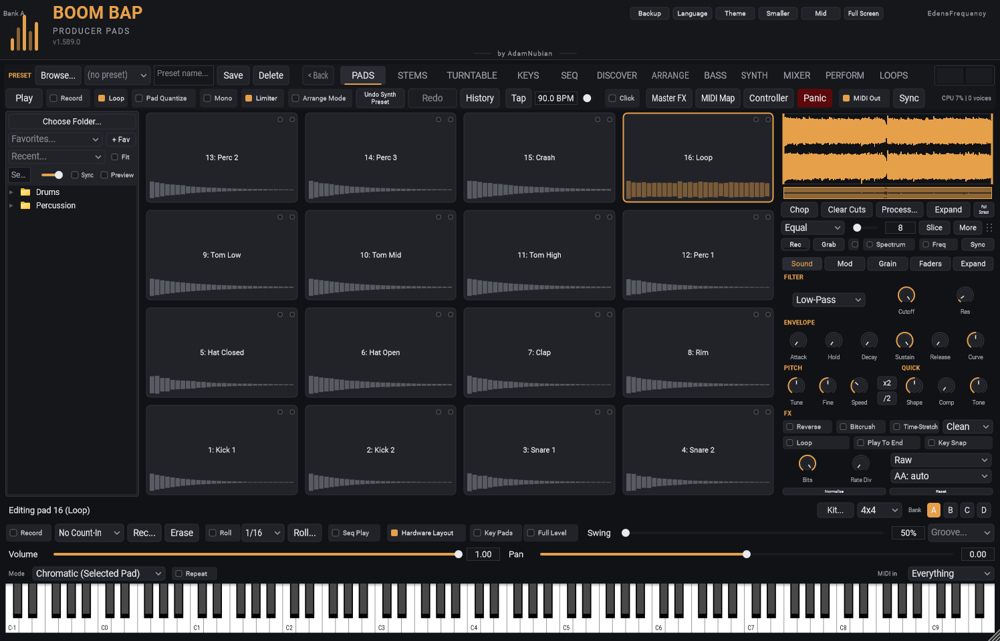
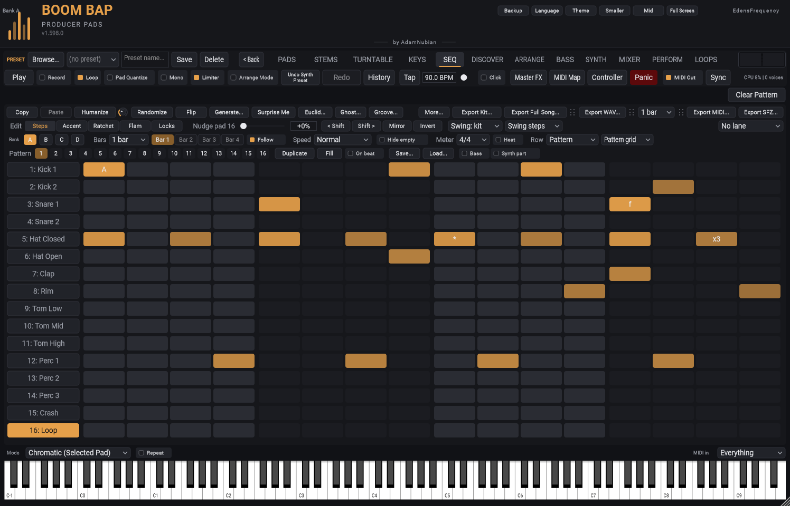
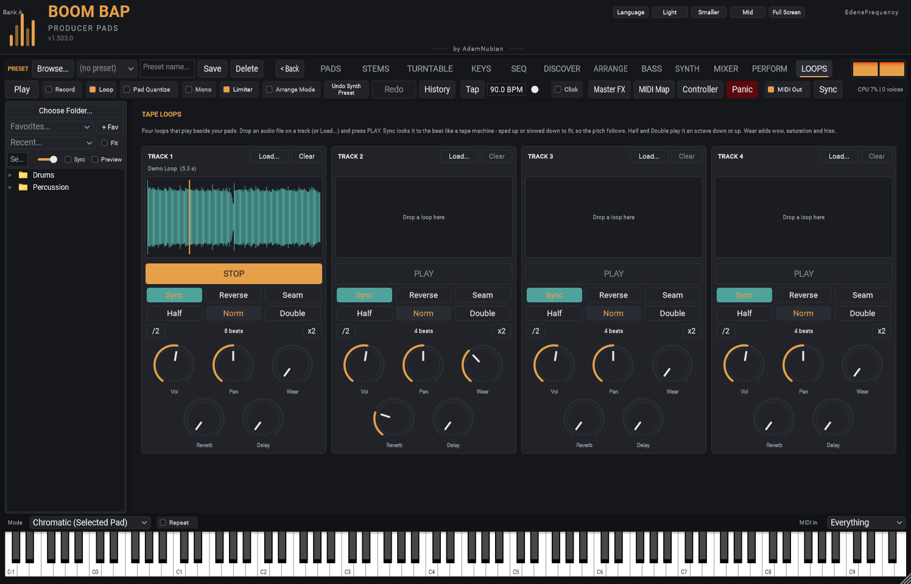
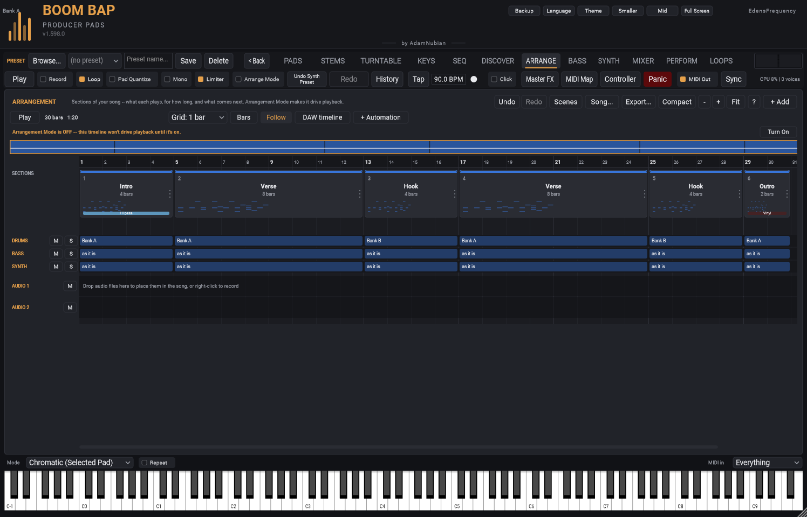
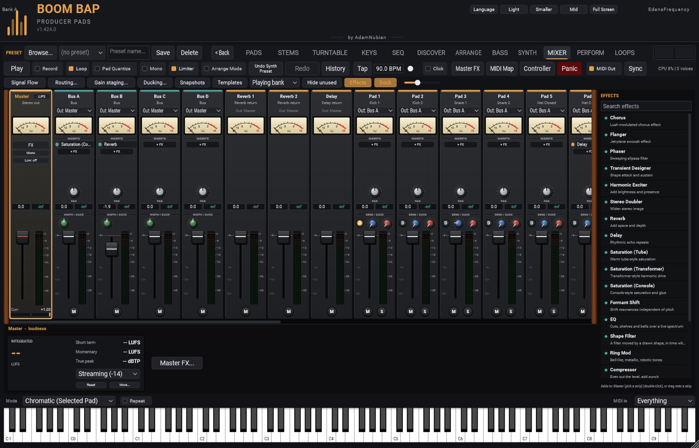
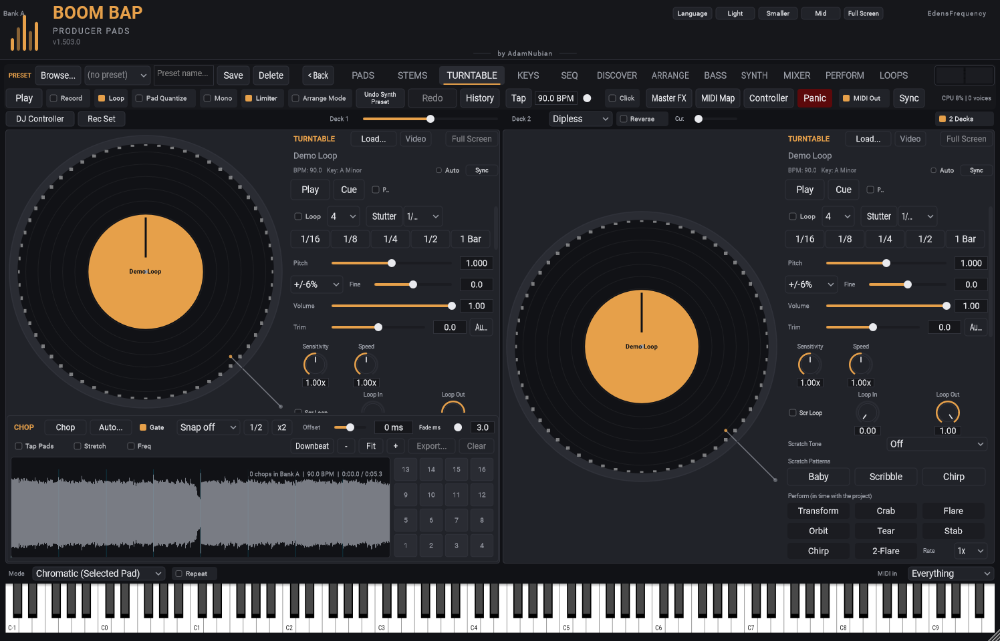
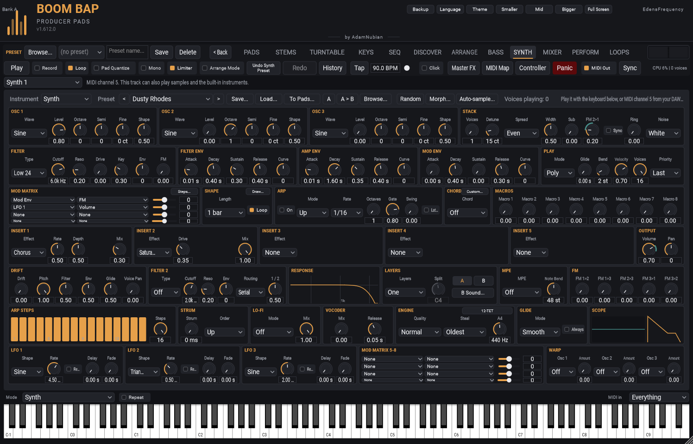

  
  
  
  
  

<h3 align="center">Chop a break, swing it until it knocks, and finish the song without leaving the plugin.</h3>

  A pad sampler and sequencer built for boom bap. It runs in your DAW as a VST3 or CLAP, or on its own as a standalone app. 
  <a href="https://edensfrequency.github.io/boom-bap-producer-pads/"><b>Play the pads in your browser</b></a> &nbsp;·&nbsp;
  <a href="https://edensfrequency.github.io/boom-bap-producer-pads/web/index.html#watch"><b>Watch the 60-second trailer</b></a> &nbsp;·&nbsp;
  <a href="https://github.com/edensfrequency/boom-bap-producer-pads/releases/latest"><b>Download</b></a>

## Why it's different

Most samplers stop at the pads. This one carries a beat all the way to a
finished, mixed song: pads, a step sequencer, a bass line that slides, a
synth, two turntables, stem splitting, tape loops, an arrangement that can
build itself from your patterns, and a full mixer with loudness metering.
All of it is in one window, and every knob takes MIDI Learn.

## Twelve tabs

| Tab | What it's for |
|---|---|
| **PADS** | Up to 64 pads a bank, four banks. Load, chop, slice, record or Grab the last 30 seconds you played. Filter, envelope, old-sampler crush modes, time-stretch, granular, key zones, and **Life** to make every hit a little different. |
| **SEQ** | The whole beat in one grid: swing, accent, ratchet, flam, nudge, per-step locks, conditions, and generators for when you're stuck. |
| **KEYS** | A piano roll for the synth part and a melody for any pad. MIDI in and out. |
| **BASS** | One bass line that slides: an 808, another bass synth, or your own sample. |
| **SYNTH** | Three oscillators with wavetables, filters, envelopes, LFOs, a mod matrix, an arpeggiator and chords. |
| **TURNTABLE** | Two decks and a crossfader. Scratch, then **Deck Chop** puts the cut on your pads. Split a record on a deck into vocals, drums, bass and the rest. No jog wheel? Scratch on a knob or the pitch wheel. |
| **STEMS** | Split a loop into frequency bands, or into its drums and everything else, then put a part on a pad or drag it into your DAW. |
| **LOOPS** | Four **tape loops** locked to the beat like a tape machine, with half or double speed, reverse, and **Wear** for worn-tape wobble and hiss. |
| **ARRANGE** | Chain banks into a song, or **build a song from your patterns**. Add fills, drop-outs, and **Section FX** like Telephone, Lo-fi, Hall or Vinyl. |
| **MIXER** | A strip for every sound, four buses, sends, inserts and a master rack with LUFS, true peak and a correlation meter. |
| **PERFORM** | Four macros that each move up to eight controls, and an XY pad. Put them on your controller and play the mix. |
| **DISCOVER** | Dig through your own crates, and a reference crate to listen to. Nothing is downloaded or ripped. |

<table>
  <tr>
    <td></td>
    <td></td>
    <td></td>
  </tr>
  <tr>
    <td align="center">SEQ</td>
    <td align="center">LOOPS</td>
    <td align="center">ARRANGE</td>
  </tr>
  <tr>
    <td></td>
    <td></td>
    <td></td>
  </tr>
  <tr>
    <td align="center">MIXER</td>
    <td align="center">TURNTABLE</td>
    <td align="center">SYNTH</td>
  </tr>
</table>

## Get it

- **Download:** the [latest release](https://github.com/edensfrequency/boom-bap-producer-pads/releases/latest) has the Windows installer (the easy way), or zips of the VST3 and the Standalone. Pay what you want on the [website](https://edensfrequency.github.io/boom-bap-producer-pads/#get); $0 gets the same installer, for personal or commercial work.
- **Install:** [INSTALL.md](docs/INSTALL.md) covers setup and getting your DAW to see it.
- **Works in:** tested in FL Studio, Ableton Live and Reason. Any VST3 host should be fine, and CLAP is there for Bitwig. A Mac build comes later.
- **Learn it:** the [usage guide](docs/USAGE.md) walks every tab, there's a [PDF manual](docs/Boom-Bap-Producer-Pads-Manual.pdf), and the [changelog](CHANGELOG.md) says what changed in each release.

## Found a bug? Have an idea?

Open an [issue](../../issues/new/choose): there's a template for bug
reports and one for feature requests. Found a security vulnerability?
Please read [SECURITY.md](.github/SECURITY.md) instead of filing a
public issue. See [CONTRIBUTING.md](.github/CONTRIBUTING.md) for more.

Created by <b>AdamNubian</b>, distributed by <b>EdensFrequency</b>. Made in Southern Africa by one person.

