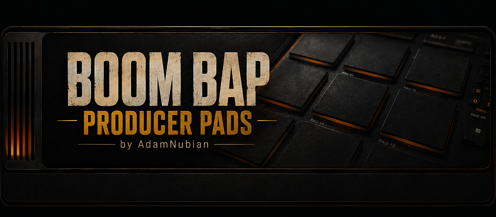

# Changelog

All notable changes to this project are documented here.
Format follows [Keep a Changelog](https://keepachangelog.com/), versioning
follows [Semantic Versioning](https://semver.org/).

## [1.313.1] — 2026-10-29

### Fixed

- **Startup crash fix**: 1.313.0 introduced a crash on startup. This patch fixes it -- if you installed 1.313.0 and the plugin would not open, install 1.313.1 instead.

## [1.313.0] — 2026-10-29

### Added

- **Mixer level readability** (Phase 141a): each Mixer channel strip now shows a dB scale (+6, 0, -6, -10, -20 dB) to the left of the fader and a unity reference line across the track at 0 dB. The meter strip is wider. No more guessing which level you're at.

## [1.312.0] — 2026-10-29

### Added

- **Strobe dot ring and tonearm on the platter** (T46): the platter now shows 60 strobe marker bars rotating with the disc. A tonearm arm tracks the groove from the outer edge at track start to the inner edge at track end.
- **Record label cover art** (T45): when the loaded sample has a sibling image (`cover.jpg`, `folder.jpg`, `artwork.jpg`, or same-named) the spinning label shows the artwork clipped to the circle.
- **Auto Gain button** (T38): a small "Auto" button next to the Trim slider normalises the channel trim to -6 dBFS peak in one click.

### Fixed

- **Turntable deck panel content no longer squashes** (BUG-001): the scrollable controls rail now measures its own height dynamically instead of using a stale constant.

## [1.311.0] — 2026-10-29

### Fixed

- **Vendor name in DAW plugin browser**: the plugin now appears under EdensFrequency in Ableton, FL Studio, and other DAW plugin browsers.

## [1.310.0] — 2026-10-29

### Fixed

- **Full Screen in DAW no longer leaves dark empty borders** (BUG-002): clicking Full Screen inside FL Studio, Ableton, or any other DAW now resizes the plugin to its native 1x size (2200x960) rather than the full monitor, so the host window fits the plugin content without empty black bands.

## [1.309.0] — 2026-10-29

### Fixed

- **Turntable deck panel no longer squashes**: the lower controls (Loop In/Out, Scratch section, and newer rows) now render at their correct sizes and the panel scrolls as expected.
- **Plugin content centres correctly at non-standard window sizes**: the plugin layout stays centred when the host provides a window with a different aspect ratio from the native resolution.

## [1.308.0] — 2026-10-29

### Added

- **Channel trim per deck**: a Trim slider (-24 dB to +6 dB) in each turntable panel, independent of the channel fader. Automatable and MIDI-learnable.
- **Set recording**: a Rec Set button in the toolbar captures the current arrangement to an in-memory recording.
- **Quantized scratch**: a Q toggle next to Record Pattern — when on, recorded scratch gestures snap to the nearest 1/16th beat before saving.

## [1.307.0] — 2026-10-28

### Added

- **Chirp and two-flare scratch patterns**: two new built-in crossfader patterns selectable from the scratch panel.
- **Scratch rate**: a Rate knob controls pattern playback speed (0.25x to 4x).
- **Needle drop**: click anywhere on the waveform overview to jump the playhead without stopping playback.
- **Cut-in**: a Cut-In button opens the crossfader from fully closed for a single stroke, then returns it to the prior position on release.

## [1.306.0] — 2026-10-28

### Added

- **Platter physics**: the platter visual responds to mouse drag with momentum and friction.
- **Vinyl warp simulation**: a Warp control adds a low-frequency pitch wobble.
- **Scratch tone**: a Tone knob shapes the timbre of the scratch buffer output.
- **Latch reverse**: locks reverse playback on continuously without holding the button.
- **Slipmat start**: when Slip is active, pressing Play spins up with a brief acceleration curve rather than snapping to speed.

## [1.305.0] — 2026-10-28

### Added

- **Turntable > Loop rolls**: five held buttons (`1/16`, `1/8`, `1/4`, `1/2`, `1 Bar`). Hold one to stutter-loop at that length while slip keeps your place; release and playback snaps back to where it would have been.
- **Turntable > Beat markers in chop lane**: after loading a record the plugin detects the beats and shows faint cyan tick marks across the waveform — a quick visual reference for where the downbeats are.
- **Turntable > Deck 2 chop lane**: the second turntable deck now has a full chop lane. Slice, auto-chop, tap, and assign pads directly from deck 2's record, independent of deck 1.

## [1.304.0] — 2026-10-28

### Added

- **Turntable > Chop lane Fade**: a slider (0–50 ms) sets the crossfade on every chop edge — smoother transitions, no hard clicks. Default is 3 ms.
- **Turntable > Pitch range**: choose +/-6 %, +/-12 %, +/-25 %, or +/-100 % — the pitch slider narrows to the range you want, so small adjustments stay precise.
- **Turntable > Fine pitch**: a separate slider nudges the pitch by up to +/-100 cents on top of the main slider.
- **Turntable > Hot cue names and colours**: right-click any set hot cue to rename it or pick a colour (gold, red, green, blue, purple, orange, cyan, white).
- **Turntable > Q (quantize cues)**: snap new cue points to the nearest beat automatically.
- **Turntable > Snap to transient**: the chop lane's snap menu now includes Transient — chops snap to the nearest detected hit rather than a fixed grid.
- **Turntable > In / Out buttons**: set loop boundaries exactly where the playhead is. Pressing Out also starts the loop immediately.
- **Turntable > Saved loops**: eight numbered slots below the hot cues. Shift+click saves the current loop; click recalls it; Ctrl+click clears it.
- **Turntable > Mem (per-record memory)**: when on, the plugin remembers each record's hot cue positions and restores them automatically next time you load that record.
- **Turntable > BPM Sync + division**: the filter LFO locks to the record's tempo. Pick 1/1, 1/2, 1/4, or 2/1.
- **Turntable > Hold-to-preview cue**: hold the Cue button to play from the cue point; release to return to it.
- **Turntable > Key Lock**: keeps the original pitch of the record while you change the tempo.

## [1.301.0] — 2026-10-28

### Added

- Your **sustain pedal** holds pads and the bass, not just the synth.
- The **on-screen keyboard** plays harder the lower on a key you click.
- **KEYS**: name notes as letters, **do re mi** (from the song's key) or not at all; every row is named when they're tall enough.
- **BASS > Ref tone**: a steady tone at the song's key, low where an 808 sits, to tune a bass sample by ear.

## [1.300.0] — 2026-10-28

### Added

- **ARRANGE > Song... > Save arrangement... / Load arrangement...**: take a song's sections to another project.
- **Beat tape mode** (in Song...): a bar or two of silence after each section, so the song plays as separate beats.
- **Export... > Beat tape**: each section, all its repeats, as a numbered track ("01 Intro.wav"), with a playlist.
- **Fit to a length...** (in Song...): type 3:00 and the sections stretch or shrink, 4 bars at a time.

### Changed

- **Templates...** is now **Song...**: the templates are under **Start from a template**.

## [1.299.0] — 2026-10-28

### Added

- **ARRANGE**: right-click a section for **Comment...** -- a note on it, shown when you hover.
- **Drop-out**: the drums stop for the last 1-4 beats of a section, the gap before a hook.
- **Templates...**: lay out a whole song in one go -- Boom bap song, Short song, Hook first, Beat tape or Long loop (Undo brings back what was there).

## [1.298.1] — 2026-10-28

### Fixed

- **MIDI in** is remembered again when you reopen a project or the Standalone -- v1.298.0 always went back to **Everything**.

## [1.298.0] — 2026-10-25

### Added

- **Pad melody chord mode** in KEYS: turn on Chord mode to hear each
  in-scale melody note as a close triad during preview and playback.

## [1.297.0] — 2026-10-25

### Added

- **MIDI in** (above the plugin's keyboard): play the **pads**, the **synth**, the **bass**, the **decks'** hot cues or **DISCOVER** from any MIDI keyboard or your DAW, on any channel -- or **Everything**, each part on its own channel as before.
- The plugin's keyboard **lights the keys** you hold on your MIDI keyboard, and the **pads flash** when MIDI hits them.
- The Standalone **switches on your keyboard or pad controller** by itself when it's plugged in.

### Fixed

- The **BASS** tab's preset box lists every bass sound, in folders, not just eight.

## [1.296.0] — 2026-10-24

### Added

- **100 more synth sounds** (553 in all): vowel choirs and vocal chops, bowed ensembles and solo strings, synth brass and winds, sitar-like and koto-like plucks, steel-drum tones and electric keys. Ten more sounds in each of ten folders.

## [1.295.0] — 2026-10-24

### Added

- **116 more synth sounds** (453 in all): arp **sequences** (triplets, octave runs, gates, chords); **wobble** basses; detuned, sync and G-funk **leads**; **risers**, noise sweeps and a sub drop; **drones**; laser and bubble **blips**; tape, vinyl and cassette **lo-fi pads**; music box, toy piano and **celesta**; and **string machines**.

## [1.294.0] — 2026-10-24

### Added

- **117 new synth sounds** (337 in all): kalimba, marimba and glockenspiel; drawbar and gospel **organs**; **clavs**; **horn** stabs, swells and falls; **flutes**; **voices** (ah, oh, oo -- choirs and chops); sitar-, koto- and steel-drum-like **world** sounds; **guitar**-like plucks; pizzicato and tremolo **strings**; rain, tape hiss and radio **textures**; and plucked **basses**.

### Fixed

- **<** and **>** on the SYNTH tab now go on into the next folder instead of staying in one.
- **Browse...**: clicking a folder always shows everything in it (it clears the search); the search looks in every folder.

## [1.293.0] — 2026-10-24

### Added

- **Presets in folders**: every synth sound sits in a folder by type, then character (Bass > Sub & 808, Keys > Electric Piano, Pads > Dark...).
- **Browse...** now has a **folder tree** with counts; pick a folder and search inside it.
- The SYNTH **Preset** menu opens by type; **<** and **>** step through the folder you're in.
- **Save...** puts your preset in a folder -- one you have, a type folder, or a **New folder...** -- and asks before replacing one.

## [1.292.0] — 2026-10-24

### Added

- **ARRANGE**: **drums, bass and synth lanes** under the sections, each with **M** and **S**.
- Per section: the **bass and synth** (a slot, or silent), **Mute pads...**, **Repeats**, a **Pickup**, a **Tempo** (with a ramp), a **mixer snapshot**.
- Next Action: **Random section**, **Stop**, and Jump a set number of times.
- **+ Automation**: mixer levels across the song, drawn or recorded with **R**.
- **Play from here**, **Loop**, **Scenes**, click the ruler to play from a bar, **markers**, **Follow**.
- Section **types and colours**, pattern **thumbnails**, a **minimap** with the song's energy.
- Select several sections, **Undo / Redo**, keyboard shortcuts, a **Grid**, **Split** and **Merge**, the song's length in minutes, **DAW timeline**.

## [1.291.0] — 2026-10-23

### Added

- **SYNTH**: an **arp step editor** (rests and accents), **swing** and **latch**, and Chord / Converge orders.
- Nine more **chords** and a **Custom...** chord; **Strum**.
- A **lo-fi stage** and a **vocoder** (route a voice or a beat to the plugin's sidechain).
- **Auto-sample...** plays the sound into an SFZ and a DecentSampler instrument.
- **220 built-in sounds**, a **Random** button and **Morph...** toward a built-in sound.
- A **scope** with the envelope moving; **Quality** (Eco to 4x) and **voice stealing**.

## [1.290.0] — 2026-10-23

### Added

- **Sync** on the toolbar: **send MIDI clock** for other apps and gear to follow, or (in the standalone) **follow a MIDI clock** -- its tempo, Play, Stop and position. **Syncing with FL Studio...** in the same menu shows the setup either way round.

## [1.289.0] — 2026-10-23

### Added

- **More...** beside the SEQ tab's exports: **stems** (one WAV per sound, with its effects) for the pattern or the whole song, each song section as its own loop, **MIDI with a track per part**, and **drum MIDI import** -- each note on the pad that sounds like it, or by note.
- **Export options**: 16, 24 or 32-bit, 44.1 to 96 kHz, normalise, and what happens to the tails.
- The ARRANGE tab has its own **Export...**: the song with a marker at each section, its stems, its sections as loops, its MIDI.
- **Kit... > Export kit** now makes Ableton Live 12 **Drum Racks**, **.xpm drum programs**, and sample folders for **Bitwig** and **Reason**.
- The BASS tab's **MIDI / audio...** exports the line as MIDI or audio (or drag either into your DAW) and imports MIDI onto it.

## [1.288.0] — 2026-10-23

### Added

- **Four buses** on the MIXER, and a bus can feed a later one (Bus A into Bus B for one glue compressor over two groups).
- **A second reverb**, and strips for both reverbs and the delay: level, mute and meter. Click a reverb's name for its size, damping and width.
- **Sends on every strip**: right-click a strip, **Sends...** -- reverb 1, reverb 2, delay, and for a pad, before or after its fader.
- **Ducking...**: two duck groups, each following the pads marked D, the bass, the synth, a deck, or the sidechain input (in FL Studio, the mixer's sidechain), with attack, release and a meter.
- **Snapshots**: store eight mixer settings and recall them whole or just the mutes. The **Mixer Snapshot** parameter recalls them from your DAW's automation.
- Right-click a strip to **link** faders, make it **solo-safe**, **rename** it or **colour** it. **Narrow**, **Hide unused** and a bank picker on the top row.
- Every fader shows its level in dB -- click it to type one. Undo takes back a burst of mixer moves at once.
- **Signal Flow** is now a map: click a step to go to it. **Templates** saves your buses, returns and ducking for the next beat.

## [1.287.0] — 2026-10-23

### Added
- **Mod matrix** (Mod page > Matrix...): four slots, each letting the LFO,
  the shape, velocity, a random value per hit, the key, the mod wheel or
  pressure move the pitch, filter, volume or pan.
- **Snaps** (beside Store A): four sound snapshots per pad. Store, recall,
  or recall one on every pad at once -- also from your DAW with the
  **Sound Snapshot** parameter (automate it in FL Studio) or MIDI program
  changes 0-3.
- **Macros** (beside Snaps): two knobs per pad, each moving whatever you
  give it, all at once.
- **Right-click any Mod or Grain knob** to MIDI Learn it, or to add it to
  a macro.
- **Tonal** and **Texture** in the stretch menu: long smooth cycles for
  held notes, a soft blur for pads and textures.
- **Formants** (Mod page): pitch a pad without the chipmunk sound.
- **Keys place** (Grain page): notes move the grain cloud through the
  sample instead of pitching it.

## [1.286.0] — 2026-10-23

### Added
- **Warp markers**: Sample Editor > Process... > **Warp the hits to the
  grid** lines a loose loop's hits up with the 1/16s, stretching each
  part on its own (it turns Time-Stretch on). Alt+Shift-click the
  waveform to add or take away a marker by hand.

## [1.285.0] — 2026-10-23

### Added
- **Play one pad's slices from the keyboard**: set the keyboard's Mode
  to **Slices: 16 equal** or **Slices: at transients**. Each key plays a
  slice of the selected pad, C3 (note 60) first -- nothing is cut onto
  other pads. From your DAW, send notes on **MIDI channel 6** (in FL
  Studio, set the piano roll's channel to 6).

## [1.284.0] — 2026-10-23

### Added
- **Loop seam** (Sample Editor > Process...): see where a looping pad's
  end meets its start, side by side and zoomed in. Drag either side to
  move it, or press **Smooth seam** to find an end with no click.

## [1.283.0] — 2026-10-23

### Added
- **Loop takes**: give Rec a length (1-8 bars) and tick **Loop takes**
  in its menu, and it keeps recording pass after pass until you press
  Stop. Each pass is its own take, saved and put on the pad as it
  finishes; pick an earlier one from **Put a take from the last loop on
  the pad**.

## [1.282.0] — 2026-10-23

### Added
- **Count-in** for Rec: right-click Rec for **Count in 1 bar** or **2
  bars**. You hear a click on each beat, then it records. While the song
  plays (in your DAW too), the take starts right on a bar line.

## [1.281.0] — 2026-10-22

### Added
- The **SYNTH** has **five effect slots** (INSERT 1-5, was three), and so
  does the bass's synth sound. Sounds you saved before load as they were.

## [1.280.0] — 2026-10-22

### Added
- **Five effect slots** on every pad, Bus A and B and the bass (was
  three). On the MIXER, a strip's slot menu can now **Move** an effect
  earlier or later in the chain, as a pad's can. Insert chains hold all
  five; ones you saved with three still load.

## [1.279.0] — 2026-10-22

### Added
- **Bypass** any effect slot to hear it without the effect, its settings
  kept: in a pad's Insert FX menu, in a mixer strip's slot menu (the slot
  greys out), and the **Off** button beside each master rack slot.

## [1.278.0] — 2026-10-22

### Added
- Loading or saving a preset now shows **Loading preset...** or
  **Saving preset...** over the plugin until it's done, so you can see
  it's working (a big kit takes a moment, saving copies every sample).

## [1.277.0] — 2026-10-22

### Added
- **Insert chains** on the MIXER too: click any strip's effect slot
  (a pad, a bus or the bass) for **Insert chains**, and the master rack
  has a **Chains** button. Save a strip's three effects under a name and
  load them anywhere: a chain saved on a pad loads on a bus, and the
  other way round.

## [1.276.0] — 2026-10-22

### Added
- The **Bass** strip on the MIXER has **three effect slots**, like a
  bus's: put the Lo-fi Box, Tape saturation or a Reverb on the bass
  (sample or synth), with Knobs... and a Mix for each.

## [1.275.0] — 2026-10-22

### Added
- Four **hold** buttons on the PERFORM tab, for the whole mix while you
  hold them: **Stutter** (loops a 1/16), **Sweep** (a filter closing over
  a bar), **Tape stop** and **Throw** (into a big reverb that rings on
  after you let go).

## [1.274.0] — 2026-10-22

### Added
- **Insert chains** in a pad's menu: **Save this pad's chain...** keeps
  its three effects and their settings under a name; pick a saved chain
  to put it on any pad (or every selected pad).

## [1.273.0] — 2026-10-22

### Added
- **Move earlier / later in the chain** in a pad's Insert FX menus:
  change the order its three effects run in (slot 1 first), settings and
  all.

## [1.272.0] — 2026-10-22

### Added
- Click the **Bass** strip's name in the Mixer for **Offset**: play the
  bass up to 10 ms later, so it and the kick hit together and sound
  fullest.

## [1.271.0] — 2026-10-22

### Added
- **Drive** in a pad's or a bus's channel panel (click its name in the
  Mixer): pushes it into a console's soft saturation after its effects --
  the peaks round off and the body comes up.

## [1.270.0] — 2026-10-22

### Added
- Click a pad's or a bus's **name** in the Mixer for its **Trim**: turn
  it up or down (+-18 dB) before its effects -- a quiet sample can come
  up here, where the fader only turns down.

## [1.269.0] — 2026-10-22

### Added
- The **Bass** strip in the Mixer has the **Width** knob now too, and
  right-clicking it makes the bass mono below 80, 120 or 160 Hz -- handy
  for a stereo 808 sample.

## [1.268.0] — 2026-10-22

### Added
- A **Gate** insert effect: shuts the sound off (or down, with Range)
  when it falls under Threshold -- the room off a snare, the hiss between
  hits. On pads, buses, the master rack and the SYNTH.

## [1.267.0] — 2026-10-22

### Added
- **Preset: Tape & glue** at the top of the Master FX popup: a little
  console warmth and a gentle compressor on the whole mix, so it sits
  together. It sets slots 1 and 2 and leaves slot 3 as it is.

## [1.266.0] — 2026-10-22

### Added
- **Reference track**: in the LUFS readings, **Load...** a finished song
  you like and **Hear reference** to switch between it and your mix.
  **Match level** turns it to your mix's loudness first, so you compare
  the sound, not the volume.

## [1.265.0] — 2026-10-22

### Added
- **Dust**, at the bottom of the Master FX popup: one slider of old
  record for the whole mix -- the top rolls off, it saturates a little,
  and crackle and hiss come in. It's in exports too.

## [1.264.0] — 2026-10-22

### Added
- Right-click the **Width** knob on a bus, the Synth or a turntable strip
  to make its low end mono below 80, 120 or 160 Hz -- keeps the bass and
  kick centred however wide the rest is.

## [1.263.0] — 2026-10-22

### Added
- **Gain staging...** on the Mixer: one click sets every loaded pad's
  volume so its loudest hit lands at the same level (-6, -12 or -18 dB),
  leaving room for the mix before you balance by ear. Undo puts them
  back.

## [1.262.0] — 2026-10-22

### Added
- Bus A and Bus B's effects have a **Mix** knob (in each effect's
  Knobs... panel), and their menus offer **Parallel compression
  (preset)** -- put your drums on a bus and pick it.

## [1.261.0] — 2026-10-22

### Added
- The **Synth** and both **turntable** strips in the Mixer now have a
  **Width** knob too, beside Duck.

## [1.260.0] — 2026-10-22

### Added
- A **Width** knob on Bus A and Bus B in the Mixer: narrow a group of
  sounds toward mono, or spread it wider (double-click for 100%).

## [1.259.0] — 2026-10-22

### Added
- **Parallel compression (preset)** in a pad's Insert FX menu: the
  Compressor set to squash hard and blended in at half, so the drums get
  thicker without losing their hit.

## [1.258.0] — 2026-10-22

### Added
- A **spectrum analyser** under the LUFS readings: the whole mix from
  20 Hz to 20 kHz, so you can see where it's crowded or thin.

## [1.257.1] — 2026-10-22

### Fixed
- **Tape Stop** can now be picked from a pad's Insert FX menu (it did
  nothing there before; the Mixer and master rack were fine).

## [1.257.0] — 2026-10-22

### Added
- The Mixer's master meter now shows the **average level (RMS)** as a
  thinner, lighter bar inside the peak meter. The bigger the gap between
  the two, the punchier the mix; a small gap means it's squashed.

## [1.256.0] — 2026-10-22

### Added
- A **vectorscope** beside the LUFS readings: a picture of the mix's
  stereo spread. A thin line straight up is mono; the wider the cloud,
  the wider the mix.

## [1.255.0] — 2026-10-22

### Added
- Pick a **target** in the LUFS readings (streaming -14, Apple Music -16
  or broadcast -23) and it tells you how far over or under it your song
  is.

## [1.254.0] — 2026-10-22

### Added
- Every strip in the Mixer now holds its **peak** for a moment and has a
  **clip light** over its meter, like the master. Click a meter to clear
  its light.

## [1.253.0] — 2026-10-22

### Added
- The LUFS readings now show the **true peak** too -- how high the
  waveform really goes between samples. It turns red above -1 dBTP,
  where it could clip once the song is made into an MP3 or AAC.

## [1.252.0] — 2026-10-22

### Added
- A **LUFS** button on the Mixer's master strip shows the mix's loudness
  as streaming services measure it: **momentary**, **short-term** and
  **integrated** (since you pressed Reset).

## [1.251.0] — 2026-10-22

### Added
- The Mixer's master meter holds its **peak** for a moment, and a **clip
  light** above it turns red if the output reaches 0 dB -- click the
  meter to clear it.

## [1.250.0] — 2026-10-22

### Added
- An **Offset** slider on a pad's Mod page: play the pad's sound up to
  10 ms later, to line a layered kick or snare up with another. The
  **Phase** button now sits just above it.

## [1.249.0] — 2026-10-22

### Added
- A **correlation meter** under the Mixer's master fader: +1 is mono, 0
  very wide, and below 0 (red) means parts of the mix cancel out when
  played in mono.

## [1.248.0] — 2026-10-22

### Added
- Right-click the toolbar's **Limiter** for its **ceiling** (-0.1 to -2 dB)
  and **release** (fast, medium, slow). Saved with the project; exports
  use them too.

## [1.247.0] — 2026-10-22

### Added
- A **Phase** button on a pad's Mod page (by Width and Mono below) that
  flips the pad's polarity -- the fix when two layered kicks or snares
  sound thin together.

### Fixed
- A pad's **Width** and **Mono below** now apply to exports, not just to
  what you hear while playing.

## [1.246.0] — 2026-10-22

### Added
- **Mono** and **Low** on the Mixer's master strip. Mono plays the whole
  mix in mono while it's on, to check how it sounds on one speaker (just
  for listening: not saved, not in exports). Low makes everything under
  80, 120 or 160 Hz mono, so kicks and bass sit in the centre -- saved
  with the project and in exports.

## [1.245.0] — 2026-10-22

### Added
- A **Tape Stop** insert effect: turn Stop past halfway and the sound
  slows to a halt over Time, like a tape machine switched off; turn it
  back and it's live again. Map Stop to a macro or a MIDI button to throw
  it live. On pads, buses, the master rack and the SYNTH.

## [1.244.0] — 2026-10-22

### Added
- A **Tremolo** insert effect, in time with the song: Rate (1/2 to 1/32
  notes), Depth, and Shape (smooth to a hard chop). On pads, buses, the
  master rack and the SYNTH.

## [1.243.0] — 2026-10-22

### Added
- A **Lo-fi Box** insert effect -- fewer bits and a lower sample rate for
  crunch and grit -- with Bits, Rate and Mix. On pads, buses, the master
  rack and the SYNTH.

## [1.242.0] — 2026-10-22

### Added
- **Transient Designer** (Threshold, Ratio, Release), **Harmonic Exciter**
  (Freq, Drive, Amount) and **Stereo Doubler** (Left, Right) get **Edit
  Knobs...** too -- left in the middle, they sound as they always did.

## [1.241.0] — 2026-10-21

### Added
- **Chorus**, **Flanger** and **Phaser** inserts get **Edit Knobs...**: Rate
  and Depth (and Feedback on the Flanger). Left in the middle, they sound
  as they always did.

## [1.240.0] — 2026-10-21

### Added
- A **Compressor** insert effect -- Threshold, Ratio and Makeup -- to even
  out a sound or give drums punch. On pads, buses, the master rack and the
  SYNTH.

## [1.239.0] — 2026-10-21

### Added
- A **Ring Mod** insert effect -- bell-like, metallic, robotic tones -- with
  Freq and Mix knobs. On pads, buses, the master rack and the SYNTH.

## [1.238.0] — 2026-10-21

### Added
- **AA** (anti-alias) for the crush modes (Sound page, under the mode):
  auto (as the mode has it), always on (smoother, darker) or off (the
  bright, ringing grit).

## [1.237.0] — 2026-10-21

### Added
- Granular **Scan sync**: let the grain cloud cross the whole sample in 1,
  2, 4 or 8 bars, in time with the song (Grain page).

## [1.236.0] — 2026-10-21

### Added
- Three new filters for pads and chop lanes, the same as the SYNTH's:
  **Ladder** (a warm, singing 24 dB low-pass), **Diode** (squelchier) and
  **Vowel** (sweep Cutoff to go "a-e-i-o-u").

## [1.235.0] — 2026-10-21

### Added
- Every pad's envelope has a **Hold** (full level for a while after the
  attack) and a **Curve** (snappy, straight, or slow) -- on the Sound page.

## [1.234.0] — 2026-10-21

### Added
- Two steeper filters for pads and chop lanes: **High-Pass 24** and
  **Band-Pass 24**.

## [1.233.0] — 2026-10-21

### Added
- A **filter envelope** on every pad (Mod page): open (or close) the filter
  at the hit and sweep it back -- the classic "pew" or a plucky bass.

## [1.232.0] — 2026-10-21

### Added
- STEMS: tick which stems **Export** writes, and switch the pad and its
  stems between **Waveform** and **Spectrum** (a spectrogram -- low
  frequencies at the bottom, louder is brighter).

## [1.231.0] — 2026-10-21

### Changed
- STEMS: splitting runs in the background -- the plugin stays usable, and
  the pad shows SPLITTING... until it's done.

## [1.230.0] — 2026-10-21

### Added
- STEMS: a **Play** button, the time and a position bar under the
  overview; a playhead across every waveform; and **S** (solo), **M**
  (mute) and a level meter on each stem.

## [1.229.0] — 2026-10-21

### Changed
- STEMS: each stem is a card -- its colour, its own waveform, and its level
  in dB. Drag the round icon into your DAW.

## [1.228.0] — 2026-10-21

### Changed
- **A new STEMS tab**: pick a pad on the left; see its sound, details and
  each stem (with its level) in the middle; split, preview and export on
  the right.

## [1.227.0] — 2026-10-21

### Changed
- STEMS: a pad's row shows the stems you split earlier -- even in an
  earlier session -- instead of empty chips. Perc's chip is blue now, so
  it doesn't look like Mid's.

### Fixed
- STEMS Preview now plays stems split as AIFF.
- Splitting a sample with a dot in its name ("Kick 1.5") works properly:
  its stems show up and preview.

## [1.226.1] — 2026-10-21

### Fixed
- The sample editor's **Zero X** switch was cut off at the end of its row;
  it now fits.

## [1.226.0] — 2026-10-21

### Added
- **Width** and **Mono below** for every pad (on the Mod page, by Voices):
  make a pad wider or narrower, and keep its low end in the centre.

## [1.225.0] — 2026-10-21

### Added
- **Spectrum** in the sample editor: see the sample as a spectrogram --
  low frequencies at the bottom, louder is brighter.

## [1.224.0] — 2026-10-21

### Added
- **Record 1, 2, 4 or 8 bars**: right-click Rec and pick a length -- the
  take stops by itself after that many bars at the song's tempo.

## [1.223.0] — 2026-10-21

### Added
- **Grab bars**: right-click Grab for the last 1, 2, 4 or 8 bars, cut
  exactly on the bar lines -- ready to loop.

## [1.222.0] — 2026-10-21

### Added
- **Tune its root note to C** (right-click a pad): finds the note a
  one-shot sounds at and tunes the pad so it plays as C -- in tune when you
  play it chromatically from KEYS.

## [1.221.0] — 2026-10-21

### Added
- **Process...** in the sample editor (where Trim Silence was): trim
  silence, fade in, fade out, gain +3 / -3 dB, remove DC offset, or crop
  the sample to the region.

## [1.220.0] — 2026-10-21

### Added
- **Hear a slice before you chop**: in the sample editor, Alt-click
  between two cut points to play just that stretch.

## [1.219.0] — 2026-10-21

### Added
- **Zero X** in the sample editor: cut points and trim handles land on a
  zero crossing, so the edges don't click.

## [1.218.0] — 2026-10-21

### Added
- **Name and colour pads by sound**: right-click any pad. Each loaded pad
  is coloured for what it sounds like (kick red, snare orange, hats
  yellow, perc green, loop blue, bass purple), and named if it has no
  name of its own.

### Fixed
- The guide now says what's been true for a while: you can drag a file
  from the PADS browser onto a pad.

## [1.217.0] — 2026-10-21

### Added
- **Swap two banks**: right-click a bank button on SEQ, **Swap With Bank
  X** -- their pads, patterns and grid sizes change places.

## [1.216.0] — 2026-10-21

### Added
- **Copy a pad onto another**: right-click a pad, **Copy pad**; then
  right-click another, **Paste pad here** -- all of it, or just its
  sample, its settings or its pattern.

## [1.215.1] — 2026-10-21

### Fixed
- On a pad with velocity or key-zone layers, choosing an option under
  **Layers > Blend the layers** changed a different setting (velocity
  curve, 16 Levels, Pad 1's MIDI note or DAW output). It now does what
  it says.

## [1.215.0] — 2026-10-21

### Added
- A **preview volume** slider next to Preview in the PADS browser (it sets
  DISCOVER's previews too).

## [1.214.0] — 2026-10-21

### Added
- Load a preset's **sounds only** (keeping your patterns) or its
  **patterns only** (keeping your sounds): click the PRESET label.

## [1.213.0] — 2026-10-21

### Added
- A playing pad shows **how far it's got**: a gold line moves across its
  waveform.

## [1.212.0] — 2026-10-21

### Added
- **Mute or solo a row on SEQ**: right-click the row's name. A muted row
  shows [M], a soloed one [S].

## [1.211.0] — 2026-10-21

### Added
- **MIDI channel** per pad (right-click a pad): a pad can answer on one
  channel only -- two controllers, or a drum track on channel 10.

## [1.210.0] — 2026-10-21

### Added
- **A bus can go to its own DAW output** (MIXER > Routing, the Bus A / Bus B
  rows): your drum bus as one track in the DAW, its effects included.

## [1.209.0] — 2026-10-21

### Added
- **DAW outputs for the bass, synth and decks**: MIXER > Routing has a
  **DAW out** column -- send any of them, or any pad, to its own output in
  your DAW.

## [1.208.0] — 2026-10-21

### Added
- **Pressure (aftertouch)** per pad (right-click a pad): press harder into a
  held pad to swell its **volume** or open its **filter**.

## [1.207.0] — 2026-10-21

### Added
- **Bass MIDI channel** on BASS: play the bass from any of channels 4 and
  6-16, to suit your keyboard.

## [1.206.0] — 2026-10-21

### Added
- **DAW output** per pad (right-click a pad): send any pad -- 17 to 64 as
  well -- to any of the 16 outputs, several pads to one if you like.

## [1.205.0] — 2026-10-21

### Added
- **Pad 1's MIDI note** (right-click a pad): pads can start at C0, C1 (as
  before), C2 or C3, to match your controller.

## [1.204.0] — 2026-10-21

### Added
- **16 Levels** (right-click a pad): pads 1-16 all play that one sound --
  softest to loudest, or a semitone up each pad.

## [1.203.0] — 2026-10-21

### Added
- **Velocity curve** per pad (right-click a pad): **Soft** lets gentle hits
  through, **Hard** saves the loudest for real hits.
- **Full Level** on PADS: every pad you play hits at full, however hard.

## [1.202.0] — 2026-10-20

### Added
- **A chord lane** on KEYS, under the bar numbers: each chord of the synth
  part as a named block -- click one to select its notes.

## [1.201.0] — 2026-10-20

### Added
- **Stamp...** on KEYS: your key's seven chords as buttons -- click them in
  order to lay down a progression, one after another, as triads up to
  thirteenths, a beat, two beats or a bar each.

## [1.200.0] — 2026-10-20

### Added
- **Reharmonise** in KEYS **Voicing...**: swap the selected chords for
  the chord a third down (C becomes Am) or up (C becomes Em), simplify them
  to triads, or make them sevenths -- all in your key.

## [1.199.0] — 2026-10-20

### Added
- **12 more chord progressions**, and the lists in **Chords...**,
  **Melody...** and BASS **Generate...** group them by mood -- Warm,
  Soulful, Dark, Uplifting, Dreamy... -- with each one's style beside it.

## [1.198.0] — 2026-10-20

### Added
- **Bigger chords** in KEYS **Chords...**: pick **Triads**, **Sevenths**,
  **Ninths**, **Elevenths**, **Thirteenths**, **Sus2** or **Sus4**.

## [1.197.0] — 2026-10-20

### Added
- **Follow chords** on BASS: one click moves every bass note onto the
  nearest note of the synth part's chord at that moment.

## [1.196.0] — 2026-10-20

### Added
- **BASS shows the chords**: the notes of the synth part's chord are
  shaded under each step, so the bass line can follow them (**Chords**
  turns it off).

## [1.195.0] — 2026-10-20

### Added
- **Chord names** on KEYS: every chord in the synth part is labelled
  (C, Am7, Gsus4, C/E...) just above it.

## [1.194.0] — 2026-10-20

### Added
- **Voicing...** on KEYS: select a chord's notes to invert it up or down,
  spread it out, close it up, or **strum** it -- up or down -- and back.

## [1.193.0] — 2026-10-20

### Added
- **More scales** (Melodic Minor, Locrian, Phrygian Dominant, Double
  Harmonic, Hungarian Minor, Whole Tone, Diminished, Hirajoshi, Major
  Blues) and a **Custom** one -- pick its notes with **Notes...**.
- **Move parts**: change the key and the synth part and bass line move
  with it.
- **A key per section** on ARRANGE (right-click > Key).
- **Fold** on KEYS shows only the scale's notes.
- BASS notes snap to the key when **Snap to scale** is on; pad **Key Snap**
  follows the project's key.

## [1.192.0] — 2026-10-20

### Added
- **Melody...** on KEYS shapes the line -- **Rise**, **Fall**, **Arch**,
  **Dip** or a repeated **Motif** -- within a **Range** and largest
  **Leap**, can **end on the root**, can **answer its first half**
  (call and response), and writes a **counter-melody** under another
  pad's melody.

## [1.191.0] — 2026-10-20

### Added
- **Generate...** has 11 more styles (Jazz Hop, Golden Era, West Coast,
  Neo-Soul, Amapiano, Gqom, Kwaito, UK Garage, Jersey Club, Phonk, Baile
  Funk), **Clap / Rim** and **Perc** parts, **Density**, **Complexity** and
  **Variation**, a **fill** in the last bar, and **Continue bar 1** to carry
  your own first bar on.
- **Shift-click Randomize** to keep the steps on the beat.

## [1.190.0] — 2026-10-20

### Added
- **Groove...** on SEQ: take the feel of a loop -- this pattern, the
  selected pad's sample, or a MIDI file -- and pull your pattern's timing
  and accents toward it, a little or all the way.

## [1.189.0] — 2026-10-20

### Added
- **Swing per pad** (SEQ, beside Nudge) and **for the bass line** (BASS):
  a straight hat over swung drums. **Swing 8ths / 16ths / 32nds** picks
  what the swing moves.
- **Humanize** now moves timing as well as velocity on SEQ; KEYS and BASS
  get a **Humanize** too.

### Fixed
- The **Groove...** feels (now Straight, Nudge, Lean, Shuffle, Triplet,
  Lazy, Drunk) give the swing they say; the Swing slider reads in percent
  (50% = straight). MIDI Out sends swung steps on time.

## [1.188.0] — 2026-10-20

### Added
- **Record the synth part and the bass from a MIDI keyboard.** Arm
  **Record** and play: the synth's notes go into the KEYS synth part, notes
  on channel 4 into the bass line.
- **Step in** (KEYS and BASS): play a note and it goes in at the cursor,
  then the cursor moves on -- write a line one note at a time.

## [1.187.0] — 2026-10-20

### Added
- **More from Roll** (PADS > **Roll...**): **Latch** it on, **Triplets**,
  **Swing**, and a velocity that ramps up or down over a bar.
- With Roll on, **holding a pad on your MIDI controller rolls it** -- press
  harder (aftertouch) to play it louder.
- **Recording a roll** with Record armed puts it in the pattern as
  ratchets.

### Fixed
- Rolls keep steadier time.

## [1.186.0] — 2026-10-20

### Added
- **Recording options** (PADS > **Rec...**): how tightly hits snap to the
  steps (**Quantize strength** -- 0% keeps your timing), **Overdub** or
  **Replace**, and a **count-in when Play starts**.
- **Erase**: hold it and hit pads to clear their steps as the beat plays.

### Fixed
- A recorded hit played just ahead of the beat lands on that beat, not the
  step before.

## [1.185.0] — 2026-10-20

### Added
- **Bass and synth notes can play only some times round** -- 1:2, 2:4,
  Fill, First, Prev and the rest, as on SEQ. On BASS, right-click a note's
  Slide or Accent cell; on KEYS, pick it beside Chance for the selected
  notes.

## [1.184.0] — 2026-10-19

### Added
- **A lane under the SEQ grid.** Pick it at the right of the Edit row and
  drag to draw the selected pad's velocity, chance or a lock per step.
- **Paint** steps by dragging across a row; **shift-click** a range to copy
  just those steps; edit with the **arrow keys**, **Space**, **+ / -** and
  **Delete**.
- **More locks:** resonance, reverb send, and **Sticky** -- a step's locks
  carry on to the pad's next plain steps. A flam's gap per step.

## [1.183.0] — 2026-10-19

### Added
- **Deeper steps** on SEQ. In **Locks**, a step can play only some times
  round (**1:2**, **2:4**...), only with Fill held, only the first time, or
  after its row's last such step (**Play**); a little early or late
  (**Time**); backwards (**Rev**). Ratchets go to x8 and can ramp up or
  down. **< Shift**, **Shift >**, **Mirror** and **Invert** rework the
  selected pad's row.

## [1.182.0] — 2026-10-19

### Added
- **Triplet rows.** On SEQ, set the selected pad's row to **1/16T**,
  **1/8T** or **1/32** (beside **Row**): its steps play on that grid --
  triplet hats against straight drums, 32nd rolls.

## [1.181.0] — 2026-10-19

### Added
- **Meters.** A pattern can be 3/4, 5/4, 6/8 or 7/8 (SEQ > **Meter**):
  bank and pattern switches, ARRANGE sections and exports count its bars.
- **Heat** on SEQ colours each step by how hard it plays.

### Fixed
- Export Full Song uses the pattern each section picks.

## [1.180.0] — 2026-10-19

### Added
- **Polymeter.** Give a pad's row its own length on SEQ (**Row**) -- 3, 5,
  7 steps against the pattern's 16 -- and it loops on its own, drifting
  against the others and lining up again. Each row shows its own playhead.

## [1.179.1] — 2026-10-19

### Fixed
- The preset bar's **Delete** button shows properly again (it was squashed
  to "...").
- On SEQ, the **Bank A-D** buttons now sit on the Bars row, so **D** is no
  longer squashed.

## [1.179.0] — 2026-10-19

### Added
- **The bass and synth part can change with the pattern.** Turn on
  **Bass** or **Synth part** on SEQ's Pattern row and each pattern gets its
  own bass line or synth part.
- **Generate > 4 Bars** now fills patterns 1-4 of the bank you're on, so
  your other banks stay as they are.

### Fixed
- Playing a song again from the start now starts at its first section.

## [1.178.0] — 2026-10-19

### Added
- **16 patterns per bank.** On SEQ, **Pattern 1-16** switch the beat on
  the next bar (or beat) while the kit stays. **Duplicate** copies it to
  the next free one to make a variation; hold **Fill** for pattern 16.
  **Save... / Load...** keep patterns in your own library.
- **ARRANGE picks the pattern.** Right-click a section > **Pattern**.

## [1.177.0] — 2026-10-19

### Added
- **Longer parts.** The synth part on KEYS can be 16 or 32 bars, and the
  bass line 8 or 16 -- room for a whole verse.

## [1.176.0] — 2026-10-19

### Added
- **Patterns up to 4 bars.** On SEQ pick **Bars** (1-4) for the bank's
  pattern -- new bars start as copies of the ones you have -- and flip
  between them with **Bar 1-4** (or let **Follow** show the bar that's
  playing). **Hide empty** clears pads with no steps out of the grid.
- **Half time and double time.** **Speed** plays the same steps as 8ths or
  32nds, without rewriting anything.

## [1.175.0] — 2026-10-18

### Added
- **Find your sounds.** **Browse...** (next to the presets, and on the
  SYNTH tab) list your kits and synth sounds together: search them, give
  them categories and tags, star favourites. It opens where you left off.
- **A / B the synth.** Try a change on B and flip back to A to compare;
  **A > B** copies the sound across.
- **Undo for sounds.** Turning synth knobs, loading a synth preset or a kit
  can now be undone like everything else.

## [1.174.0] — 2026-10-18

### Added
- **Draw your own movement.** Draw a shape -- smooth curves or steps, from
  a 1/16 to 4 bars, looping or once -- and let it move a pad's pitch,
  filter, volume or pan (Mod page > Shape), or anything in the synth's mod
  matrix.
- **Shape Filter**, a new insert effect: a filter that opens and shuts in
  time with the song along a shape you draw -- rhythmic chops on a held
  sample.

## [1.173.0] — 2026-10-18

### Added
- **An EQ you can see.** Pick **EQ** in any insert slot -- a pad's, a bus's
  or the master's -- then **Edit EQ...**: drag the bands over a live
  picture of the sound, cut the lows or highs as steeply as you like, and
  make a band act only when that part of the sound gets loud.

## [1.172.0] — 2026-10-18

- SYNTH has a new bottom row: **Drift** makes each voice a little different,
  like an old analogue synth; a second filter (in series or side by side)
  with a graph of what the filters do; and new filter types -- Ladder,
  Diode, two Combs and a talking Vowel filter.
- SYNTH can hold **two sounds**: split across the keyboard or stacked on
  every note.
- SYNTH plays **MPE** controllers: each note bends, presses and slides on
  its own.

## [1.171.0] — 2026-10-18

### Added
- **Blend layers instead of switching them.** Right-click a Velocity
  layers or Key zones pad > Layers > **Blend the layers (morph)**: the
  layers crossfade by how hard you hit, by the **mod wheel** or
  **expression** while a note holds (soft strings swelling to loud), by an
  LFO, or at a fixed mix of two sounds.
- **Vary** on the Mod page: a little random pitch, pan, filter and start on
  every hit, so repeated hits don't sound identical -- the same every time
  you play from the start, and in Export WAV.

## [1.170.0] — 2026-10-18

### Added
- **Chop lanes.** Right-click a sliced pad > **Chop lanes...**: the
  sample with each chop as a column. Pick a lane -- Volume, Pan, Pitch,
  Reverse, Stutter, Filter, Delay or Reverb -- and drag across the chops
  to paint a value on each. **Random** fills a lane with musical values,
  **Repeat** copies the first few chops over the rest, **Clear** resets
  it. What you paint stays with the chop wherever it plays.
- **Stutter** on a pad: its start played 2 to 8 times in the same length.
- **A delay send.** A shared delay, a dotted 1/8 at your tempo bouncing
  left and right -- each pad sends to it like the reverb.
- **Two new filters**: **Low-Pass 24**, a steeper low-pass, and **Comb**,
  which rings at the cutoff's note.

## [1.169.0] — 2026-10-18

### Added
- **Key zones.** One instrument across the keyboard: a pad's Layers can
  spread several pads over the notes, each playing from its own root.
  Kit > Import > **Folder as one instrument** sets it up from file names.
- **Release samples.** A pad can play another pad when its note is let
  go -- a key-off thump, a string's release -- quieter the longer it was
  held. SEQ steps with a length let go at their end too.
- **The PERFORM tab.** Four macros, each moving up to eight controls,
  and an XY pad that plays two of them.
- **Follow** on the Mod page: a pad's volume or filter moved by another
  sound's level -- a gate or a duck.
- **Drum synth.** Right-click a pad > **Drum synth...**: a kick, 808,
  snare, hats, clap, rim, tom or cowbell, shaped with five knobs.

## [1.168.0] — 2026-10-16

### Added
- **< and > on a pad.** Hover a loaded pad and arrows appear on its
  edges: they load the previous / next sound in the same folder, keeping
  the pad's settings -- the quickest way to find the right kick with the
  beat playing. Also in the pad's right-click menu.
- **Drag straight into your DAW.** New grips beside **Export WAV** (the
  beat as audio), **Export Full Song**, the Sample Editor's **More** (the
  slices as MIDI) and **Grab** (the last few seconds). Everything you drag
  out -- these, a pad, a pattern -- is now kept in **Music > Boom Bap Drag
  Out** (your DAW keeps finding it) and named with the tempo and key.
- **Crush modes.** A menu beside the Bitcrush knobs gives a pad the sound
  of an old sampler's converter: **Gritty** 12-bit 26 kHz, **Warm** 12-bit
  40 kHz, **Crunchy** 8-bit 22 kHz, **Lo-fi** 8-bit 11 kHz, **Soft** 16-bit
  32 kHz -- or **Raw**, the knobs as before.
- **Stretch modes.** A menu beside Time-Stretch: **Clean** as before, or
  the old samplers' stretch -- **Tight** or **Loose** for a warble, or
  **Buzz** for the robotic jungle stretch.
- **To Pads** on the SYNTH tab (and the bass's Edit sound): play your
  sound into empty pads -- one note, three velocities as a velocity group,
  or one pad per octave -- to chop and sequence like any sample.

### Fixed
- **Tempo detection** read many boom bap loops at the wrong tempo (90 as
  120, or double time). It now finds the beat itself; the deck's x2 and
  1/2 buttons are still there for anything outside 70-140 BPM.
- **Key detection** read low notes wrongly, so loops with an 808 could
  show the wrong key (an A minor record as C# minor or E minor). It now
  listens to the bass line for the key's root. It's still an estimate --
  check it by ear on anything unusual.
- **A pad's Time-Stretch** came back off when you reopened a project,
  switched banks or loaded a kit. It's now kept.

## [1.167.1] — 2026-10-03

### Fixed
- **SYNTH: turning on Arp, or picking a Chord type, could crash the
  plugin** (since 1.161.0), and the **CHORD** list showed effect names
  instead of chords. Both now work.

## [1.167.0] — 2026-10-01

### Added
- **DISCOVER: folders.** The watch folder's subfolders show in the Local
  Files list -- double-click one to open it, **..** goes back up, as deep
  as your folders go. **Search** and **Favorites** look through every
  folder at once and show where each clip is; **Shuffle** picks from the
  folder you're in and the folders inside it.

## [1.166.0] — 2026-10-01

### Changed
- **New pictures in every guide**, and the guides brought up to date with
  the plugin as it is now: the SYNTH tab, the KEYS synth part, the rebuilt
  BASS tab, the MIXER's buses and routing, the drum groove, Grab, the
  arrangement's view controls, and more. The website shows all ten tabs.

### Fixed
- **Panic** now silences the SYNTH and the bass synth too (it stopped
  only the pads and the bass sample before).
- The **expanded Sample Editor** no longer lets the pads and sound
  controls underneath show through around its buttons.
- **Standalone:** it could be taken for a DAW that's stopped -- the
  toolbar's **Tap**, **BPM** and **Click** could disappear or flicker, and a
  pattern could stay still when you pressed **Play**. The Standalone now
  always keeps its own time, at the toolbar's tempo.
- Effect knobs in **Master FX** and a pad's **Edit Knobs...** show two
  decimals instead of a number cut off in the box.

## [1.165.0] — 2026-10-01

### Changed
- **Export WAV and Export Full Song are the whole mix as you hear it.**
  Each pad's insert effects, reverb send and Duck, Bus A and Bus B, the
  master rack, the Master fader and the safety limiter are all in the
  file now (before, it was the dry pads, bass and synth). A pattern's
  effect tails wrap round to its start, so the loop is seamless; a song's
  last notes and tails ring out at the end.
- A muted pad marked Duck Source still ducks the others in an export, as
  it does when playing.

## [1.164.0] — 2026-10-01

### Added
- **MIXER: Bus A and Bus B.** Route any source -- a pad, the Bass, the
  Synth, a deck -- to a group bus with its own three effects, pan, volume
  and mute. **Routing...** shows every source against Master, Bus A and
  Bus B; click to send it.
- **Duck** on the Bass, Synth and Turntable strips: dips them when the
  duck-source pad plays -- the 808 making room for the kick.

## [1.163.0] — 2026-10-01

### Added
- **Grab**, next to Rec: it's always listening, and puts the last 10, 20 or
  30 seconds onto the selected pad -- of what the plugin has been playing
  (resample your jam in one click) or of your audio input. Right-click for
  the length, the source and the captures folder.

### Changed
- **Key Pads** now plays the pads from your computer keyboard on every tab
  except TURNTABLE, not just PADS.

## [1.162.0] — 2026-10-01

### Added
- **SEQ: drum groove.** A new **Edit** row: **Accent** (louder), **Ratchet**
  (2-4 hits inside a step), **Flam** (a soft grace hit just before) and
  **Locks** (a step's own pan, filter and start). The steps show their
  marks: A, x2-x4, f, *.
- **Nudge**: play a pad a little late, up to half a 16th, for that laid-back
  feel. Each pad its own, saved with the kit.
- All of it is saved with your patterns and banks, copied and pasted, and
  in Export WAV.

## [1.161.0] — 2026-09-30

### Added
- **SYNTH: an arpeggiator** (Up, Down, Up-Down, Random, As played; 1/4 to
  1/32 and triplets; 1-4 octaves; gate), in time with the song -- and
  free-running at the tempo when it's stopped.
- **SYNTH: Chord** -- every note becomes a chord (Major, Minor, 7ths, Sus,
  Power, Octave).
- Two presets that use them: **Arp Bells** and **Chord Stab**.
- Both work from the keyboard, MIDI, the KEYS synth part, and in exports.

## [1.160.0] — 2026-09-30

### Added
- **KEYS: a synth part.** A piano roll for the SYNTH -- chords and
  melodies, 1 to 8 bars, notes on any grid from 1/4 to 1/32 and triplets,
  looping with the transport. Draw, select, move, copy, resize and erase
  notes; a velocity lane; the selected notes' note, length, velocity and
  chance; Quantize; Undo and Redo; Ctrl+D to repeat a phrase.
- **Chords...** writes a progression into the synth part (one or two
  chords a bar, or stabs on every beat; triads or sevenths).
- MIDI import and export (and drag-out) for the synth part.
- Export WAV includes the synth part.

### Changed
- KEYS has a **Synth part / Pad melody** switch; the pad editor is as
  before under Pad melody.

## [1.159.1] — 2026-09-30

### Fixed
- **Export WAV now includes the bass** -- the synth bass or your bass
  sample, with its slides, accents and lengths, its volume and pan, and
  mute/solo as in the mixer. Exports never had the bass before. Exporting
  an arrangement plays the bass line straight through the whole song.

## [1.159.0] — 2026-09-30

### Changed
- **The BASS tab, rebuilt.** It says what it is -- one bass line, one note
  at a time, notes can slide into each other -- and it plays straight away:
  - **Sound: Synth or Sample.** Synth is a bass synth with presets (808,
    Distorted 808, Sub Bass, Reese, Acid, Fat Bass, Pluck Bass, Wobble
    Bass) and six big knobs: Tone, Punch, Drive, Length, Glide, Sub. **Edit
    sound...** opens every synth control. Sample is your own bass sound, as
    before.
  - **Draw the line in a piano roll**: click to add a note (it holds until
    the next one), drag to move it or set its length, right-click to remove.
    Notes in the KEYS tab's key are shaded.
  - **Slide, Accent and Velocity** lanes under it -- no more hidden
    Shift+scroll for a step's note.
  - **1 to 4 bars**, **Octave -/+**, **Clear**, and **Generate...** (now
    across every bar, in your key).
  - The keyboard plays the bass while the tab is open.
- Your older projects keep their bass line and their bass sample.

## [1.158.1] — 2026-09-30

### Changed
- **SYNTH presets**: 10 more (Dusty Rhodes, Soul Stab, Music Box, G-Funk
  Whine, Whistle Lead, Distorted 808, Choir Pad, Sweep Pad, String Machine,
  Fat Bass), and the list is now Init, then A to Z.

## [1.158.0] — 2026-09-30

### Added
- **SYNTH tab: a synthesiser to play.** Three oscillators (sine, triangle,
  saw, pulse, noise, or a wavetable), up to 7 stacked voices with detune
  and width, a sub, FM, a filter with drive, three envelopes, two LFOs, a
  mod matrix, poly / mono / legato with glide, three insert effects, and 16
  presets (Warm Keys, Soft Pad, Saw Lead, Pluck, Bell, 808, Reese, Acid and
  more). Save your own sounds as presets.
- **Wavetables from your own sounds.** Set an oscillator to Wavetable and
  load (or drop) any audio file: its first seconds become the table.
- **Play it** with the keyboard at the bottom (it switches to Synth while
  the tab is open), or on **MIDI channel 5** from your DAW or controller.
- **Synth strip in the MIXER.**

## [1.157.0] — 2026-09-30

### Changed
- **KEYS fills the screen.** The piano roll now stretches across the whole
  panel, and at the left end of the new **Zoom** every row fits; slide it
  for taller rows. Beat numbers run along the top.
- **Draw, Select and Erase tools.** Drag notes to move them (hold Alt to
  copy), drag a box to select several, erase by clicking or dragging over
  them. Double-click or right-click a note to remove it; a single click
  now selects it. Delete, the arrow keys (transpose, move) and Ctrl+A work
  on the selection.
- **Key and Scale.** Pick a key and a scale (Major, Minor, Dorian,
  Pentatonic, Blues and more): its rows are shaded so you stay in key, and
  **Snap to scale** keeps new and moved notes on it. Saved with your
  project.
- **Velocity lane** under the grid: drag the bars to set how hard each
  note plays.
- **Selected note** row: change the note, length, velocity and chance of
  the selected notes.

## [1.156.0] — 2026-09-30

### Added
- **Send a pad to deck 2.** A pad's menu now has **Send to deck 2** and
  **Send to deck 2 as it sounds** next to deck 1's two; the two-deck view
  comes up by itself.

### Changed
- **"As it sounds" prints the pad's insert effects** too -- reverb, delay,
  saturation and the rest, each at its own mix, with the tail kept.
- **Saved loops are saved with your project.** SHIFT + HOT CUE's loops on
  the controller come back when you reopen it, like hot cues; a new record
  on the deck starts with none.
- The controller's messages on screen (which deck it plays, what BROWSE
  and LOAD are doing) can be translated.

## [1.155.0] — 2026-09-30

### Changed
- **Nearly all the plugin's text can now be translated.** The words the
  first round missed -- Play, Record, Undo/Redo, the FX switches (Reverse,
  Bitcrush, Key Snap...), the filter and LFO lists, the Convert tab's
  choices, and messages built from pieces ("Editing pad 3", "Downloading
  40 of 250 MB") -- go through the Language menu too. The template for
  translators now has about 950 lines. See
  [Languages, and translating the plugin](https://github.com/edensfrequency/boom-bap-producer-pads/blob/main/docs/usage/translating.md).

## [1.154.0] — 2026-09-30

### Added
- **DJ controllers light up in a DAW too.** Your controller's buttons now
  light the same way inside a DAW as in the Standalone, once you've opened
  the plugin's window. The Dixon MID34's built-in layout is picked
  automatically in a DAW as well, when it's plugged in. See
  [The controller's lights](https://github.com/edensfrequency/boom-bap-producer-pads/blob/main/docs/usage/modules/midi/dj-controller.md#the-controllers-lights).

## [1.153.0] — 2026-09-30

### Fixed
- **Work sometimes wasn't there next time.** The Standalone used to keep
  your session only when you closed it normally, so a crash, Task Manager,
  a forced restart or a power cut lost everything since you opened it. It
  now also saves every 30 seconds while you work. See
  [Your work is saved as you go](https://github.com/edensfrequency/boom-bap-producer-pads/blob/main/docs/usage/saving-and-standalone.md#your-work-is-saved-as-you-go).
- Opening the Standalone a second time while it's already open now says
  so: the two share one settings file, and whichever closes last used to
  quietly win.

## [1.152.0] — 2026-09-30

### Added
- **Crash reports, only if you want to send them.** If the Standalone
  ever closes unexpectedly, it saves a short report on your computer (no
  recordings, files or settings, and no user name). Next time it asks
  whether to send it: **Send report...** opens a GitHub issue in your
  browser with the report filled in, for you to read and submit. Nothing
  is ever sent by itself, and **Don't ask again** stops the question. See
  [If the Standalone closes unexpectedly](https://github.com/edensfrequency/boom-bap-producer-pads/blob/main/docs/usage/saving-and-standalone.md#if-the-standalone-closes-unexpectedly).

## [1.151.0] — 2026-09-29

### Added
- **Chop a pad again.** Every pad can now go back onto the deck: right-click
  it and choose **Send to the deck, to chop again** (the slice as it is) or
  **Send to the deck as it sounds** (with its pitch, speed, reverse, filter,
  envelope and LFO printed in). It lands on deck 1, the TURNTABLE tab
  opens, and Deck Chop slices it into more pads -- only empty ones, so
  nothing you've made is overwritten. Deck to pads to deck, as many times
  as you like. See
  [Chop a pad again](https://github.com/edensfrequency/boom-bap-producer-pads/blob/main/docs/usage/modules/turntable/turntable-tab.md#chop-a-pad-again).
- **A loading screen.** While samples, a kit or a record are loading -- a
  project opening, a big kit, a long video on the deck -- the window dims
  slightly and says **Loading...** with how many are left, so it's clear
  why pads are still empty or clicks aren't doing anything yet. It only
  appears if loading takes more than a moment, and goes as soon as it's done.

## [1.150.0] — 2026-09-29

### Added
- **Languages.** The plugin can now be shown in other languages: press
  **Language** in the banner and pick one. It ships in English; a
  language is a text file anyone can write, and **Make a template for
  translators** in the same menu gives you a file with every piece of
  text (about 700) to translate. **Pseudo** is a test language that shows
  what's translatable (in brackets) and what still isn't. See
  [Languages, and translating the plugin](https://github.com/edensfrequency/boom-bap-producer-pads/blob/main/docs/usage/translating.md).
  Some text built from pieces (like "Cue 3 at 12.50s") stays English for
  now.

## [1.149.0] — 2026-09-29

### Added
- **A light theme.** Press **Light** in the banner (next to Smaller / Mid /
  Full Screen) to switch the whole plugin to warm off-whites with dark
  text, and **Dark** to go back. Every open window switches at once, and
  the plugin remembers your choice. See
  [Banner strip](https://github.com/edensfrequency/boom-bap-producer-pads/blob/main/docs/usage/modules/toolbar/toolbar-and-presets.md#banner-strip-top-next-to-the-logo).

### Fixed
- The numbers on set hot cues, the running scratch pattern, switched-on
  stems and the Convert button are easier to read: their gold is a shade
  deeper, so the white text on it stands out properly.
- The toolbar's pad name, Swing, Volume and Pan labels now use the
  plugin's own text colour instead of plain white.

## [1.148.0] — 2026-09-29

### Added
- **Automate a pad's LFO depth in your DAW.** Every pad now has a **Pad N
  LFO Depth** parameter, so you can draw a filter sweep, a tremolo or a
  vibrato that grows over a section. The Mod page's Depth knob follows it.
  See [The Mod page](https://github.com/edensfrequency/boom-bap-producer-pads/blob/main/docs/usage/modules/dsp-controls/dsp-controls.md#the-mod-page).
- **Grain shapes.** The Grain page's new **Shape** choice gives grains a
  Smooth (as before), Flat, Sharp or Swell envelope -- from soft washes to
  plucked, rhythmic clouds.

### Changed
- On a granular pad, a pitch LFO or the Pitch Envelope now bends every
  grain while it plays, not only the grains that start afterwards: vibrato
  and pitch drops sound on the whole cloud. Granular pads without pitch
  modulation sound exactly as before.

### Fixed
- A pad with **Voices** at 2 or more now shows as playing while an earlier
  hit still rings, not only while its latest hit sounds.

## [1.147.0] — 2026-09-29

### Added
- **True stems.** The TURNTABLE tab's new **Stems** section splits the
  record on a deck into its vocals, drums, bass and other, and lets you
  switch each on and off (Shift+click plays one on its own). The
  separator is a one-time download (about 250 MB) and runs on your
  computer -- no account, no key, nothing uploaded. A record is split once
  and kept, so its stems are ready the next time you load it. See
  [Stems](https://github.com/edensfrequency/boom-bap-producer-pads/blob/main/docs/usage/modules/turntable/turntable-tab.md#stems).
- On the Dixon MID34, the **STEMS** pads work the real stems once a record
  has them: the top row switches vocals, drums, bass and other on and off,
  the bottom row plays one on its own.
- **SHIFT + HOT CUE: saved loops.** An empty pad saves the running loop (or
  a loop from where the record is); a lit pad plays it again from its
  start; SHIFT + pad clears it.
- **SHIFT + FX ON: a second page of effects** -- reverb, vinyl noise,
  wow/flutter and motor ramp on or off, a low-pass or high-pass filter
  while you hold the pad, Slip, and Censor.
- **SHIFT + SAMPLER: tempo adjust.** While SAMPLER blinks, the jog changes
  the deck's tempo instead of moving the record.

### Fixed
- **A controller that goes quiet.** The Standalone now keeps a short log of
  what it did with your controller
  (`%APPDATA%\Boom Bap Producer Pads\controller-log.txt`), and the guide
  explains the usual cause -- Windows powering the USB port down -- and how
  to stop it. See
  [If something doesn't work](https://github.com/edensfrequency/boom-bap-producer-pads/blob/main/docs/usage/modules/midi/dj-controller.md#if-something-doesnt-work).

## [1.146.0] — 2026-09-29

### Added
- **The MID34 plays both decks.** **DECK A/B** switches the jog, CUE, PLAY,
  SYNC and the pads between deck 1 and deck 2 (it lights for deck 2, and
  deck 2 comes on screen).
- **Browse and load from the controller.** Turn **BROWSE** to move through
  the sample browser; **LOAD** opens a folder, or loads the file onto the
  selected pad (PADS tab) or the controller's deck (TURNTABLE tab), with a
  note showing the file you're on. See
  [Browsing from the controller](https://github.com/edensfrequency/boom-bap-producer-pads/blob/main/docs/usage/modules/midi/dj-controller.md#browsing-from-the-controller).
- **Jog nudge.** On a controller with a touch-sensitive jog, turning the
  jog's edge while a record plays speeds it up or slows it down for a
  moment -- to line a beat up by hand.

## [1.145.0] — 2026-09-29

### Added
- **The Dixon MID34's side buttons do their real jobs.** They no longer
  play samples: SAMPLER, HOT CUE, LOOP, STEMS, FX ON and SCRATCH choose what
  the 8 performance pads do -- play pads, hot cues, loops and beat jumps,
  switch the record's bass/mids/highs on and off, brake/spinback/censor/
  stutter, or scratch patterns -- SYNC syncs deck 1, and SHIFT gives the
  second jobs printed under the buttons (roll, beat jump, slip, pitch
  reset, deleting a hot cue, pads 9-16, and fast search on the jog). The
  mode button and the pads that do something light up. See
  [Pad modes](https://github.com/edensfrequency/boom-bap-producer-pads/blob/main/docs/usage/modules/midi/dj-controller.md#pad-modes-dixon-mid34).
- A learned controller can teach its own Shift and mode buttons too: the
  controller window lists them after the pads.

## [1.144.0] — 2026-09-29

### Added
- **The Dixon MID34 works straight away.** Plug it in and open the
  Standalone: the plugin switches it on by itself and knows its layout --
  the jog scratches deck 1 (touch the top to grab the record), Play and
  Cue work deck 1, the side faders and knobs are each deck's volume and
  filter, the crossfader works, and the pads and side buttons play pads
  1-16. No teaching needed. Your own saved controller still wins.
- **Your controller's lights come on.** The plugin lights its buttons the
  way DJ apps do: a quick flash when it connects, then Play lit while its
  deck plays, Cue and Sync while the deck has a record, and pads while
  they hold a sound. They go off when you close the plugin.
- The controller window's Heard line now says which device a message came
  from, and if nothing arrives it suggests unplugging the controller and
  plugging it back in -- some controllers go quiet after the computer
  sleeps. The Standalone picks a replugged controller up again by itself.
- **Delete** in the controller window removes a saved controller (to the
  Recycle Bin).

## [1.143.0] — 2026-09-28

### Added
- **Switch your DJ controller on from the controller window.** The window
  now lists your MIDI devices at the top: tick your controller and the
  Standalone listens to it (and remembers it). Before, this was hidden
  under Options > Audio/MIDI Settings, so the controller seemed to do
  nothing. If another program has the controller open, the window says
  so.
- **See what the plugin hears.** A "Heard" line shows the last message
  your controller sent, so you know it's connected before you teach it
  anything.
- A **DJ Controller** button at the top of the TURNTABLE tab opens the
  same window, where you'd look for it.

## [1.142.0] — 2026-09-28

### Added
- **Use your DJ controller.** The new **Controller** button in the toolbar
  teaches the plugin a DJ controller: move each control when it asks, and
  the jog wheels scratch the decks, Play/Cue/Sync, pitch, volume, EQ and
  filter work each deck, the crossfader moves between them, and the
  performance pads play pads 1-16. It works out on its own how your jog
  wheels count, tells the two decks apart, and uses extra-smooth faders
  when your controller has them. **Measure a jog turn** makes one turn of
  your jog wheel move the record like one turn of a real record. Save your
  controller by name and it's there next time, in the Standalone and in
  your DAW. See
  [Using a DJ controller](https://github.com/edensfrequency/boom-bap-producer-pads/blob/main/docs/usage/modules/midi/dj-controller.md).

## [1.141.1] — 2026-09-28

### Fixed
- **Dropping a file now does what you'd expect wherever you drop it.**
  Dropped on the DISCOVER crate, the Sample Editor or a page with nothing
  to take it (SEQ, MIXER, STEMS...), an MP3 or video used to seem refused:
  it was quietly used to set the project tempo instead. Now the crate adds
  it, the Sample Editor loads it onto its pad, and anywhere else a menu
  asks what you want: load it onto a pad, send it to the deck, add it to
  the crate, or match the project tempo to it. See
  [Dropping files anywhere](https://github.com/edensfrequency/boom-bap-producer-pads/blob/main/docs/usage/modules/pads/pad-grid-and-browser.md#dropping-files-anywhere).
- **More file types load**: M4B audiobooks, M4R ringtones, MKA and raw AAC
  audio, and 3G2, ASF and camcorder video (MTS, M2TS, TS). MP3, WMA and WMV
  files the older Windows reader can't open get a second try with Windows'
  newer one.

## [1.141.0] — 2026-09-28

### Added
- **Key Pads**: play the pads from your computer keyboard (1234 / QWER /
  ASDF / ZXCV, laid out like the grid; Shift plays softer). Turn it on
  next to Hardware Layout. See
  [Pad grid](https://github.com/edensfrequency/boom-bap-producer-pads/blob/main/docs/usage/modules/pads/pad-grid-and-browser.md#the-pad-grid).
- **Screen readers and keyboard**: every pad, knob, fader and dropdown
  now has a name a screen reader can say ("Pad 3: Kick", "Cutoff", "Pad 3
  volume") instead of just "slider". Tab reaches the pads; Space or
  Return plays the focused pad and Shift+F10 opens its menu.

## [1.140.0] — 2026-09-28

### Added
- **Record into a pad**: **Rec** in the Sample Editor records your audio
  input straight onto the selected pad. It waits for sound and starts the
  moment it comes in (or right-click → **Start straight away**), and
  **Stop** saves the take as a WAV in Music\Boom Bap Recordings and loads
  it onto the pad. In the Standalone, choose an input in the audio
  settings; in a DAW, send audio to the plugin's new **sidechain input**
  (off until you use it, so existing projects don't change). See
  [Sample editor → Recording into a pad](https://github.com/edensfrequency/boom-bap-producer-pads/blob/main/docs/usage/modules/sample-editor/sample-editor.md#recording-into-a-pad).

## [1.139.0] — 2026-09-28

### Added
- **Manage your clips in DISCOVER**: **Favorite** (a gold star, and a
  **Favorites** filter), **Rename...** and **Delete...** now act on the
  actual file. Rename keeps pads and decks in this project pointing at
  the new name; Delete moves the file to the Recycle Bin after asking, so
  you can get it back. Right-click a clip for everything you can do with
  it, including Show in Explorer. The crate can also be sorted
  **Newest** first. See
  [DISCOVER → Local Files](https://github.com/edensfrequency/boom-bap-producer-pads/blob/main/docs/usage/modules/discover/discover-tab.md#local-files).

### Fixed
- **Deck Chop: clear the last record's chops.** Putting a new record on
  the deck left the old record's chops on their pads, and Clear couldn't
  reach them, so the bank stayed full. Now the lane says how many are
  left, the mini pad grid outlines them in gold, and **Clear** removes
  them in one step (Ctrl+Z brings them back). Right-click any pad in the
  mini grid to clear just that one.

## [1.138.1] — 2026-09-28

### Fixed
- **Videos no longer slow everything down.** Clicking a file in DISCOVER
  (or previewing one in the sample browser) used to read the whole file
  into memory before you heard anything, up to 20 minutes of a video's
  sound. Clicking through a few long videos queued one full read each, so
  memory filled up and **Load to Pad** or **Send to Deck** had to wait
  behind all of them. Previews now start straight away and only read a
  moment ahead, and loads never wait for previews.
- **The DISCOVER video preview shows the picture** for MP4, MOV and MKV
  videos. Before, almost every video said "Windows can't show this video's
  picture here (Unsupported stream)" and played only its sound.
- **A load that can't work now says so.** If a video's sound can't be
  decoded (or it has none), Load to Pad, Send to Deck and dropping it on a
  pad used to do nothing at all; now a message explains why. The same goes
  for a video that loads but is completely silent, such as a screen or
  webcam recording made without a microphone.
- **Load to Pad and Send to Deck show their progress** in DISCOVER
  ("Loading ... onto pad 1", "Sent ... to the deck"), and Send to Deck
  switches to the deck once the record is actually on it.
- Windows' file properties (Properties > Details) show the right version
  again. They had said 1.42.1 since August.

## [1.138.0] — 2026-09-28

### Added
- **Granular mode**: play a pad as a cloud of tiny overlapping grains of
  its sample, for textures, pads, drones and frozen moments. Find it on
  the new **Grain** page of the pad controls: turn on **Granular**, then
  shape it with Size, Density, Position, **Scan** (0 freezes the sound on
  one moment), Jitter, Pitch spread and Stereo. It works live, on the
  keyboard, and in Export WAV / Export Full Song. See
  [DSP controls → The Grain page](https://github.com/edensfrequency/boom-bap-producer-pads/blob/main/docs/usage/modules/dsp-controls/dsp-controls.md#the-grain-page).

### Changed
- The pad controls' top buttons are now **Sound | Mod | Grain | Faders |
  Expand**. "Mixer Strips" is now called **Faders**; it does the same as
  before.

## [1.137.0] — 2026-09-27

### Changed
- Tidier spacing everywhere: every tab now uses the same gaps between
  controls and between sections, so the layout reads more evenly and a
  little more fits in the pad controls.

## [1.136.0] — 2026-09-27

### Added
- **Chop into a fresh bank**: slice a sample, or auto-chop a record, onto
  the next empty bank instead of the one you're in. Your current kit stays
  as it is and the plugin switches to the new bank. Find it under
  **More > Slice into the next empty bank** in the Sample Editor, and
  **Auto... > Into the next empty bank** in Deck Chop. Undo takes it back.

### Changed
- The Sample Editor's **MIDI** button is now **More**, holding "Save slices
  as MIDI..." and the new bank option.

### Fixed
- Clicking a bank (A-D) while the song is stopped now switches straight
  away. It used to wait until you pressed Play.

## [1.135.0] — 2026-09-27

### Added
- **Voices** on the Mod page: let a pad's earlier hits ring out when you
  hit it again. Use it for long cymbals and 808s, overlapping rolls, or
  chords on the KEYS tab from one pad. See
  [DSP controls → The Mod page](https://github.com/edensfrequency/boom-bap-producer-pads/blob/main/docs/usage/modules/dsp-controls/dsp-controls.md#the-mod-page).

### Changed
- Hitting a pad again no longer clicks: the previous hit now fades out in a
  few milliseconds instead of stopping dead.
- **Export WAV** and **Export Full Song** now sound exactly like playback:
  choke groups, Mono mode and a pad cutting itself off all happen in the
  export too. Before, every hit in an export rang to its end.

### Fixed
- On the KEYS tab, letting go of one key no longer cuts off another key
  you're still holding.

## [1.134.0] — 2026-09-27

### Added
- **Layers**: make a pad play one of several pads each time it's hit, so
  repeated drums don't sound machine-gunned.
  - **Velocity layers:** soft hits play one sound, hard hits another.
  - **Round robin:** each hit plays the next sound in turn.
  - **Random:** a different sound each hit.

  Right-click a pad > **Layers**. The pads you group stay normal pads with
  their own settings. See
  [Pad grid → Layers](https://github.com/edensfrequency/boom-bap-producer-pads/blob/main/docs/usage/modules/pads/pad-grid-and-browser.md#the-pad-grid).
- SoundFont, SFZ and DecentSampler kits with velocity layers or round
  robin now import as Layers, and **Kit > Export** writes your Layers back
  out.

### Changed
- The **Groove** presets next to Swing are now named for their swing
  amount: Swing 54%, 58%, 62% and 66%. The amounts are the same as before.

## [1.133.0] — 2026-09-27

### Changed
- **A cleaner look**, still dark:
  - calmer charcoal greys with one warm accent colour;
  - flat knobs, buttons and pads, with no shine or glow;
  - simpler tabs, where the active one is underlined;
  - a new built-in font (Roboto) that's easier to read at small sizes and
    looks the same on every computer.

### Fixed
- The window's resize corner now sits in the bottom-right corner at every
  window size. At smaller sizes it used to appear in the middle of the
  pads.
- The piano roll's hint text no longer shows garbled characters.

## [1.132.0] — 2026-09-27

### Added
- **Filter types**: next to Cutoff and Res you can now pick **Low-Pass**
  (as before), **High-Pass** (thin a sample out), **Band-Pass** (the
  telephone/radio sound) or **Notch**.
- A **Mod** page in the pad controls (press **Mod** at the top of the
  panel):
  - an **LFO** that wobbles the pitch (vibrato), filter (wah), volume
    (tremolo) or pan, free or locked to the tempo;
  - a **pitch envelope** for that punchy "thump" on kicks and toms;
  - **velocity** response, so softer hits are darker or start later into
    the sound;
  - **Ping-Pong** loops, and **X-Fade** to smooth a loop point that
    clicks.

  These are saved with your project, bank kits and presets. See
  [DSP controls → The Mod page](https://github.com/edensfrequency/boom-bap-producer-pads/blob/main/docs/usage/modules/dsp-controls/dsp-controls.md#the-mod-page).

## [1.131.0] — 2026-09-27

### Added
- **Perform** on the TURNTABLE tab (scroll down the controls): scratch
  patterns with real fader cuts -- **Transform**, **Crab**, **Flare**,
  **Orbit**, **Tear** and **Stab** -- played in time with your project and
  back where they started; **Brake** and **Spinback**; **Censor** (hold to
  play backwards); **Slip** (scratch without losing your place); **8 hot
  cues** per deck; and **jump** back or forward by beats or bars. See
  [TURNTABLE tab → Perform](https://github.com/edensfrequency/boom-bap-producer-pads/blob/main/docs/usage/modules/turntable/turntable-tab.md#perform).
- A **crossfader** between the two decks (2 Decks mode), with Dipless,
  Smooth and Scratch curves and Reverse. Right-click it to put it on a
  real fader with MIDI Learn.

## [1.130.0] — 2026-09-27

### Added
- **Slice** row in the Sample Editor: pick a mode and press Slice.
  **Equal**, **Transients** (with a sensitivity slider: just the big hits,
  or every ghost note too), **Beat grid** (a bar, half bar, beat, 1/8 or
  1/16, following the loop's real hits), **Find chops** (picks the best
  phrase starts for you) and **Random**. Slice 1 stays on the pad, the
  rest go on the pads after it, and Undo reverts. **MIDI** saves the
  slices as a MIDI file that replays the loop from the pads. See
  [Sample editor → Slice](https://github.com/edensfrequency/boom-bap-producer-pads/blob/main/docs/usage/modules/sample-editor/sample-editor.md#slice).
- **Auto...** on the TURNTABLE tab's Deck Chop lane: chop a whole record
  in one go -- every hit, every bar or beat, the strongest phrases, or at
  random.
- Slices and chops no longer click where they were cut, even through a
  held note, and every cut sits just before its hit so no attack is lost.

### Fixed
- Chopping from a pad near the end of the grid could put slices on pads
  you couldn't see. They now stop at the last pad, and Slice tells you
  how many didn't fit.
- Kits brought in with **Kit > Import** now get their tempo and key
  detected, like any loaded sample.

## [1.129.0] — 2026-09-27

### Added
- **Kit...** button on the PADS tab: take a bank's kit anywhere, or bring
  one in. **Export** as a SoundFont (DirectWave, FL Studio's Fruity
  SoundFont Player, Kontakt), SFZ, a DecentSampler preset, one WAV with a
  slice marker per pad (Slicex, Fruity Slicer), or a complete **FL Studio
  pack** folder (one-shots for FPC, the SoundFont, the sliced WAV, the
  pattern as MIDI, and a how-to). **Import** SoundFonts, SFZ kits,
  DecentSampler presets, WAVs with slice markers, or a folder of samples
  -- each sound on its own pad, and Undo brings your previous kit back.
  See [Kit import & export](https://github.com/edensfrequency/boom-bap-producer-pads/blob/main/docs/usage/modules/pads/kit-import-export.md).

### Changed
- **Export SFZ** now keeps each pad's tuning, Play To End / Loop, and
  choke groups.

## [1.128.0] — 2026-09-27

### Added
- **Use videos as samples.** In DISCOVER's Local Files, a video's
  soundtrack now loads onto a pad (Load to Pad, Send to Empty Pad,
  double-click) just like an audio file -- chop a music video, a live
  clip or a phone recording. Videos also load on the turntable deck and
  anywhere else you can drop a sample. Works with whatever Windows itself
  can play: MP4 and MOV from phones and cameras, WMV, and MKV/AVI with
  common codecs. M4A and AAC audio files work too.
- **Send to Deck** in Local Files: puts the selected file (audio or video)
  on the turntable and jumps to the TURNTABLE tab, ready to scratch or
  chop with Deck Chop.
- **Convert** tab in DISCOVER: turn audio files and videos -- one file or
  whole folders, subfolders included -- into WAV, AIFF, FLAC or OGG, with
  your choice of sample rate, bit depth, mono/stereo, normalizing and
  silence trimming. It runs in the background while you keep working,
  never overwrites anything, and **Watch Output Folder** shows the
  results in Local Files. See
  [DISCOVER tab → Convert](https://github.com/edensfrequency/boom-bap-producer-pads/blob/main/docs/usage/modules/discover/discover-tab.md#convert).
- In Local Files, the arrow keys now audition the next/previous file.

### Changed
- Pads and the deck load up to the first 20 minutes of a very long file
  (a whole film would need gigabytes of memory). Convert it first to keep
  all of it.
- Saving a preset or sharing a kit with a video on a pad now stores just
  its soundtrack as a WAV, not the whole video.

## [1.127.0] — 2026-09-24

### Added
- **Deck Chop** on the TURNTABLE tab: put a record on the deck, play it,
  and hit **Chop** (or press **C**) on the beat -- every chop lands on a
  pad straight away, ready to play. The chops show as numbered markers on
  the record's waveform (the number is the pad), and moving a marker
  re-cuts its pad on the spot. Tap an empty pad in the lane's mini pad
  grid to chop onto that exact pad. Also: **Gate**, beat-grid **Snap**,
  **1/2** / **x2** to fix a record whose tempo was read as double or half
  time, **Offset** for by-ear timing, **Tap Pads** (chop from the PADS tab
  or your MIDI controller), **Stretch** to your project tempo, and
  **Export** every chop as audio files plus a MIDI file. See
  [TURNTABLE tab → Deck Chop](https://github.com/edensfrequency/boom-bap-producer-pads/blob/main/docs/usage/modules/turntable/turntable-tab.md#deck-chop).

### Fixed
- After restarting on a 48kHz audio device, the turntable (and banks
  B-D) could play noticeably fast, and trimmed or chopped pads could
  start in slightly the wrong place after reopening a project. All of it
  now stays exactly right whatever your sample rate.
- Projects with several pads cut from the same file load faster and use
  much less memory.

## [1.126.0] — 2026-09-06

### Fixed
- The MIXER tab now shows strips for every pad in the active bank's
  grid, not just the first 16 -- closes the limitation from v1.125.0.

## [1.125.0] — 2026-09-06

### Added
- Each bank can now have its own pad grid size -- pick 4x4, 5x5, 6x6,
  7x7, or 8x8 (16 to 64 pads) from the new "Grid Size" dropdown next to
  Bank A/B/C/D on the PADS tab. The pads themselves get smaller to fit a
  bigger grid -- the window stays the same size.

### Fixed
- Fixed a bug that would have silently misdirected some MIDI-learned
  knob mappings when this update installed -- caught and fixed before
  release, existing mappings are unaffected.

### Known limitation
- Dedicated per-pad audio outputs (for routing a pad to its own DAW
  channel) are only available for pads 1-16 regardless of grid size.

## [1.124.0] — 2026-09-06

### Fixed
- You can now switch Bank A/B/C/D directly from the PADS tab, right under
  the grid -- previously only reachable from the SEQ tab. 4 banks x 16
  pads = 64 pads total were always there, just hard to find.

## [1.123.0] — 2026-09-06

### Fixed
- The top row of tabs (PADS, STEMS, TURNTABLE, KEYS, SEQ, DISCOVER,
  ARRANGE, BASS, MIXER) could look squeezed, overlapping, or show cut-
  off labels at smaller window sizes -- it was shrinking faster than
  the rest of the toolbar. Now scales evenly with everything else at
  every size.

## [1.122.0] — 2026-09-06

### Fixed
- The window could open smaller than its intended default size -- now
  forced back to the right size right after opening.
- "Full Screen" could stop short of actually filling your screen on
  some displays. Should now reach the real usable area -- let us know
  if it's still off on your setup, since we couldn't reproduce the
  original issue on our own test machine.

## [1.121.0] — 2026-09-06

### Fixed
- **Playback would silently go quiet partway through a session in some
  DAWs** -- if your host looped a short pattern (FL Studio's Pattern
  mode does this by default), the sequencer could get stuck after the
  first loop and stop triggering anything, even though it still looked
  like it was playing. Fixed.

### Added
- **Live MIDI Out** -- new toggle (on by default) that sends the
  pattern you're playing out as real MIDI while it plays, not just as
  sound. Heads up: FL Studio itself doesn't have a built-in way to
  record a plugin's MIDI output into its piano roll -- you'd need a
  virtual MIDI cable tool (MIDI Yoke or loopMIDI) set up in FL's own
  settings for that. Exporting or dragging a pattern in (added last
  version) always works with no extra setup needed.

## [1.120.0] — 2026-09-05

### Fixed
- You couldn't actually drag a pattern out of the Piano Roll into your
  DAW's piano roll -- the buttons there only ever opened a Save dialog.
  Both "Export MIDI..." and the Chords popup's "Export as .mid..." now
  have a small grip-dot handle next to them you can drag straight into
  FL Studio (or any other DAW), same as the SEQ tab already let you do.

## [1.119.0] — 2026-09-05

### Added
- **Generate Pattern now shows you a preview first** (for 1 Bar -- 4
  Bars still writes right away). Click Generate and the result appears
  as teal outline blocks on the Piano Roll so you can see it before
  anything actually changes. Like what you see? Hit the new "Commit"
  button next to Generate to write it for real.

### Fixed
- Undo wasn't actually undoing a generated bassline -- it reverted
  everything else but left the bassline itself in place. Fixed.

## [1.118.0] — 2026-09-05

### Added
- **Generate Pattern** in the Piano Roll -- pick a Genre, Key, Type
  (Full chord/melody/bass, or Rhythm/drums), Mode, and Length (1 Bar or
  4 Bars), then hit Generate. Choosing 4 Bars writes a real 4-bar
  sequence across all four pattern banks and sets up an Arrangement so
  it plays through automatically -- it'll ask first if any of those
  banks already have something in them.

### Fixed
- Undo now correctly restores all four pattern banks after a 4-Bar
  generation, not just the one you're currently viewing.

## [1.117.0] — 2026-09-04

### Fixed
- Note Map's committed notes weren't musically sensible -- they now
  carry real pitch (with the correct octave) and land at the right
  relative position within the pattern instead of just stacking up in
  order. Also removed the separate Export MIDI button added last
  version -- use the Piano Roll's own Export MIDI... once you've
  committed a pattern, same place every other exported pattern uses.

## [1.116.0] — 2026-09-04

### Fixed
- Note Map's MIDI export control was easy to miss -- it's now a clearly
  labeled "Export MIDI" button. Click it for a save dialog, or drag it
  straight into your DAW like before.

## [1.115.0] — 2026-09-03

### Added
- **Note Map** on the sample editor -- toggle "Notes" to see which
  pitches are actually present across a sample's timeline, right on
  the waveform. Click or drag to select the ones you want, or use the
  threshold slider to grab everything above a level in one go. Preview
  your selection, nudge it up or down an octave, then Commit to write
  it straight onto that pad's own pattern -- or drag it straight out
  as a .mid file once it's grabbed.

## [1.109.0] — 2026-09-02

A large batch since 1.92.0 -- new tabs, new generators, new export/import
options, and a round of interface polish.

### Added
- **New MIXER tab** -- a console-style row of channel strips: all 16
  pads, the bass voice, both turntable decks, and a Master strip. Each
  strip has Pan, Volume, Mute, Solo, insert-effect slots (pads), a Send
  knob for the shared reverb bus, a Duck toggle/amount for sidechain
  ducking, and a live level meter. Solo is global across the whole
  console.
- **Arrangement ruler + zoom** -- the ARRANGE tab now has a bar-numbered
  ruler and Zoom In/Out/Fit controls (toggle back to the original
  compact view any time); your zoom and format choice are remembered
  across sessions.
- **CLAP format** -- alongside VST3 and Standalone.
- **Generators**: Euclidean rhythm patterns, a ghost-note fill-in
  utility, a bassline generator that locks to a chord progression on
  the BASS tab, and controller mapping presets for common generic
  4-knob/8-knob MIDI controllers.
- **Export/import**: whole-kit export/import as a single `.bbkit` file,
  cross-project bank import, full-song export (renders the whole
  arrangement to one WAV), export every pad's stems in one click, and
  dragging a pattern straight out as a `.mid` file.
- **"Surprise Me" kit generator**, **named groove/swing templates**, and
  **project-wide tempo match** (drop a reference track anywhere on the
  window to set the whole project's tempo).
- **Metronome count-in before recording**, **note repeat** (hold a key
  to retrigger it), **turntable auto-relock** to host tempo, and a
  **master safety limiter** (on by default).
- **Library-wide sample tagging** and **preset search** -- tag/search
  your sample library and preset list instead of scrolling flat lists.
- **Panic button**, **undo history popup**, **MIDI Map popup** (every
  active CC mapping in one place), **waveform thumbnails on pads**, and
  **batch-apply color/insert-effect type** across selected pads.
- **Interface polish**: a consistent meter style everywhere, live value
  readouts while dragging any knob, a Back button for tab history, a
  Signal Flow explainer on the Mixer tab, a skippable first-launch
  tour, more visible drag handles on Arrangement blocks, a
  duplicate-preset-name warning, and pad color tags now showing on
  their Mixer strip too.

### Fixed
- Several TURNTABLE tab layout bugs, worst in 2-Decks mode (clipped
  control rail, truncated buttons, a squashed platter/rail split) --
  the tab should now stay usable and fully visible at any window size.
- A window-resize sizing bug that could let the toolbar's tab buttons
  overlap or spill off-screen at small window sizes.
- Bank-to-bank copy not refreshing the pad grid when pasting into the
  bank you were currently viewing.
- Humanize now respects a pad's Favorite protection and can be undone,
  like every other pattern-changing button.

## [1.92.0] — 2026-09-01

### Added
- **4 new drum pattern templates** — Halftime, Afrobeats, Drill, and
  Lo-Fi join Boom Bap, Trap, House, and Dembow in the Generate popup's
  Template dropdown (SEQ tab). It also now suggests a starting template
  based on your Kick pad's detected tempo — always changeable.
- **"Use Pad's Key" buttons** — the Chords and Melody generator popups
  (KEYS tab) can now read a loaded pad's detected key and fill in the
  Root/Scale fields for you.
- **Chord-aware melody generation** — the Melody generator popup has a
  new "Chord-aware" option that makes the generated melody outline a
  chord progression instead of freely wandering the scale. Pick the
  same progression you used in the Chords popup for a melody that fits
  the chords you already wrote.

## [1.81.0] — 2026-08-31

### Added
- **Melody generator** — a new "Melody..." button on the KEYS tab. Pick
  a root note and scale, and it writes a ready-to-tweak melody onto the
  selected pad. Works fully offline, nothing sent anywhere.
- **Export a chord as MIDI** — the Chords popup now has its own "Export
  as .mid..." button.

## [1.80.0] — 2026-08-31

### Added
- **Chord progression generator** — a new "Chords..." button on the KEYS
  tab. Check which pads have the same sustained sample loaded on them
  (your "voice pads"), pick a root note, scale, and progression, and it
  writes a ready-to-tweak chord progression across those pads. Works
  fully offline, nothing sent anywhere.

## [1.79.0] — 2026-08-31

### Fixed
- **Humanize now respects Favorite and can be undone.** Previously it
  quietly ignored a pad's Favorite protection and couldn't be undone —
  the one button in the app that worked that way. Now it behaves like
  every other pattern-changing button (Randomize, Flip, Generate).

## [1.77.0] — 2026-08-30

### Added
- **Generate drum patterns** — a new "Generate..." button on the SEQ tab.
  Assign which pads are your Kick/Snare/Closed Hat/Open Hat, pick a
  style (Boom Bap, Trap, House, Dembow), and it writes a ready-to-tweak
  pattern across those pads. Works fully offline, nothing sent anywhere.

## [1.76.0] — 2026-08-30

### Added
- **Search YouTube button** in the DISCOVER tab's YouTube Crate — search
  YouTube directly and add results to your crate. Not active yet in this
  build (waiting on the developer to finish deploying the search
  service); until then it tells you so rather than doing nothing.

## [1.75.0] — 2026-08-30

### Added
- **2 Decks** — the TURNTABLE tab's "2 Decks" toggle is live. Turn it on
  for a second, fully independent deck (its own sample, Play/Cue, Pitch/
  Volume, EQ/Filter/Reverb, Loop/Stutter, Vinyl Sim, and scratch
  controls) side-by-side with the first. Full Screen isn't available
  while 2 Decks is on.

## [1.72.0] — 2026-08-30

### Fixed
- Turntable Vinyl Sim settings (Wow/Flutter, Vinyl Noise, Saturation,
  Motor Ramp) now actually save with your project — they were silently
  resetting to off on reload

## [1.68.0] — 2026-08-29

### Fixed
- The BASS tab was leaving a lot of empty space below its controls —
  it now fills the space it's actually given

## [1.65.0] — 2026-08-29

### Added
- **AIFF export** — the STEMS tab now has a Format: WAV/AIFF choice,
  applied to split stems and the Export... button
- **Formant Shift** — a new insert effect (available per-pad and in
  Master FX) that shifts a sound's resonant character independent of its
  pitch

## [1.64.0] — 2026-08-29

### Fixed
- Restored the plugin's window proportions to how they originally looked
  — the toolbar now spans 2 compact rows instead of 1 very wide one

## [1.63.0] — 2026-08-29

### Added
- **Per-pad insert effects** — each pad now has 3 effect slots instead of
  1. Right-click a pad and pick "Insert FX 1/2/3". Reverb, Delay, and
  Saturation slots also get an "Edit Knobs..." option with real,
  adjustable parameters
- **Window-size buttons** — "Smaller", "Mid", and "Full Screen" buttons
  in the top banner give you one-click sizing. Full Screen always fits
  your actual screen

### Fixed
- The Saturation (Console) effect was missing from the per-pad Insert FX
  menu — it's back
- Resizing the plugin by dragging one edge could distort its proportions
  — it now always keeps its shape
- The keyboard strip at the bottom could leave an empty gap on the right
  at some window sizes — fixed
- The plugin now opens a bit larger by default

## [1.62.0] — 2026-08-28

### Added
- **Master FX knobs** — Reverb, Delay, and Saturation slots in the
  Master FX popup now have real adjustable knobs (Size/Damping/Mix for
  Reverb, Time/Feedback/Mix for Delay, Drive for Saturation). Knobs are
  automatable and MIDI-learnable, same as any other knob

## [1.61.0] — 2026-08-28

### Added
- **Master bus rack** — a new "Master FX" button in the toolbar (visible
  on every tab) lets you add up to 3 effects to your final mix

### Fixed
- The 5 new Insert FX types added last update could revert to the wrong
  effect after saving/reloading a project — fixed
- Some toolbar controls (BPM, Metronome) were rendering too small to
  use in certain window sizes — fixed

## [1.60.0] — 2026-08-28

### Added
- **5 new Insert FX types** — Reverb, Delay, and 3 Saturation flavors
  (Tube, Transformer, Console) — available from any pad's right-click →
  Insert FX menu

## [1.59.0] — 2026-08-28

### Added
- **TURNTABLE tab: Full Screen mode** — press **E** (or the Full Screen
  button) to hide everything but the platter and a small Play/Cue
  strip, for an uncluttered view while performing. Press **Escape** or
  click again to return

## [1.58.0] — 2026-08-28

### Changed
- **TURNTABLE tab redesigned** — a much bigger platter (platter on the
  left, controls on the right, instead of stacked top-to-bottom) for a
  more realistic deck feel. A "2 Decks (coming soon)" toggle previews
  what's next — a real second deck is coming in a future update

## [1.57.0] — 2026-08-28

### Added
- **Quick Stop** — a small stop icon now appears in the top-left corner
  of any pad that's currently playing. Click it to cut the sample off
  right away instead of waiting for it to finish or reaching for Mute

## [1.56.1] — 2026-08-28

### Fixed
- **Check for Updates** was silently checking the wrong location and
  never finding anything — fixed

## [1.56.0] — 2026-08-28

### Added
- **New BASS tab** — a dedicated bass voice, separate from the 16-pad
  grid. Load a sample, shape it with its own volume/pan/filter/ADSR/
  tune/fine controls, and program a 16-step pattern with a per-step
  **Glide** toggle to slide smoothly from one note into the next
  instead of retriggering

## [1.54.0] — 2026-08-28

### Added
- **ARRANGEMENT tab** — right-click a section for **Edit Next Action...**
  to choose what happens when it finishes: play the next section
  (default), jump to a specific section, or hold and repeat forever.
  Sections that jump show a curved arrow to their target; sections that
  hold show a small looping-arrow icon. This completes the ARRANGEMENT
  tab feature set

## [1.53.0] — 2026-08-28

### Fixed
- The plugin window was too large by default and didn't fit properly in
  some DAWs. It now opens at half its previous size and can be freely
  resized both smaller and larger from there — drag any edge or corner

## [1.52.0] — 2026-08-28

### Added
- **ARRANGEMENT tab** — you can now drag a section's right edge to
  resize it (in whole bars), and drag a section to reorder it within
  the timeline

## [1.51.0] — 2026-08-28

### Added
- **ARRANGEMENT tab** (early preview) — build a timeline of your 4 kit
  banks (Bank A/B/C/D) as sections with a length in bars each. Click
  **+ Add** to add a section, double-click or right-click a section to
  rename or delete it. Turn on **Arrangement Mode** in the toolbar and
  the timeline drives bank switches automatically instead of you
  clicking A/B/C/D by hand (which are disabled while it's on). Still
  early: sections currently always play in order and loop back to the
  start — custom ordering and hold/jump behavior are coming in a
  follow-up update

## [1.49.1] — 2026-08-28

### Changed
- Documentation reorganized: the usage guide is now split into one page
  per feature area instead of one long scroll, and covers Mono mode,
  the Stem pre-mix levels, and the mouse-wheel knob nudge for the first
  time

## [1.49.0] — 2026-08-28

### Changed
- **Mouse-wheel nudge on knobs** — hover over any knob (DSP panel,
  Turntable, or the toolbar's BPM/Swing/Volume/Pan sliders) and scroll
  to nudge it by a small, precise step instead of a big jump

## [1.48.0] — 2026-08-28

### Added
- **Mono mode** — new toolbar toggle. Turn it on and triggering any pad
  cuts off whatever else is currently sounding, kit-wide. This is
  different from a pad's own Choke Group setting, which only cuts other
  pads in the same numbered group — Mono affects every pad at once. Off
  by default, and automatable from your DAW like any other parameter

## [1.47.0] — 2026-08-27

### Added
- **Stem level pre-mix** on the STEMS tab — five level sliders
  (Low/Mid/High/Harmonic/Percussive) above the pad list, host-automatable
  like any other parameter. Split a pad, hit each row's "Prev" button to
  preview the blend, adjust the sliders to taste, then Export bakes your
  chosen balance into the written files instead of exporting everything
  at full volume

## [1.46.0] — 2026-08-27

### Added
- **Vinyl Sim** on the TURNTABLE tab — Wow/Flutter, Vinyl Noise, and
  Saturation knobs, plus a Motor Ramp toggle that spins the record up
  to speed from a stop instead of starting instantly. All off by
  default, so nothing changes unless you turn them on

## [1.45.0] — 2026-08-27

### Added
- **Pad Quantize** — new toolbar toggle for live performance. Turn it
  on and hitting a pad (MIDI or click) waits for the next beat instead
  of firing right when you hit it. Sequencer steps aren't affected

## [1.44.0] — 2026-08-27

### Added
- **Key Shift Pad** — right-click a loaded pad and it spreads across
  your other empty pads, each one a semitone higher than the last.
  Instantly turns a chop into a playable chromatic instrument

## [1.43.1] — 2026-08-27

### Fixed
- The YouTube embed is now actually confirmed working end-to-end --
  the previous fix wasn't enough on its own

## [1.43.0] — 2026-08-27

### Added
- **YouTube Crate** — a new way to browse DISCOVER: tag YouTube videos
  you paste in (genre, style, year, key, BPM), then filter/search your
  own crate and get a ranked "Up Next" queue of similar tracks. Nothing
  is downloaded or auto-searched -- you tag what you add

### Fixed
- The YouTube embed actually plays now -- it was silently failing to
  load on some systems and showing a confusing error page instead

## [1.42.1] — 2026-08-27

### Fixed
- YouTube embed sometimes failed to load and showed a confusing script
  error instead. If it still can't load on your system, the YouTube
  field now disables itself with an explanation rather than showing a
  broken page

## [1.42.0] — 2026-08-27

### Added
- **DISCOVER tab now plays video** — local video files preview with
  picture and sound (whatever your system can play), and you can paste
  a YouTube URL to watch it embedded right in the tab. View only --
  nothing is ever downloaded
- DISCOVER's layout redone with a bigger preview pane

## [1.41.0] — 2026-08-27

### Added
- **Favorite a pad** (right-click menu) to protect its pattern from
  Randomize and Flip — shown as a small gold star on the pad

## [1.40.0] — 2026-08-27

### Added
- **New DISCOVER tab** — quickly audition and shuffle through your own
  local samples. Point it at a folder to watch, or add specific files;
  Shuffle picks something at random and plays it, then Load to Pad or
  Send to Next Empty Pad drops it straight in

## [1.39.0] — 2026-08-27

### Added
- **Flip** button in the SEQ tab — generates a fresh pattern across a
  chopped loop's slices, a quick way to hear it rearranged
- **Export SFZ...** — exports your kit as an SFZ instrument, playable
  in any SFZ-compatible sampler outside this plugin
- Right-click a stem in the STEMS tab to send it straight to an empty
  pad

## [1.38.0] — 2026-08-27

### Added
- Chopping, Auto-Slicing, and Transients now automatically snap cut
  points to avoid clicks at slice boundaries
- **Key Snap** toggle in the DSP panel — Tune snaps to notes that are
  actually in the sample's detected key instead of any raw semitone

## [1.37.0] — 2026-08-27

### Added
- **Step probability** — Shift+scroll on a lit step to give it a chance
  of not firing each time round, for evolving/generative patterns.
  Shows as a small percentage on the step when set below 100%
- **Randomize** button next to Humanize — regenerates which steps are
  on/off while keeping about the same density as before

## [1.36.0] — 2026-08-27

### Added
- **Multi-level Undo/Redo** — Undo now remembers up to 20 steps back
  instead of just one. A new Redo button sits next to it (Ctrl+Y or
  Ctrl+Shift+Z also work)

## [1.35.0] — 2026-08-27

### Added
- **Loop** toggle in the DSP panel — the sample repeats instead of
  stopping at the end of its region. Works best held with a MIDI note or
  the on-screen keyboard, since releasing the note is what stops it
- **Play To End** toggle — makes a pad always play its full length, even
  if the triggering note was very short

### Fixed
- The installed plugin wasn't always picking up the latest version after
  a rebuild — fixed at the build-system level

## [1.34.0] — 2026-08-27

### Added
- **Harmonic/Percussive split** in the STEMS tab — a second way to split
  a pad's sample, alongside the existing Low/Mid/High bands (not instead
  of it). Good for pulling apart sustained/melodic content from drum
  hits/transients. Classical DSP, not AI-based separation
- **Time-Stretch** toggle in the DSP panel — when on, the Speed knob
  changes how long a sample plays without changing its pitch (Tune/Fine
  still handle pitch on their own). Off by default, so nothing about
  existing pads changes unless you turn it on

## [1.33.0] — 2026-08-27

### Added
- **Insert FX per pad** — right-click any pad and choose Insert FX to add
  Chorus, Flanger, Phaser, Transient Designer, Harmonic Exciter, or
  Stereo Doubler to that pad's sound. "None" (the default) sounds exactly
  like it always did. Saved with your project, presets, and kit banks

### Fixed
- Growing the plugin window taller now actually gives the pad grid,
  sample editor, and DSP panel more room instead of just adding empty
  space at the bottom

## [1.32.1] — 2026-08-26

### Fixed
- **Trim Silence** now shows up under Undo — previously it couldn't be
  undone at all

## [1.32.0] — 2026-08-24

### Fixed
- Presets could forget the first row of pads when reloaded — fixed
- Live-Record didn't do anything when the plugin was loaded in a DAW
  unless you also pressed the DAW's own transport play button — it now
  works as soon as you arm it and start hitting pads
- Presets now stay working even after you delete the original sample
  files — saving a preset copies every sample it uses into its own data
  folder alongside it

### Added
- Pad banks now carry full kits, not just patterns — switch between 4
  complete 16-pad kits (64 pads total) with the Bank A/B/C/D buttons in
  the step sequencer. Bank switches land on the next bar, not instantly,
  so they never chop a pattern off mid-phrase
- Hardware-matching pad layout, on by default — pad 1 is now bottom-left
  instead of top-left, matching how many real pad controllers are
  numbered. Toggle **Hardware Layout** in the toolbar to switch back to
  plain reading order
- **Mixer Strips** view for the DSP panel — the same filter/envelope/
  pitch/FX controls as vertical faders instead of knobs, if you find that
  quicker to read or automate by ear. Plus an **Expand** option for more
  room to work them precisely
- **Trim Silence** in the sample editor — automatically trims leading and
  trailing silence from the current region
- The turntable now responds to an external MIDI jog-wheel controller,
  not just mouse drag

## [1.31.0] — 2026-08-10

### Added
- Direct BPM entry — you can now click into the tempo readout next to
  Tap Tempo and type an exact BPM (or drag it like a knob), instead of
  only being able to get close by tapping. Standalone mode only

## [1.30.0] — 2026-08-10

### Fixed
- Fixed a gap that could make some DAWs silently fail to record
  automation when you moved a knob or used a MIDI-mapped controller —
  every control in the plugin now correctly signals the host when a
  change starts and stops, not just what the new value is

## [1.29.0] — 2026-08-10

### Added
- Export current pattern as MIDI — "Export MIDI..." on the SEQ tab
  saves your whole 16-pad pattern as a standard MIDI file you can drag
  into any DAW track. Each pad gets its own fixed note, matching how
  the plugin already listens for pad triggers, so it'll play back
  correctly if you route it back into this plugin

## [1.28.0] — 2026-08-10

### Added
- Export current pattern as a WAV file — click "Export WAV..." on the
  SEQ tab, pick how many bars, and get a bounced-down reference file of
  your current pattern. Great for quickly sharing a beat idea without
  needing to record it through your DAW first

## [1.27.0] — 2026-08-10

### Added
- Metronome — a "Click" toggle next to Tap Tempo gives you an audible
  click while playing in standalone mode, so you've got something to
  play along to before you've programmed a beat. Ticks on every quarter
  note with an accented click on beat 1

## [1.26.0] — 2026-08-10

### Added
- Tap tempo — running the standalone app with no DAW? A new Tap button
  in the toolbar lets you tap out a tempo instead of being stuck at a
  fixed 120 BPM. It's used everywhere the plugin previously assumed 120
  with no host around: the sequencer, the Keys preview, Roll, and Sync

## [1.25.0] — 2026-08-10

### Added
- Turntable scratch loop points — turn on "Scr Loop" and set Loop In/Out
  to keep a short sample (a vocal stab, a quick chop) playing forever
  under your scratching instead of running out partway through the
  gesture

## [1.24.0] — 2026-08-10

### Added
- Trim/gain staging preview — a new Gain slider next to Normalize lets
  you dial in a gain trim and actually hear it (trigger the pad while
  adjusting) before committing. Click Apply Gain to keep it, or just
  slide back to 0dB to back out — nothing changes until you apply it

## [1.23.0] — 2026-08-10

### Added
- Waveform mini-map — a small strip under the sample editor's waveform
  now shows the whole clip with a highlighted box marking where you're
  currently zoomed in. Click or drag it to jump to a different part of
  a long sample instantly, instead of zooming all the way out first

## [1.22.0] — 2026-08-10

### Added
- A/B compare for a pad's DSP settings — click "Store A" to remember
  where you started, then use the A/B button to flip back and forth
  while you tweak, so you can actually hear whether the change is an
  improvement. Not saved with your project — it's just a listening aid

## [1.21.0] — 2026-08-10

### Added
- Per-pad color tagging — right-click a pad and pick "Color" to tag it
  with one of 8 colours, shown as a small strip along the bottom of the
  pad. Handy for grouping pads visually (all kicks red, all snares
  blue, etc.) — the color sticks with the pad even if you swap the
  sample out, and follows it if you drag-reorder pads around

## [1.20.0] — 2026-08-10

### Added
- Auto-slice-to-pads — found a long loop or one-shot pack in the sample
  browser? Right-click it and choose "Auto-Slice to Empty Pads" to load
  it, slice it at its transients, and drop each piece onto its own empty
  pad automatically. It'll never overwrite a pad you've already loaded

## [1.19.0] — 2026-08-10

### Added
- Drag-to-reorder pads — hold Shift and drag one pad onto another to
  swap them completely: sample, all its knob settings, and its pattern.
  Works even if the target pad is empty. A normal drag (no Shift) still
  works exactly like before — export the sound out to your DAW's browser

## [1.18.0] — 2026-08-10

### Added
- Choke groups — right-click a pad, pick "Choke Group", assign it to
  A/B/C/D. Pads sharing a group cut each other off instantly when
  triggered, just like a closed hi-hat stopping an open one. A small
  letter badge shows which group a pad is in. Off by default

## [1.17.0] — 2026-08-10

### Fixed
- A rare crash/data-corruption risk around Pattern Banks and Undo when
  autosaving or loading a preset at the exact same moment as playback
- A rare crash risk with custom scratch patterns if you saved or deleted
  one while a different one was playing
- Clearing or chopping a pad could leave a stale BPM/Key estimate behind,
  throwing off the Sync button on the affected pad
- The Stems tab could show stale info after loading a preset if Stems was
  already the tab you had open
- A handful of background-loading edge cases (loading a sample, MIDI
  import/export, folder browsing, stem export) that could misbehave if
  you closed the plugin window at exactly the wrong moment

## [1.16.0] — 2026-08-10

### Added
- You can now rename a loaded pad's clip — right-click it and choose
  "Rename...". Clearing the name box reverts to the filename. The rename
  sticks with that specific sound: loading a new sample or chopping the
  pad resets it, and Undo covers it too

## [1.15.0] — 2026-08-10

### Added
- Undo! Press Ctrl+Z (or click the Undo button in the toolbar) right
  after Chopping a sample, clearing a pattern, or clearing a pad, and
  it's back. One level — it undoes the last one of those, not a full
  history

## [1.14.0] — 2026-08-10

### Added
- Pattern banks on the SEQ tab — 4 banks (A/B/C/D), each holding a
  complete pattern for the whole kit. Great for verse/chorus-style
  variations. Switching banks waits until the start of the next bar
  instead of jumping mid-pattern, and your banks are saved with the project

## [1.13.0] — 2026-08-10

### Added
- You can now record your own custom scratch patterns on the Turntable
  tab — hit Record, perform your scratch, hit Stop, give it a name, and
  it's saved for next time right alongside the 4 built-in presets (Baby,
  Scribble, Chirp, Transform)

## [1.12.0] — 2026-08-10

### Added
- Multi-pad batch editing — Ctrl+click pads to select several at once
  (shown with a teal ring), then any DSP knob or toggle you turn applies
  to all of them together instead of one at a time
- A "Normalize All" button that normalizes every loaded pad in one click,
  instead of doing each pad individually
- A "Humanize" button on the SEQ tab that randomizes each step's velocity
  a little, so a programmed pattern feels less mechanical

## [1.11.0] — 2026-08-10

### Added
- Full Screen button on the sample editor, next to Expand/Collapse — grows
  the chopper to fill the whole plugin for the most accurate view while
  chopping, with a button to lower it back down
- Keyboard shortcuts: press `E` to cycle through the sample editor's
  views (normal, expanded, full screen), or `Escape` to jump straight
  back down — no need to aim for a small button

### Changed
- The trim handles and cut-point markers in the sample editor are now
  easier to grab precisely, especially on a laptop trackpad

## [1.10.0] — 2026-08-10

### Fixed
- A real bug where notes triggered from your DAW's piano roll or the
  on-screen keyboard could come out almost silent — a couple milliseconds
  of audio instead of the full hit. This affected playback everywhere
  except clicking pads directly or the built-in sequencer's own steps
- The SEQ tab's step grid (and a couple of other things, like which tab
  is highlighted) wasn't visually showing on/off state, even though
  clicking was actually working underneath — it just never looked like
  it. Fixed at the root, so this couldn't quietly break again elsewhere

### Added
- A small CPU/voice-count readout in the toolbar
- Clicking a step ON in the SEQ tab now plays a quick preview so you can
  hear what you just programmed

## [1.9.0] — 2026-08-10

### Added
- Copy and Paste buttons on the SEQ tab — select a pad's row, hit Copy,
  select another pad, hit Paste, and the whole pattern (including step
  velocities) transplants over in one click

## [1.8.0] — 2026-08-10

### Added
- Mute and Solo buttons on every pad — small "M"/"S" toggles in the
  corner. Solo a pad and only soloed pads play; mute one and it goes
  silent (but keeps playing internally, so unmuting mid-hit picks up
  right where it actually is instead of restarting)

## [1.7.0] — 2026-08-09

### Added
- Per-step velocity on the SEQ tab — scroll your mouse wheel over a lit
  step to make it louder or quieter, shown by how bright it looks. Your
  existing patterns are unaffected until you touch this
- Recording live while Record is armed now captures how hard you actually
  hit the pad, instead of always recording it at full volume

### Changed
- Turntable's Sensitivity/Speed knobs and preset scratch buttons are now
  grouped together right under Pitch/Volume, ahead of the EQ/Filter/Reverb
  tone knobs

## [1.6.0] — 2026-08-09

### Added
- Turntable now has Sensitivity and Speed knobs for scratching — Sensitivity
  controls how much platter drag turns into audio movement, Speed controls
  how quickly the sound spins down/up when you let go. Both are MIDI-learnable
  and default to exactly how scratching already felt
- Four preset scratch buttons on the turntable — Baby, Scribble, Chirp, and
  Transform — one click plays a scripted scratch gesture on whatever's loaded

## [1.5.0] — 2026-08-09

### Added
- The step sequencer now has its own SEQ tab, showing all 16 pads' patterns
  at once in a full grid instead of one pad's row at a time squeezed onto
  the Pads page — click a pad's name on the left to jump to editing it

### Fixed
- Hits recorded live while Record was armed now show up on the step grid
  right away instead of only appearing after you happened to click
  something else

## [1.4.0] — 2026-08-09

### Added
- An "Expand" button on the sample chopper now grows the waveform view
  to a noticeably bigger size (both wider and taller) so it's easier to
  place chop points and trim handles precisely — click it again to go
  back to the normal layout

## [1.3.0] — 2026-08-09

### Fixed
- Notes with a specific length in your DAW's piano roll (or held on the
  on-screen keyboard) now actually stop when they're supposed to instead
  of always playing the full sample — the pad fades out through its own
  Release setting instead of getting cut off with a click
- The Keys tab's pattern preview now actually locks to your DAW's
  play/stop and tempo position instead of running on its own separate
  clock that could drift out of time

### Added
- Record and Loop buttons in the toolbar, next to Play/Stop, so they're
  reachable from every tab instead of only Pads (Record) or Keys (Loop)

## [1.2.0] — 2026-08-09

### Fixed
- Turntable scratch was glitchy and too fast in some drag patterns —
  rebuilt to track the real speed of your drag instead of forcing
  playback to catch up within a single audio block
- Turntable Pitch and Volume now actually respond to MIDI Learn — the
  right-click menu was already there, it just didn't do anything

### Added
- Turntable momentum — letting go of the platter now spins the sound
  down naturally instead of stopping dead
- Turntable gained EQ (3-band), Filter, Reverb, a beat-length Loop, and
  hold-to-engage Stutter — the same set of tools the Boom Bap Producer
  Decks turntables have, all MIDI-learnable
- Right-click MIDI Learn now covers every knob and toggle in the plugin,
  not just most of them — including Roll, Record-arm, and the turntable
- Roll's on/off state now actually saves with your project (it used to
  silently reset every time you reopened it)
- The turntable now starts/stops with your DAW's own play/stop, and a
  new Play/Stop button in the toolbar (visible on every tab) also gives
  the standalone build a genuine one-click transport
- A persistent, playable keyboard strip at the bottom of the plugin —
  three modes: play whichever pad is selected chromatically, one key per
  pad, or the whole keyboard split into 16 zones (one per pad)
- The Keys tab now has its own Play/Loop preview, so you can audition a
  pattern on its own without needing the whole song playing
- Loading a sample (onto a pad, the turntable, or previewing in the
  browser) now happens in the background instead of freezing the UI —
  noticeable on larger files

### Changed
- Stems tab redesigned — colour-coded Low/Mid/High chips and clearer
  per-pad cards that show at a glance which pads are loaded and which
  have already been split. Same underlying feature, just easier to read

## [1.1.0] — 2026-08-07

### Added
- Auto BPM + key detection when you load a sample, plus a "Sync" button
  that matches the pad's Speed to your host's tempo
- Transient-aware auto-slice — a "Transients" button that slices at the
  sample's actual hits instead of equal divisions
- Per-pad output routing — route any pad to its own channel in your
  DAW's mixer instead of the shared stereo output
- Frequency-colored waveform — a "Freq" toggle in the sample editor
  tints the waveform by pitch content (low=red, high=blue)
- Cue-point quantize-to-beat — a "Quantize" toggle snaps chop points and
  trim handles to the beat grid (or nearest transient with no detected
  tempo)
- Refreshed branding, and a proper icon for the standalone app and the
  installed VST3
- The plugin now shows its version number right in the banner

## [1.0.1] — 2026-08-07

### Added
- Per-pad DSP chain: resonant filter (cutoff/resonance), ADSR envelope,
  pitch (tune/fine) and speed, reverse, normalize, bitcrush (ADR-0006)
- Real-time output metering with clip indication
- All per-pad DSP settings + swing converted to real, host-automatable
  parameters, with right-click MIDI Learn on every control (ADR-0008)
- Presets — save/load/delete named presets independent of any DAW project
  (ADR-0009)
- Real file-system sample browser with search, replacing the placeholder
  (ADR-0010, search added later — ADR-0016)
- Roll (note-repeat: press-and-hold a pad to auto-retrigger) and Auto-Slice
  (divide a region into N equal pieces) (ADR-0011)
- Full visual redesign: custom dark/gold "premium hardware sampler" look,
  rotary knobs, animated pad glow/pulse, restyled meter and browser
  (ADR-0012)
- Tabs: **STEMS** (3-band frequency split of a pad's sample, with drag-out
  and folder export), **TURNTABLE** (a dedicated scratch-capable deck,
  independent of the 16 pads), and **KEYS** (an on-screen keyboard plus a
  pitch-and-length-aware piano roll, with MIDI import/export) (ADR-0013,
  ADR-0014, ADR-0017, ADR-0019)
- Standalone build (`Boom Bap Producer Pads.exe`) — runs without a DAW,
  with its own audio/MIDI device selection and a "Seq Play" toggle to
  drive the step sequencer in the absence of a host transport (ADR-0015,
  ADR-0020)
- Ctrl+scroll zoom on the sample editor, anchored to the cursor (ADR-0016)
- Per-pad Pan control (equal-power), host-automatable and MIDI-learnable
  (ADR-0021)
- Live-record: pad hits played during playback write directly into the
  step grid instead of step-programming only (ADR-0021)
- Sample-accurate step triggering — steps now start on the exact sample,
  not just the right block (ADR-0021)
- Sample browser: drag a file straight onto a pad to load it, audition
  (preview) files before loading, favorite folders, and a recent-files
  list (ADR-0022)

### Fixed
- A state-restore bug where pads/steps not mentioned in an incoming preset
  or DAW project state could leak whatever was already loaded, instead of
  explicitly clearing (ADR-0009)
- Sample browser filenames getting clipped to a sliver a few folders deep
  into a real library (ADR-0012)
- Turntable scratch sounding like "a high-pitched jumbled" version of the
  sample rather than a real scratch — root-caused to an unclamped position
  accumulator that could diverge during boundary-hitting scratches; also
  reduced drag sensitivity and added a centre deadzone (ADR-0018)
- Step sequencer never advancing in the standalone build — confirmed via
  JUCE's own source that the Windows standalone wrapper never provides a
  playhead at all (ADR-0020)

## [0.1.0] — 2026-08-05

First working build. VST3, Windows only.

### Added
- 16-pad one-shot sample engine — load a sample per pad via file chooser,
  right-click menu, or drag-and-drop; trigger via MIDI (notes 36–51, real
  velocity) or UI click (fixed velocity); choke-per-pad retriggering
- 16-step sequencer per pad, synced to the host DAW's transport/tempo
  (not a free-running clock); swing control
- Pattern and sample assignments persist with the DAW project
- Original pad-grid UI with playhead highlight and per-pad selection for
  step editing
- `pluginval` strictness 5 validated; confirmed loading and playing in
  FL Studio

### Known limitations
- No sample trimming/start-point — full sample plays from 0 every time
- No per-pad volume/pan/ADSR controls
- Step triggering is block-quantized, not sample-accurate (a few ms of
  possible jitter)
- No live-record of pad hits into the step grid (step-programming only)
- Not yet load-tested in Reason or Ableton Live
- Windows only — no macOS/Logic build yet
