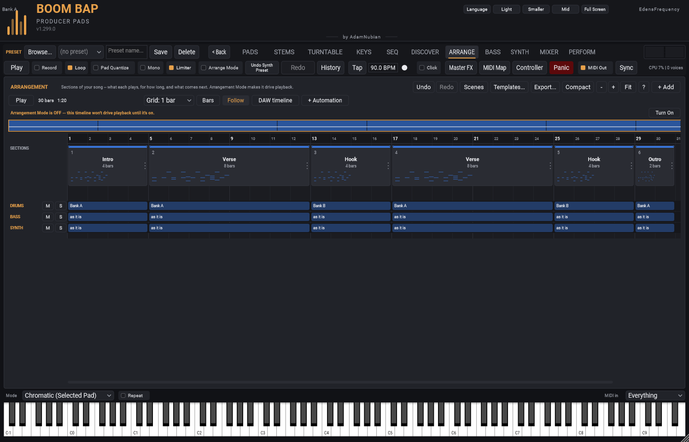

[&larr; Back to Usage overview](../../../USAGE.md) | [INSTALL](../../../INSTALL.md) | [LICENSE](../../../LICENSE.md) | [CHANGELOG](../../../CHANGELOG.md)
<hr>


<hr>


# ARRANGEMENT tab



Build a timeline out of your 4 kit banks (see [The pad grid & sample
browser](../pads/pad-grid-and-browser.md) for what a bank is) — sections you can
arrange into a song structure instead of switching banks by hand.

- **+ Add** — adds a new section (4 bars, same bank as the last section
  you added).
- **Double-click** a section, or right-click and choose **Rename...**,
  to give it a name (e.g. "Intro", "Chorus") — leave it blank to fall
  back to showing which bank it plays.
- **Drag a section's right edge** to resize it, in whole bars.
- **Drag a section** to reorder it within the timeline — a gold line
  shows where it'll land.
- **Right-click → Edit Next Action...** to choose what happens when a
  section finishes:
  - **Continue to Next** (default) — play the next section in order.
  - **Jump to Entry...** — jump to a specific other section instead. The
    section shows a curved arrow to its target, plus a small "-> N"
    label.
  - **Hold Forever** — repeat this section indefinitely. Shown with a
    small looping-arrow icon on the section itself.

  ```mermaid
  flowchart TD
      A["A section finishes playing"] --> B{"Its Next Action?"}
      B -- "Continue to Next\n(default)" --> C["Play the next section\nin timeline order"]
      B -- "Jump to Entry..." --> D["Jump to whichever\nsection was chosen"]
      B -- "Hold Forever" --> E["Repeat this same\nsection indefinitely"]
  ```
- **Right-click → Pattern** picks which of the bank's 16 patterns the
  section plays ("Whatever the bank is on" leaves it to the bank). The block
  shows it as "/ P3".
- **Right-click → Key** plays the section's synth part and bass line a few
  semitones up or down (-5 to +6) -- a key change for a chorus or a last
  section. The block shows it as "/ +2".
- **Right-click → Duplicate** adds a copy of a section right after it;
  **Right-click → Delete** removes it.
- Each section's block width is proportional to its length in bars, so
  longer sections are visibly wider.
- **The view:** a ruler with bar numbers along the top and **Zoom in**,
  **Zoom out** and **Fit** (the whole song in view). The button beside
  them switches to the **Compact** view (plain blocks, no ruler) and back. **?** explains the
  tab in a few lines.

**Arrangement Mode** (toolbar toggle, next to Limiter, or the **Turn On**
button in the bar that says it's off) turns the timeline on: while it's on, playback advances through your sections automatically
following each section's Next Action — a gold highlight shows which one
is currently playing — and the SEQ tab's A/B/C/D bank buttons are
disabled, since the timeline is what's driving bank switches now. Turn
it back off to return to switching banks by hand.

## Sections, round two

- **Select** a section by clicking it; **Ctrl**-click adds or removes one,
  **Shift**-click selects a run. Right-click settings apply to all of them
  where that makes sense.
- **Right-click** a section for more:
  - **Type** (Intro, Verse, Hook, Bridge, Break, Drop, Outro) and
    **Colour** -- a type brings its own colour.
  - **Repeats** -- play it up to 8 times before moving on.
  - **Bass** and **Synth** -- leave them as they are, make them silent in
    this section, or switch to one of their 16 slots.
  - **Mute pads...** -- tick the pads that sit this section out.
  - **Tempo...** -- the section's own BPM, and a ramp from the section
    before. The standalone plays it; in a DAW the DAW's tempo leads.
  - **Pickup** -- the drums come in only for the last 1-3 beats of its
    first bar.
  - **Drop-out** -- the drums stop for the last 1-4 beats of its last bar:
    the gap before a hook. An orange mark runs along the end of the block.
  - **Comment...** -- a note on the section (a lyric idea, "add a riser
    here"). The block shows a small note; hover over it to read it.
  - **Mixer snapshot as it starts** -- recall one of the MIXER's snapshots.
  - **Play from here**, **Loop this section** (or the selection),
    **Split** before one of its bars, **Merge with the next section**.
- **Edit Next Action...** also has **Random section** and **Stop (the end
  of the song)**, and a Jump can be taken a set number of times, then the
  song goes on.
- Each block shows a small picture of its pattern; the strip above the
  timeline is the whole song in its colours with an energy line -- click
  it to scroll there.

## Starting from a template

**Templates...** lays out a whole song to start from, with drop-outs
leading into the hooks:

| Template | What you get |
|---|---|
| **Boom bap song** | Intro, verse (16), hook (8), verse (16), hook (8), bridge, hook, outro -- 72 bars |
| **Short song** | Intro, two 8-bar verses and hooks, outro |
| **Hook first** | Opens on the hook: intro, hook, verse, hook, verse, hook, outro |
| **Beat tape** | A short instrumental: intro, the beat, a break, the drop, outro |
| **Long loop** | 32 bars of one beat to write or freestyle over |

Verses play bank A and hooks bank B, so make your hook beat on bank B. A
template replaces the sections there (it asks first); **Undo** brings
them back.

## Lanes and automation

Under the sections are three lanes: **DRUMS**, **BASS** and **SYNTH**.
Each cell shows what that section does with the part; click it to change
it. **M** mutes a part for the whole song, **S** solos it.

**+ Automation** adds a lane for a mixer level (the master, bass, synth,
a deck, a bus, a return, or a pad). Click to add a point, drag to move it,
right-click to delete it. Or turn on **R**, play the song and move that
level in the MIXER -- the lane records it.

## Playing it

- **Play** / **Stop** (the standalone; Space too). In a DAW, its own
  transport plays it.
- **Click the ruler** to play from that bar; **right-click** it to add a
  **marker**, or to rename or delete one.
- **Follow** keeps the playhead in view. **DAW timeline** makes the DAW's
  bar the song's bar, so moving the DAW's playhead (FL Studio's song
  position too) moves the song.
- **Scenes** shows the sections as big buttons: while playing, click one
  and the song goes there at the next bar.
- The time label shows where the song is and how long it is; **Bars** /
  **Time** switches the ruler. **Grid** sets what sections and points snap
  to.

**Shortcuts:** Space play / stop, Delete, Ctrl+D duplicate, Ctrl+Z /
Ctrl+Y undo / redo, Ctrl+A select all, Left / Right select (Shift extends,
Ctrl moves the section), Enter play from the selection, L loop, F2
rename, + / - zoom.

## Exporting the song

**Export...** in the header: the song as one WAV with a marker at each
section (named by the section), its **stems** (one WAV per sound across
the song), **each section as its own loop**, or **MIDI** with a track per
pad, the bass and the synth. The SEQ tab's **More... > Export options**
set the bit depth, sample rate, normalise and tails for all of them.

