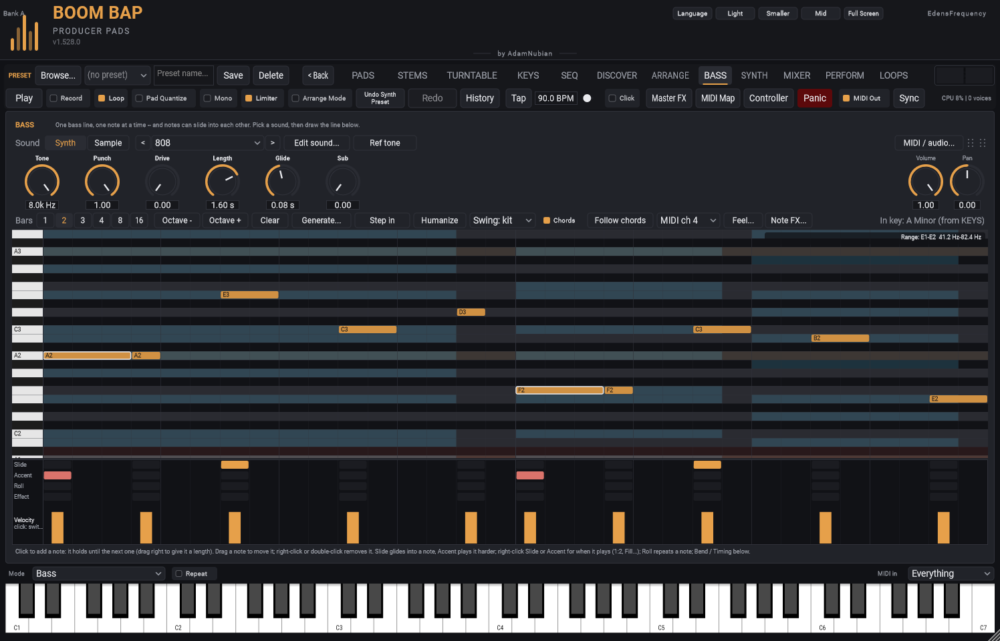
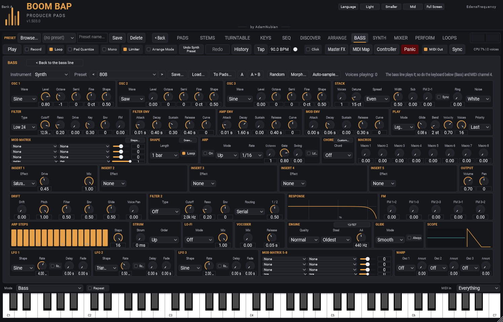

[&larr; Back to Usage overview](../../../USAGE.md) | [INSTALL](../../../INSTALL.md) | [LICENSE](../../../LICENSE.md) | [CHANGELOG](../../../CHANGELOG.md)

# BASS tab

**One bass line, one note at a time -- and notes can slide into each
other.** Pick a sound at the top, then draw the line in the grid. The bass
has its own strip in the MIXER and doesn't use a pad.

## 1. Pick a sound

**Sound: Synth or Sample.**

- **Synth** (the default) is a bass synth, ready to play. Pick a preset --
  **808**, **Distorted 808**, **Sub Bass**, **Reese**, **Acid**, **Fat
  Bass**, **Pluck Bass**, **Wobble Bass** -- or one of the 70-odd more in
  the menu's folders (Sub & 808, Synth Bass, Reese & Wobble, Acid,
  Plucked, Electric & Upright), or step through them all with **<** and
  **>**. Then shape it with six knobs:
  - **Tone**: darker to brighter.
  - **Punch**: the 808 knock -- each note starts higher and drops onto its
    pitch.
  - **Drive**: grit and weight, so it cuts through small speakers.
  - **Length**: how long each note rings.
  - **Glide**: how long a slide takes to reach the next note.
  - **Sub**: a pure low sine an octave under, for weight.

  **Edit sound...** opens every control of the synth (the same ones as
  the SYNTH tab: oscillators, filter, envelopes, LFOs, mod matrix,
  effects) and every preset, and you can save your own. **< Back to the
  bass line** returns.

  
- **Sample** plays your own bass sound (an 808 you like, a sub, a bass
  note): **Load...** it or drop it on the tab. Its knobs are the sample's
  filter (**Cutoff**, **Res**), envelope (**Attack**, **Decay**, **Sustain**,
  **Release**), **Tune**, **Fine**, **Glide** time and **Loop**. Right-click
  a knob to MIDI-learn it. Beside them:
  - **Slide: smooth / even / late** -- how a slide moves to its note over
    the Glide time. Smooth (as it always was) moves fast and settles;
    even moves at one speed and lands exactly on time; late holds back
    and drops in at the end, the classic 808 fall.
  - **Octave: off / up / down** and its **Octave** level -- the same
    sample played again an octave up (bite on phone and laptop speakers)
    or down (more weight) under every note.
  - **Start**: where in the sample each note begins -- skip a slow
    attack, a click or the silence at the front.
  - **Drive**: saturation after the filter, for a thicker bass that holds
    up on small speakers.
  - **Punch**: a louder first 25 ms or so of each note, so its attack cuts
    through the kick.
  - **Sub**: a clean sine at each note's real pitch under the sample, for
    weight that stays in tune. It needs a sample with a clear note (its
    **Root** shows top right).
  - **Tune...** (next to Load): 808 auto-tune. It tells you the note the
    sample sounds as and tunes it (Tune and Fine) so that note sounds as
    **C**, as the **key's root** (when KEYS has a key), or as **the
    kick's note** -- the kick is your kit's kick pad (by name or the Kick
    colour), measured as it plays. Tuned to C, a note on the C row plays a
    C. One Undo step.
  - **Zones...** (next to Tune...): a multi-sample bass. **Add samples...**
    adds up to 7 more recordings of the same bass at other notes (pick
    several at once). Each note of the line plays the sample recorded
    nearest to it, so a low E isn't a stretched-down A. Each zone's note
    comes from its file name (**Bass_E1**) or is heard; change it in the
    list if it's wrong, or remove a zone with **x**. Zones need the main
    sample's note to be heard (its **Root**); until then the main sample
    plays everything. A slide stays on the sample it started on.

**Volume** and **Pan** (right) work for both, and are the same as the
BASS strip in the MIXER.

## 2. Draw the line

The grid is a small piano roll: notes up the side, steps across (16 per
bar).

- **Click** to add a note. It holds until the next note starts, which is
  what most 808 lines want (the rest of a held note shows lighter). Drag
  right as you click to give it a set length instead.
- **Drag a note** to move it (up and down changes its note), or drag its
  right edge to change its length.
- **Right-click** or **double-click** a note to remove it.
- **Selecting several:** **Shift-click** notes to add or take them away, or
  **Shift-drag** a box over them. Drag any selected note and they all move
  together. The selected notes are outlined in gold.
- **Keys** (click the grid first):
  - **Delete** or **Backspace** erases the selected notes.
  - **Ctrl+C**, **Ctrl+X**, **Ctrl+V**: copy, cut, and paste at the last
    place you clicked (the faint line).
  - **Ctrl+D** duplicates the selection straight after itself.
  - **Up / Down** move the selection a semitone (**Shift**: an octave);
    **Left / Right** a step (**Shift**: a beat).
  - **Ctrl+A** selects every note; **Esc** none.
  - Everything but dragging is one Undo step, and so is **Clear**.
- Moving, copying and pasting a note keeps its Roll, Bend, Timing and when
  it plays.
- One note at a time: a new note inside a held one ends it there.
- **Top right of the grid**: **Now** -- the note sounding and its
  frequency, as you hear it (the sound's own octave and Tune included, so
  it can differ from the grid's row name), its key lit orange on the
  keyboard; and the line's **Range**, lowest to highest note. Rows too low
  for most speakers (under 30 Hz) are tinted red, and the Range says so
  when the line goes there. A sample bass needs a clear note (its Root) for
  these.
- **Scroll** over the grid to see higher or lower notes. The keyboard on
  the left plays a note when you click it.
- If you've set a **Key** and **Scale** on the KEYS tab, the grid shades
  the notes in that key (and says so, top right) -- stay on the lighter
  rows and the bass fits the rest of the beat.

Under the grid, one cell per note:

- **Slide**: glide into this note from the one before instead of starting
  it fresh (the note before has to run up to it). The Glide knob sets how
  long the slide takes.
- **Accent**: play this note harder.
- **Right-click** a note's Slide or Accent cell to pick when it plays:
  **1:2** (the 1st of every 2 times round the line), **2:4**, **Fill**
  (only while Fill is held), **First**, **Prev** (when the line's last such
  note played) and their opposites (**!**). The choice shows on the Accent
  cell.
- **Roll**: play the note again, evenly across its length -- **x2**, **x3**,
  **x4**, **x6** or **x8** -- for 808 rolls. A note that holds to the next
  one rolls across one step. Click the cell to step through the rolls,
  right-click it to pick one. The first hit can still slide in; the rest
  start fresh, at the same pitch, and the next note ends a roll.
- **Effect**: **Rev** plays a sample-bass note backwards (from the end of
  the sample, or from Start counted from the end); **Stop** winds the
  note down like a tape machine stopping -- the speed (and pitch) falls to
  nothing over its length, fading at the very end. Tape stop works on the
  synth bass too; Reverse is for samples. Click the cell to step through,
  right-click to pick.
- **Velocity**: drag the bars up or down.
- **Bend**: click **Velocity** (the lane's name, on the left) to switch the
  lane to **Bend**, and back. Drag a note's bar up or down from the middle
  line to bend it up to 12 semitones up or down: the pitch moves there
  evenly over the note's length (or until the next note, when it holds) --
  an 808 drop or rise. Double-click a bar to straighten the note. A roll's
  hits follow the bend. MIDI out sends the notes without the bend.
- **Slide ms**: the next view of that lane -- a slide's own time, 10 to
  1000 ms, for this note only (drag up; double-click puts it back to the
  Glide knob). It matters on notes with Slide on (bright bars), and on the
  synth when Legato ties notes.
- **Timing**: click the lane's name again (Velocity, Bend, Timing, Slide
  ms, round and back) and drag a note's bar up to play it late or down to play it
  early, by up to half a step, in steps of 5%. Double-click puts it back on
  the step. Lay a few notes late for a lazy, behind-the-beat bass line.

- **Recording:** with **Record** armed and the beat playing, notes you
  play on MIDI channel 4 go into the line on their nearest step, as long as
  you held them.
- **Step in:** turn it on and each note you play on channel 4 goes in at the
  cursor (one step long); let go and the cursor moves on a step.

- **Humanize** moves each note's velocity a little at random; **Swing:
  kit** gives the line its own swing (kit = the PADS Swing).

- **Chords** (on by default) shades, under each step, the notes of the
  KEYS synth part's chord playing there -- land the bass on them to follow
  the harmony. **Follow chords** does it for you: every note moves to the
  nearest of those chord notes (notes already on one stay; Undo takes it
  back).

- **MIDI ch** picks the channel the bass plays and records on from a MIDI
  keyboard: 4 (as it always was) or 6-16.

- **Feel...** sets how the line plays, and its tone:
  - **Legato**: a note that starts while the last one is still sounding
    carries on from it at its own pitch, without starting again -- no new
    attack, one long phrase. With the synth bass the notes are tied, and
    the sound's own Mode and Glide decide how they join.
  - **Length lock**: with a sample bass, every note keeps the sample's own
    length. Normally a high note plays the sample faster (and runs out
    sooner) and a low one slower; locked, a long 808 rings just as long on
    every note. Best with samples that have a clear note (their **Root**).
  - **Accent**: how much harder an Accent plays a note (0-80 velocity; 40
    is how it always was).
  - **Vel > Tone**: with a sample bass, softer notes play darker -- the
    filter closes by up to four octaves on the softest. 0 is off.
  - **Layer**: plays the other sound under the one you picked -- the synth
    under your sample bass, or the sample you loaded under the synth. Both
    play every note of the line, each with its own knobs. A favourite: a
    sampled 808's knock over the clean **Sub Bass** synth. 0 is off. The
    two only line up if the sample is in tune -- use **Tune...** first.
  - **Harmonics**: adds the bass's own harmonics, so it's still heard on
    phones and laptops where the lowest notes don't come through (your ear
    fills in the note). Works for the synth and a sample. 0 is off.
  - **Drive type**: how the sample bass's **Drive** knob saturates --
    **Tape** (smooth, as before), **Tube** (warmer, lopsided) or **Fuzz**
    (hard and buzzy). The synth bass has its own Drive.

## 3. Tools

- **Bars 1, 2, 3, 4, 8 or 16**: how long the line is. Going longer starts the new bars as
  copies of the ones you have.
- **Octave - / Octave +**: every note down or up an octave.
- **Clear**: remove every note.
- **Ref tone** (beside Edit sound...): a steady tone at the song's key (the
  KEYS tab's), low where an 808 sits -- the button names the note. Play
  your bass sample against it and tune it until the two stop beating.
  Switch it off when you're done; it isn't saved or exported.
- **Generate...**: write a line from a chord progression's root notes,
  across every bar. It opens on the KEYS tab's key; use the same Root,
  Scale and Progression as your chord pads to keep them together. Then:
  - **Genre**: a starting point for a style -- Boom Bap, Lo-Fi, Trap,
    Drill, G-Funk, House, Afrobeats, Dub, Acid, Halftime. It fills in
    everything below (you can still change any of it). With **Its sound
    and feel too** ticked, **Generate** also sets its synth sound
    (switching the bass to Synth), its **Feel** settings, and slides into
    the notes for the sliding styles (trap, drill, acid). Untick it to keep
    your own sound. Undo takes back the line, not the sound.
  - **Style**: **Chord roots** (a note on each chord) or **Follow the
    kick** (a note on every kick in the pattern, on the chord's root
    there). Kick pads are found by name ("Kick", "BD") or by the Kick
    colour Name and Colour by Sound gives them; with none, nothing changes
    and it says so.
  - **Notes**: **Hold** (each lasts until the next) or **Short** (one step
    each, bouncier).
  - **Octave**: **Low** (as before) or **Mid**, an octave up.
  - **Ghost notes**: quiet one-step pickups in the longer gaps, two steps
    before the next note.
  - **Approach notes**: a note a semitone below (or above) on the step
    before each chord change, leading into it.

## MIDI and audio

**MIDI / audio...** (right of the sound row): export the line as MIDI
(the line's 0 is C2, note 36) or as audio -- its bars through the bass
strip, ready to loop -- or **Import MIDI** onto it (it replaces the line;
Undo puts it back; where notes overlap, the lowest wins). The two handles
beside the button drag the MIDI or the audio straight into your DAW.

## Playing it live

The keyboard at the bottom plays the bass while the BASS tab is open (its
Mode switches to **Bass**, and back when you leave). From a DAW or
controller, **MIDI channel 4** plays it (or set **MIDI in** to **Bass**).
A sustain pedal holds its notes.

## Your older projects

A project saved before this version keeps its bass line (moved into the
grid as it was) and, if it had a bass sample, plays that sample. Projects
without one get the Synth's 808.
