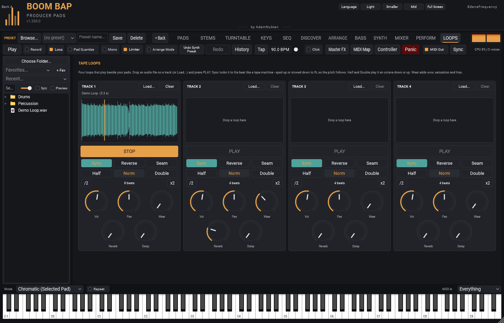

[&larr; Back to LOOPS](README.md) | [All feature guides](../README.md)

# Tape Loops

Open the **LOOPS** tab (top row, after PERFORM). There are four tracks
side by side.

## Loading a loop

Drop an audio file (WAV, AIFF, FLAC, OGG or MP3) onto a track's
waveform box, or click the box or **Load...** and pick one. The track
shows the file's name and length. **Clear** takes it off.

The sample browser sits on the left of the LOOPS tab too: drag a sound
from it onto a track. Or right-click a file there and choose **Load into
Tape Loop**, then pick the track.

## Playing

Press **PLAY** on a track; press it again (**STOP**) to stop. Loops fade
in and out over a few milliseconds, so they never click.

You can also start and stop each track from a MIDI controller. In the
Controller setup, learn **Tape Loop 1 Play** (up to 4) on any button or
pad. The button lights while its track plays. Learn **Tape Loop 1 volume**
on a knob or fader to ride each track's level. See
[Using a DJ controller](../midi/dj-controller.md).

## Sync

With **Sync** on (the default), the loop is fitted to the beat the way a
tape machine would: sped up or slowed down so it lasts a whole number of
beats at the tempo. That means the **pitch follows the tempo** -- a loop
made at 90 BPM played at 96 BPM sounds a little higher. While your DAW
(or the Standalone's own Play) is running, the loop stays in time with
the song; start it at any moment and it comes in on the beat.

Turn Sync off and the loop plays at its own speed and pitch, free of the
tempo.

### Beats

When you load a loop, the plugin works out how many beats it lasts:
from the tempo in the file name if it has one (`dusty-keys_90bpm.wav`),
otherwise from its length at the current tempo. If a synced loop plays
twice as fast or slow as it should, use **/2** or **x2** beside the
beat count.

## Half, Norm, Double

**Half** plays the loop an octave down over twice as many beats;
**Double** an octave up over half. Both stay in sync.

## Reverse

Plays the loop backwards (still in sync).

## Seam

If a loop clicks or bumps where it goes round (it doesn't end where it
starts), turn on **Seam**. The last 20 ms of the loop fade into the first,
so the join is smooth. The loop gets that little bit shorter, which you
won't hear in Sync. Leave it off for loops that were cut cleanly.

## The knobs

| Knob | What it does |
|---|---|
| Vol | The loop's volume (double-click: back to the default) |
| Pan | Left / right |
| Wear | Old tape: slow wow and fast flutter, a duller top end, saturation and a little hiss |
| Reverb | How much goes to the shared reverb (the same one the pads send to) |
| Delay | How much goes to the shared delay |

## Good to know

- Your loops, and every setting on the tracks, are saved with your project.
  The audio files themselves stay where they are -- if you move or delete a
  file, that track comes back empty.
- Tape Loops play on the main mix. Every audio export includes the tracks
  that are playing when you export. They start on the export's first beat
  at the export's tempo, so a synced loop lines up with the music. Stem
  exports give them a file called **Tape Loops**. A track that's stopped
  isn't exported.
- On the MIXER, the **LOOPS** strip (the last one) is all four tracks
  together: a fader, pan, Mute, Solo and a meter after each track's own Vol.
- Loops up to 10 minutes long can be loaded.
