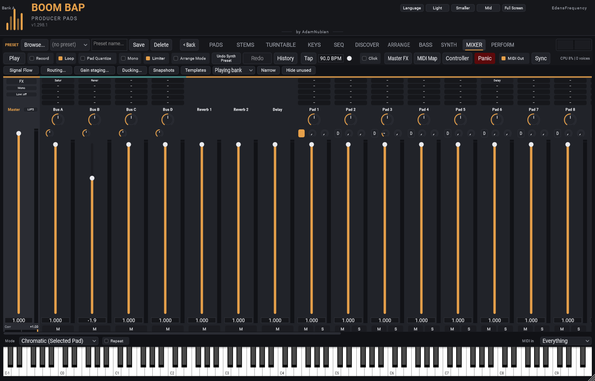
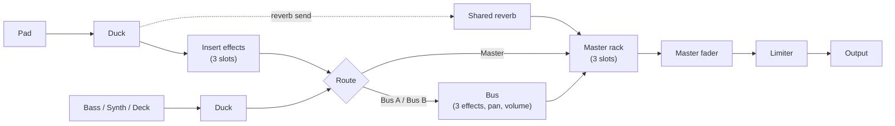
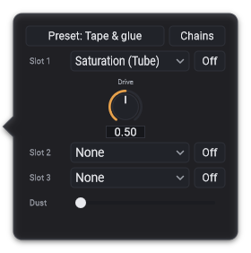
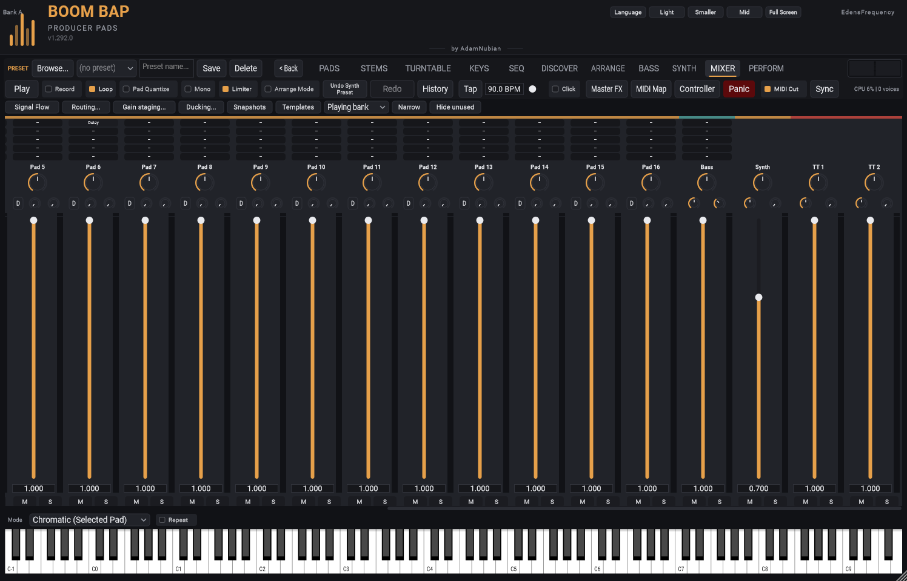
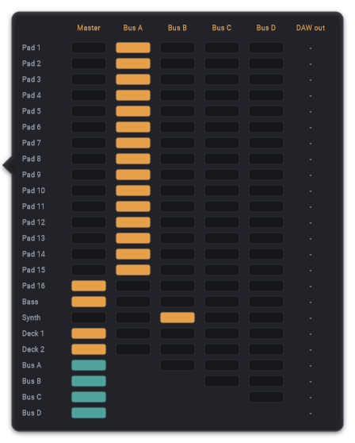

[&larr; Back to Usage overview](../../../USAGE.md) | [INSTALL](../../../INSTALL.md) | [LICENSE](../../../LICENSE.md) | [CHANGELOG](../../../CHANGELOG.md)

# MIXER tab

A console-style row of vertical channel strips — one per sound source in
the plugin (every pad in the active bank's [grid
size](../pads/pad-grid-and-browser.md), the bass, the synth and both
turntable decks), plus the **Master** strip pinned first on the left and
**Bus A** and **Bus B** beside it. Everything here is the same
underlying parameters the PADS/BASS/TURNTABLE tabs already control, just
laid out side by side for a whole-kit view instead of one source at a time.

- **Solo-active banner** (above the strips) — shown whenever anything in
  the kit is soloed, so silence elsewhere in the mix reads as "something's
  soloed," not "broken."
- **Signal Flow** — opens a plain explainer of the signal path below.

The **Duck** dips a source each time a pad marked **D** plays (the
sidechain pump); the duck-source pad itself never ducks.

## Every strip

- **Pan** knob and a vertical **Volume** fader.
- **M** / **S** — Mute and Solo, same cross-source behavior as elsewhere in
  the plugin (soloing one source silences every other un-soloed source).
- A thin peak meter down the side of the strip.

## Pad strips only

- **5 insert-effect slots** at the top — the same per-pad Insert FX chain
  from [the pad grid](../pads/pad-grid-and-browser.md)'s right-click menu, shown
  here as clickable slots instead. Picking a type here and via right-click
  on the pad are the same setting either way.
- The strip's top accent bar reflects the pad's own color tag (set via
  right-click → Color on the PADS tab) instead of a fixed color, so a
  glance across the console tells you which strips belong to which
  color-grouped pads.
- A reverb send level and a **D** (duck source) control with its own
  amount — sends this pad into a shared reverb bus, or marks it as a
  sidechain-ducking source for other pads to duck against.

## The Bass strip's effects

The **Bass** strip has **five effect slots** too, for whichever bass is
playing, sample or synth. Click one to pick an effect (everything but
EQ: the bass has its own filter on the BASS tab), then **Knobs...** and
**Mix** as on a bus. They come after the strip's fader, so the fader also
sets how hard they're pushed. For a dusty bass, try **Lo-fi Box**, then a
**Saturation**.

## Moving an effect

Effects run top slot first. In a strip's slot menu, **Move earlier in the
chain** / **Move later in the chain** swaps that effect with its
neighbour, settings and all.

## Bypass

Click a strip's effect slot and pick **Bypass** to switch that effect off
without losing its settings: the slot greys out, and exports leave it out
too. Pick it again to switch it back on. The master rack has an **Off**
button beside each slot.

## Insert chains

Click any strip's effect slot (a pad, a bus or the bass) for **Insert
chains**: **Save this strip's chain...** keeps its three effects, their
knobs and Mix under a name, and every saved chain is listed to load onto
that strip. They're the same chains as a pad's own menu, so a chain made
on a pad loads on a bus or the master rack, and the other way round. What
a strip can't hold is left out: an EQ loads onto the bass as an empty
slot, and the master rack plays every slot fully wet.

## A strip's channel panel

Click a strip's **name** for its channel panel. On pads and buses:

- **Trim** (+-18 dB) turns the sound up or down *before* its effects. A
  quiet sample can come up here, where the fader only turns down.
- **Drive** pushes it into a console's soft saturation *after* its
  effects: the peaks round off and the body comes up. A little warms it;
  a lot is grit.

On the **Bass** strip it holds **Offset**: the bass up to 10 ms later.
When a kick and a bass that hit together sound thin, slide this until
they sound fullest.

## Gain staging

**Gain staging...** (top of the Mixer, beside Routing) sets every loaded
pad's volume so its loudest hit lands on the same level: **-6 dB** for a
loud kit, **-12 dB** (a good start) or **-18 dB** for lots of headroom.
A pad that's already quieter than that stays at full. It's a level start,
not a mix: balance by ear from there. **Undo** puts every fader back.

## Master strip

Leftmost, always visible. Volume fader and a live peak meter — no
pan/mute/solo, since there's nothing to pan or solo on an already-summed
master bus. Its **FX** button opens the same 3-slot master rack popup as
the toolbar's own [Master FX](../toolbar/toolbar-and-presets.md) button —
one rack, two entry points. At its top, **Preset: Tape & glue** puts a
little console warmth in slot 1 and a gentle compressor in slot 2 (slot 3
stays as it is). Beside it, **Chains** saves the rack's three slots
under a name or loads a saved chain (see below). Under its three slots is **Dust**: one
slider of old record for the whole mix (the top rolls off, it saturates
a little, crackle and hiss come in). Double-click it for off.

Under FX:

- **Mono** plays the whole mix in mono while it's lit -- check how it
  holds up on a phone or one club speaker, where anything that cancels
  out in mono disappears. It's only for listening: it isn't saved and
  never reaches an export.
- **Low** makes everything under **80**, **120** or **160 Hz** mono
  (pick from its menu; off to start), so kicks and bass sit dead centre
  however wide the rest is. It's saved with the project and applies to
  exports too, after the master fader and before the limiter.

**LUFS** (beside "Master") opens the loudness readings -- how loud the
mix is the way streaming services and broadcasters measure it:

- **Momentary**: the last 0.4 seconds.
- **Short-term**: the last 3 seconds.
- **Integrated**: the whole song since you pressed **Reset** (quiet gaps
  and silence don't drag it down). Press Reset, play the song through
  once, and read it at the end. Streaming services play most music at
  around -14 LUFS, turning louder songs down.
- **Target**: pick what to measure against (streaming -14, Apple Music
  -16, broadcast -23) and the line under Integrated says how many LU over
  or under it you are. Over isn't wrong, it just means the service will
  turn your song down to match.
- **The vectorscope** (the square on the right) draws the stereo picture.
  A thin vertical line is mono; a cloud is wide; something leaning
  toward L or R is louder on that side; a shape lying flat means parts
  are out of phase and will thin out in mono.
- **The spectrum** (along the bottom) shows the whole mix from 20 Hz on
  the left to 20 kHz on the right: a big hump in the lows, a hole in the
  mids, too much fizz up top.
- **Reference track** (the bottom row): **Load...** a finished song you
  want yours to sit next to, then **Hear reference** to switch to it --
  click again for your mix. With **Match level** on, it's turned to your
  mix's loudness when you switch, so you're comparing the sound, not the
  volume. While it plays, every meter here reads the reference. It's
  never in an export, and closing the readings switches back to your mix.
- **True peak (dBTP)**: the highest the waveform has gone since Reset,
  counting between the samples, where a plain peak meter can't see.
  It turns **red above -1**: a song that peaks there can clip once it's
  made into an MP3 or AAC. Lower the master (or the Limiter's ceiling)
  until it stays under.

The thinner, lighter bar inside the master's meter is the **average
level** (RMS), which moves slower and is closer to how loud the mix
feels. The gap between it and the peaks is your punch: a big gap is
dynamic, a small one is squashed.

The master's meter holds its **peak** for a moment (a line that falls
after a second and a half). The small light on top turns **red** if the
output ever reaches 0 dB -- it stays lit until you click the meter, so
you'll see it even if you were looking away. With the toolbar's Limiter
on it shouldn't light at all. Every other strip's meter has the same
peak hold and clip light; a red light there means that one sound is
clipping before it even reaches the master.

Under the fader, **Corr** is the correlation meter: how alike the left
and right sides are. **+1** is mono; most mixes sit between **0** and
**+1**. When the marker goes **red** -- below 0 -- something in the mix
is out of phase and will get quieter or vanish in mono: check it with
**Mono**, then try a pad's **Phase** button or less width.

## Bass, Synth and Turntable strips

At the right end of the console (scroll across to them):

Same Pan/Volume/Mute/Solo/meter as any strip, plus a **Duck** knob: how
far it dips each time a pad marked **D** (duck source, on the pad strips)
plays. Turn it up on the Bass so the 808 makes room for the kick -- the
classic sidechain pump -- or on the Synth for a pumping pad.

## Bus A and Bus B

Next to the master: two group buses. Send several sources to one bus and
treat them together -- all the drums through one saturation for glue, the
synth and a deck through a shared delay.

- **Routing...** (top left of the MIXER) shows every source -- each pad,
  the Bass, the Synth, both decks -- against **Master**, **Bus A** and
  **Bus B**. Click a cell to send that source there. Everything starts on
  the Master.
- A bus has three **insert slots** (click one for an effect; **Knobs...**
  in the same menu sets its controls), **Pan**, **Volume**, **Mute** and a
  meter. It joins the master before the master rack. Each bus effect's
  **Knobs...** panel ends with a **Mix** slider (how much of the effect
  you hear), and its menu has **Parallel compression (preset)**: send
  your drums to a bus and pick it for thicker drums that still hit. A bus also has a
  **Width** knob (under its name): 0% squeezes everything on it to mono,
  200% spreads it twice as wide; double-click for 100%. The Bass, Synth
  and turntable strips have the same Width knob, beside Duck. **Right-click**
  a Width knob for **Mono below** (off, 80, 120 or 160 Hz): the low end of
  that strip goes mono, so its bass stays centred however wide it is.
- A pad sent to its own output in your DAW (multi-out) still goes there,
  not to a bus.
- **Export WAV** and **Export Full Song** render the mix the way you
  hear it: each pad's effects, sends and Duck, the buses, the master rack,
  the Master fader and the safety limiter.

## The EQ

Any insert slot -- a pad's, Bus A / B's or the master rack's -- can hold an
**EQ**. Pick it, then choose **Edit EQ...** from the same menu (or click the
slot's button):

- The curve sits over a live picture of the sound. **Before / After** shows
  what goes in or what comes out.
- **Bands 1-4**: drag a round handle sideways for its frequency, up or down
  for boost or cut; the mouse wheel over it makes it wider or narrower;
  double-click puts it back. Each band is a **Bell**, **Low Shelf** or
  **High Shelf**.
- **Low cut / High cut**: the square handles. Turn one on and pick how
  steep it is (12 to 48 dB/oct).
- **Dynamic** on a band: it only moves while its own frequencies are louder
  than the **Threshold**, by up to the **Range** (negative cuts, positive
  boosts) -- tame a boomy note only when it booms.
- **Output** sets the level after the EQ; **Flat** resets everything.

A slot switched to EQ starts flat. The EQ is saved with your project, the
bank, kits and the pad's A/B, and sounds the same in Export WAV.
