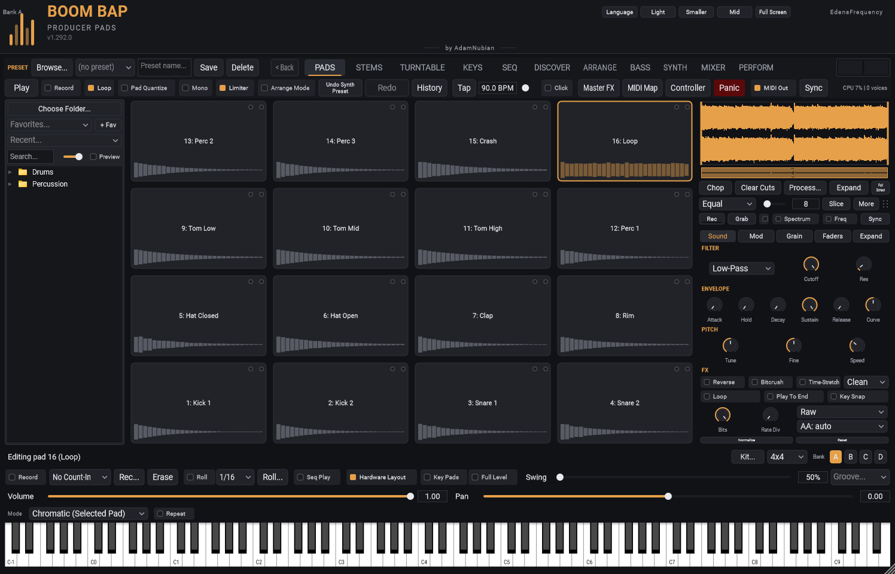
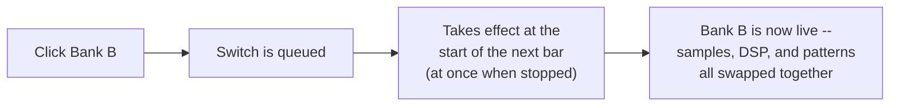

[&larr; Back to Usage overview](../../../USAGE.md) | [INSTALL](../../../INSTALL.md) | [LICENSE](../../../LICENSE.md) | [CHANGELOG](../../../CHANGELOG.md)

# The pad grid & sample browser

This is the main PADS view: sample browser on the left, the 4x4 pad grid in
the middle, and the waveform/DSP column on the right, with the performance
controls along the bottom and the keyboard under everything.

## Sample browser

Top-left panel.

- **Choose Folder...** — point the browser at your own sample library.
  Remembered across sessions.
- **Search** box — filters the visible tree by filename (case-insensitive
  substring match). Folders you already had open keep showing what they
  last scanned until you collapse and reopen them; newly opened folders
  always reflect the current search.
- **Preview** — when ticked, clicking a file plays it. The small slider
  next to it sets how loud previews play (DISCOVER's too); it's saved with
  the project.
- **Double-click a file** to load it onto whichever pad is currently
  selected.
- **Drag a file onto a pad** to load it there (Windows Explorer and your
  DAW's own browser work too -- see below).

### Dropping files anywhere

Drag audio or video from Windows Explorer (or your DAW's browser) onto:

- **a pad** — loads it onto that pad;
- **the Sample Editor** — loads it onto the pad it's showing;
- **the deck** (TURNTABLE) or the **bass lane** — loads it there;
- **the DISCOVER crate** — adds it (a folder adds its audio and video);
- **anywhere else** — a menu asks what to do with it: load it onto the
  selected pad, onto the next empty pad (several files: onto empty pads in
  order), send it to the deck, add it to the DISCOVER crate, or **match the
  project tempo to it** (sets the tempo from the file's detected BPM).

## The pad grid

16 pads. By default they're laid out bottom-left to top-right (pad 1
bottom-left, pad 16 top-right), matching how many hardware pad
controllers number their physical pads — so the pad you see selected is
the pad you actually hit. Click **Hardware Layout** in the toolbar to
switch back to plain top-left-to-bottom-right reading order.
Either way, the underlying MIDI note mapping is unchanged (notes 36–51
always trigger pads 1–16 in the same order) — this only affects which
grid cell each pad's box is drawn in.

Each pad plays one sample, one-shot (it always plays from the
start of its region; triggering it again while it's still playing cuts the
previous hit and restarts — different pads never cut each other off,
unless **Mono** mode is on — see [The toolbar](../toolbar/toolbar-and-presets.md)).

- **Chop lanes** (right-click a sliced pad > **Chop lanes...**) -- paint
  a value for each chop straight over the waveform. The window shows the
  sample the pad was sliced from, each chop as a column (with its pad
  number); pick a lane and drag across the columns. Letting go plays the
  last chop you painted.

  | Lane | What a chop gets |
  |---|---|
  | **Volume** / **Pan** | Its level and place. |
  | **Pitch** | Up or down, -12 to +12 semitones. |
  | **Reverse** | Top half plays it backwards. |
  | **Stutter** | Its start played 2, 3, 4, 6 or 8 times, in the chop's own length. |
  | **Filter** | The cutoff (top = open), with the filter picked next to the lane: Low-Pass, Low-Pass 24, Band-Pass, High-Pass, Notch or Comb. |
  | **Delay** / **Reverb** | How much goes to the shared delay (a dotted 1/8 at the tempo, bouncing left and right) or reverb. |

  **Random** fills the lane with musical values (pitch mostly on 0, 5, 7
  and 12), **Repeat** copies the chops up to the last one you painted over
  the rest (paint 1-4, then Repeat), **Clear** puts the lane back to
  normal. Each stroke or button is one **Undo**.

  Each chop is a pad, so what you paint is that pad's own setting: it
  plays wherever the chop does -- hit, SEQ, the keyboard, exports -- and
  shows on the pad's own controls. (A lock on a SEQ step only changes that
  one step.) Stutter suits one-shots; a looping pad ignores it.
- **Drum synth** (right-click a pad > **Drum synth...**) -- make a drum
  from scratch instead of loading one: **Kick**, **808**, **Snare**,
  **Closed hat**, **Open hat**, **Clap**, **Rim**, **Tom** or **Cowbell**,
  shaped by five knobs:

  | Knob | What it does |
  |---|---|
  | **Tune** | Up or down a semitone at a time (a kick at +12 is an octave higher). |
  | **Decay** | How long it rings -- a tight hat or an open one, a short kick or a long 808. |
  | **Tone** | Darker or brighter: the click on a kick, the sizzle on a snare or hat. |
  | **Punch** | The attack: how far a kick's pitch drops, a snare's snap, how spread a clap's slaps are. |
  | **Drive** | Saturation: louder, rounder, then gritty. |

  Every change plays the new drum. On an empty pad it starts with a kick;
  on a pad that already has a sound, the first change replaces it (one
  **Undo** brings the old sound back). The drum is saved as a WAV in
  **Music > Boom Bap Captures > Drum Synth**, so it plays like any sample --
  in SEQ, with the crush and stretch modes, in exports and kit exports --
  and opening **Drum synth...** again shows its knobs where you left them.
- **Drag a pad into your DAW.** Drag a loaded pad (without Shift) onto a
  track and its sound -- the trimmed region -- lands there as a WAV named
  after the pad ("Pad 3 - Kick.wav"), kept in **Music > Boom Bap Drag
  Out**. Shift+drag swaps two pads instead.
- **< and >: try the next sample.** Hover a loaded pad and arrows appear
  on its left and right edges. **>** loads the next sound in the same
  folder as the pad's sample, **<** the one before (in the order Explorer
  lists them, going round at the end). The pad keeps its settings --
  pitch, filter, envelope, effects -- so you hear each kick through the
  same chain. If nothing is playing, the new sound plays once; while a
  beat plays, you hear it in the pattern instead. The same two are in the
  pad's right-click menu.
- While a pad plays, a **gold line** moves across its waveform to show how
  far through the sound it is.
- **Full Level** (next to Key Pads) — every pad you play hits at full
  velocity, however hard you hit it. The steps of a pattern keep their own.
- **Velocity curve** (right-click a pad) — how that pad answers how hard you
  play: **Linear**, **Soft** (gentle hits come through louder) or **Hard**
  (only real hits get the top).
- **16 Levels from this pad** (right-click a pad) — pads 1-16 all play
  that one sound: **By velocity** (pad 1 the softest, pad 16 full) or **By
  tune** (pad 1 as it is, a semitone up each pad). **Off** in the same menu.
- **Pad 1's MIDI note** (right-click a pad) — the note pad 1 answers to,
  the others following: C0, C1 (36, the usual), C2 or C3. MIDI Out and the
  pattern's MIDI export use the same notes.
- **DAW output** (right-click a pad) — which of the plugin's 16 outputs the
  pad goes to in your DAW: **Its own** (pads 1-16 have one each; the others
  go to the main mix) or **Out 1**-**Out 16**. Several pads can share one.
  The output has to be switched on in your DAW's routing.
- **Pressure (aftertouch)** (right-click a pad) — on a controller that
  sends it, pressing into a held pad changes **Its volume** or opens **Its
  filter**. Until you press, the pad sounds as it always does.
- **MIDI channel** (right-click a pad) — **Any** (as usual) or one channel,
  and then the pad answers its note only there.
- **Key Pads** (next to Hardware Layout) — play the pads from your
  computer keyboard. The keys are laid out like the pads on screen:

  | Hardware Layout on | Hardware Layout off |
  |---|---|
  | `1 2 3 4` = pads 13-16 | `1 2 3 4` = pads 1-4 |
  | `Q W E R` = pads 9-12 | `Q W E R` = pads 5-8 |
  | `A S D F` = pads 5-8 | `A S D F` = pads 9-12 |
  | `Z X C V` = pads 1-4 | `Z X C V` = pads 13-16 |

  Hold **Shift** to play softer. On a bigger grid the keys cover the
  first 16 pads' corner of it. It works on every tab except TURNTABLE
  (whose letters chop the record), so you can play pads while you're on
  SEQ, KEYS, SYNTH and the rest. While Key Pads is on, **E** plays a pad
  instead of resizing the Sample Editor (use its Expand button), and
  typing in a text box still types. It's remembered for next time.
- **Keyboard and screen readers.** **Tab** moves through the controls;
  on a pad, **Space** or **Return** plays it and **Shift+F10** opens its
  menu. Screen readers (Narrator, NVDA) read each pad as "Pad 3: <its
  sample>", and each knob, fader and dropdown by its name ("Cutoff",
  "Pad 3 volume", "Grid size").
- **Click an empty pad** — opens a file chooser to load a sample onto it.
- **Click a loaded pad** — selects it (highlights gold) and triggers it
  (flashes, and glows orange while the sample is still playing).
- **Quick Stop** — a small stop icon appears in the top-left corner of any
  pad that's currently playing (it takes over the Choke Group letter
  badge's spot, which comes back once playback stops). Click it to cut
  the pad off right away instead of waiting for a long sample to finish.
- **Drag an audio file onto any pad** — loads it directly, from Windows
  Explorer or your DAW's own sample browser if it supports OS-level
  drag-and-drop.
- **Drag a loaded pad's sample out** (past a small threshold) — exports its
  current region to a temp WAV and starts a real file drag: drop it onto
  another pad to copy the sample there, or drop it into your DAW's own
  browser/playlist to pull it out of the plugin entirely.
- **Right-click any pad** — Load Sample… / Clear / Rename…, **Send to the
  deck** (to chop it again on the TURNTABLE tab, as it is or as it sounds --
  see [Chop a pad again](../turntable/turntable-tab.md#chop-a-pad-again)), plus Choke
  Group, **Layers** (see below), Color, and three **Insert FX** submenus (Insert FX 1/2/3 — up to
  3 effects in series on that pad). Each slot can hold Chorus, Flanger,
  Phaser, Transient Designer, Harmonic Exciter, Stereo Doubler, Reverb,
  Delay, one of 3 Saturation flavors (Tube, Transformer, Console), or
  Formant Shift, a **Ring Mod** (Freq and Mix: bell-like, metallic tones), a **Compressor** (Threshold, Ratio, Makeup), a **Lo-fi Box** (Bits, Rate, Mix), a **Tremolo** (in time with the song: Rate 1/2-1/32, Depth, Shape), a **Tape Stop** (Stop past halfway slows the sound to a halt over Time -- map Stop to a macro or MIDI button to throw it), a **Shape Filter** (a filter that opens and shuts in time with the song
  along a shape you draw), or an **EQ** (with **Edit EQ...**, see the [MIXER tab](../mixer/mixer-tab.md#the-eq)) ("None" is the default — sounds exactly like it always
  did). Every slot but EQ also gets an "Edit Knobs…" option in that same submenu for adjusting their parameters (Size/Damping/Mix,
  Time/Feedback/Mix, Drive, or Shift).
- **Copy pad** / **Paste pad here** (right-click menu) — copy one pad, then
  right-click another and paste **All of it**, the **Sample only**, the
  **Settings only** (its sound: level, filter, envelope, tune, crush,
  inserts, modulation) or the **Pattern only** (its steps). Mute, solo,
  colour and layers stay as they were. A paste takes what the copied pad
  holds at that moment, and Undo takes it back.
- **Name and colour pads by sound** (right-click menu) — listens to every
  loaded pad and colours it for what it sounds like: kick red, snare
  orange, hats yellow, perc green, loop blue, bass purple. A pad you
  haven't named gets the name too ("Kick", "Open Hat"...). It's a guess
  from the sound -- recolour or rename any it gets wrong; Undo takes it
  all back.
- **Tune its root note to C** (right-click menu, on a loaded pad) — finds
  the note the sound plays at (an 808 in G, say) and sets the pad's Tune
  and Fine so it plays as a C. Playing the pad chromatically from KEYS is
  then in tune. A sound with no clear note (a hat, noise) is left alone.
  Undo takes it back.
- **Key Shift Pad** (right-click menu, on a loaded pad) — spreads that
  pad's sample across your other empty pads, each one a semitone higher
  than the last. Turns one chop into a playable chromatic instrument
  across the grid, without needing the KEYS tab.
- **Layers** (right-click menu) — makes this pad play one of several
  pads each time it's hit. That's how you get drums that don't sound
  machine-gunned, and hits that change character with how hard you play.
  Load the variations onto pads next to each other, right-click the first
  one and pick:
  - **Velocity layers:** soft hits play the first pad, harder hits the
    next ones, the hardest hits the last one. Load them softest first.
  - **Round robin:** each hit plays the next pad in turn.
  - **Random:** each hit plays one of them at random, never the same one
    twice in a row.

  Then choose how many pads (this pad and up to 7 after it). If you've
  batch-selected pads (Ctrl+click), you can also build the group from those.
  The pad you right-clicked shows **VEL**, **RR** or **RND** and the count
  in its corner; the others show **in N** (the pad that plays them). They
  all stay normal pads with their own chop, envelope and effects, and you
  can still play or program them on their own. Program the pattern on the
  first pad and the variations happen by themselves, in the bounce too.
  **Off** undoes it. A pad can only be in one group.
- **Key zones** (right-click > Layers) -- several pads become **one
  instrument across the keyboard**. Each pad holds a note of the
  instrument (a piano's C3, C4, C5...), named in its file name
  ("Piano_C3.wav", "Rhodes F#4.wav"). Load them on pads side by side,
  right-click the first and pick **Key zones > Pads 1-4** (up to 16 pads).
  Then select that first pad and play the keyboard, the KEYS piano roll or
  MIDI channel 2: every note plays the nearest recorded note, tuned from
  there -- so a C sounds like the C sample and an F like the nearest one,
  not one sample stretched across five octaves. The pad shows **KEYS**.
  If a pad's file has no note in its name, it says which.
  - Quickest way in: **Kit... > Import > Folder as one instrument** puts a
    whole folder of named notes onto empty pads and sets this up for you.
  - The SYNTH tab's **To Pads... > One per octave** makes one too.
  - Notes in names count middle C as **C4** (60). A pack that calls it C3
    just sits an octave higher -- play it an octave down.
- **Blend the layers (morph)** (right-click > Layers, on a Velocity layers
  or Key zones pad) -- instead of jumping from one layer to the next, the
  layers **crossfade**: in between two of them you hear both, mixed so the
  level stays even. The pad's corner tag gets a **~**. Pick what moves the
  blend:
  - **Blend by velocity** -- how hard you hit sets the mix: soft hits the
    first pad, hard hits the last, and everything in between a smooth mix
    of the two nearest. No more sudden jump at a velocity boundary.
  - **Blend by the mod wheel (CC1)** or **by expression (CC11)** -- the
    mix moves **while the note holds**: push the wheel up and a held
    string or horn note grows from soft to loud. Wheel down plays the
    first pad, up the last; expression starts at full.
  - **Blend by an LFO** -- the mix sweeps back and forth by itself from
    each hit. **Mix / centre** sets where it sweeps around, **LFO rate**
    how fast (0.25-8 Hz) and **LFO depth** how far.
  - **Blend at a fixed mix** -- two sounds stacked at the **Mix** you pick
    (0% the first, 100% the last): a kick with a little of another kick's
    click, two drum-synth pads blended into one.
  - **Switch (no blend)** goes back to plain layers.

  In **key zones**, pads whose files are on the **same note** become that
  note's soft-to-loud layers (load "Strings_C4_soft" and "Strings_C4_loud"
  and give both C4): the blend crossfades between them. A note with just
  one sample gets a level instead -- the wheel takes it from quiet (-18 dB)
  up to full. Export WAV plays the blend as it sounds live (the wheel and
  expression stay where they are when you export). The blend is saved with
  the project and the kit.
- **Favorite** (right-click menu) — protects this pad's step pattern from
  Randomize and Flip the Sample (see [Step
  sequencer](../step-sequencer/step-sequencer-and-roll.md)) — shown with a small gold star.
- Supported file types: `.wav`, `.aif`/`.aiff`, `.flac`, `.ogg`, `.mp3`,
  `.m4a`/`.aac`, `.wma` — and videos (`.mp4`, `.mov`, `.mkv`, `.avi`,
  `.wmv`, `.webm`, `.m4v`, `.3gp`, `.mpg`), which load their soundtrack.
  See [DISCOVER → using videos](../discover/discover-tab.md#local-files)
  for what Windows can decode and the 20-minute limit.

Pads also respond to MIDI: notes 36–51 (C1 upward) trigger pads 1–16 with
real velocity sensitivity from your MIDI controller/keyboard. Clicking a pad
in the UI always triggers at a fixed velocity.

**Bank A / B / C / D** buttons (right under the grid, next to "Editing pad
N" — also available on the SEQ tab) switch between 4 complete kits — 4
banks x 16 pads = 64 addressable pad slots in total.
Switching banks swaps *everything*: every pad's sample, every DSP setting,
and every pattern, all together, so each bank is a genuinely separate kit
rather than just an alternate pattern for the same 16 samples. A bank
switch is bar-quantized — while the song is playing it takes effect at the
start of the next bar, not the instant you click, so it never chops a
pattern off mid-phrase. While it's stopped, it switches straight away.

**Right-click a bank button** on the SEQ tab to **Copy Into Bank X** (this
bank's pads and pattern over that one's) or **Swap With Bank X** (the two
trade places -- pads, patterns, all 16 pattern slots and grid sizes).
Undo takes a swap back.

**Grid size** dropdown (next to the Bank buttons) — each bank can be its
own size: 4x4 (16 pads, the default), 5x5 (25), 6x6 (36), 7x7 (49), or
8x8 (64). Picking a bigger size adds more pads to the grid immediately —
the pads themselves get smaller to fit the same space, the plugin window
doesn't grow. This applies to whichever bank is currently active and
takes effect right away, unlike Bank switching itself (no bar-quantize
wait — there's no audio content to keep in sync, just how many pads are
addressable). Every other bank keeps its own independently-set size, so
Bank A can stay a compact 4x4 while Bank B runs a full 8x8. The
SEQ/KEYS/DISCOVER tabs and MIDI note range all follow whichever size the
active bank is currently set to; see [Output
routing](../dsp-controls/dsp-controls.md) for the one thing that's capped
at 16 regardless of grid size.

**Kit...** (just left of the Grid size dropdown) exports the active bank
as a SoundFont, SFZ, DecentSampler preset, sliced WAV or a whole FL
Studio pack, and imports kits from those formats or a folder of samples.
See [Kit import & export](kit-import-export.md).
