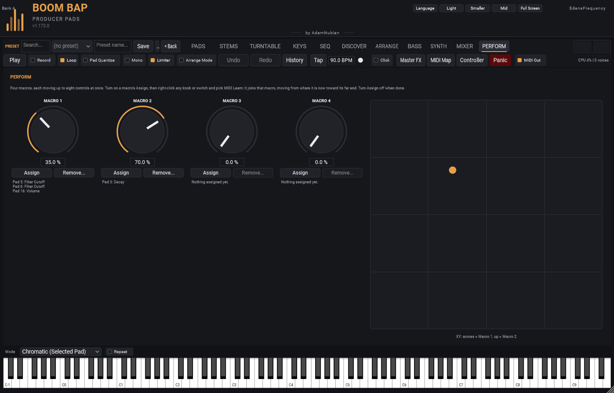

[&larr; PERFORM tab](README.md) | [All feature guides](../README.md)

# The PERFORM tab

## Macros

Four **MACRO** knobs, each moving up to eight controls at once.

**To put a control on a macro:**

1. Click that macro's **Assign** (it lights up).
2. Right-click any knob or switch anywhere in the plugin -- a pad's
   Cutoff, the reverb send, Swing, the bass volume -- and pick **MIDI
   Learn**. Instead of waiting for a MIDI knob, it joins the macro, and
   its name appears under the macro.
3. Add more the same way (up to eight), then click **Assign** again (or
   leave the tab) to finish.

**How far each control moves:** from where it is when you assign it,
toward its far end -- a filter that's open closes, a quiet pad gets
louder. So with the macro at 0 nothing changes; turning it up takes every
control from where you set it to the other end. Set each control where
you want the "start" of the move, then assign it.

**Taking controls off:** **Remove...** lists them; pick one, or **Clear
this macro**.

Macros are saved with your project, and your DAW sees them as **Macro 1**
to **Macro 4** -- automate them like any parameter.

## The XY pad

Drag anywhere on the square: **across** moves **Macro 1**, **up** moves
**Macro 2**. Put a filter on Macro 1 and a delay or reverb send on Macro 2
and you can sweep both with one finger.

## Good to know

- A control can be on several macros; the last one moved wins.
- A knob on a macro still works by hand -- the macro sets it again only
  when the macro moves.
- MIDI Learn works as usual whenever no macro's Assign is on.
