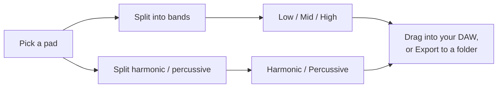

[&larr; Back to Usage overview](../../../USAGE.md) | [INSTALL](../../../INSTALL.md) | [LICENSE](../../../LICENSE.md) | [CHANGELOG](../../../CHANGELOG.md)

# STEMS tab

Splits a pad's sample three ways:

- **Bands** -- **Low / Mid / High**, by frequency, with filters. Quick.
- **Harmonic / percussive** -- the sustained part and the hits. Quick.
- **AI** -- **Vocals, Drums, Bass and Other**, by the same separator the
  decks' **Stems** use (see the [TURNTABLE tab](../turntable/turntable-tab.md#stems)).
  It runs on your computer and takes a minute or more for a long sample,
  but it's the one that can really pull a vocal or a drum part out of a
  full mix. The first time, it offers to download the separator (about
  250 MB, once, shared with the decks).

The bands and H/P split by sound, not by instrument: good for pulling
apart a one-shot's range, not for remixing a song. That's what AI is for.

The tab has three columns.

**Left -- the pads.** Every pad, with its number and sound. Click one to
work on it. Three small dots on the right show what it's been split into:
gold for the bands, purple for harmonic / percussive, teal for AI. A pad whose stems
are previewing has a teal number.

**Middle -- the pad you picked.** Its name, length, detected tempo and key,
and whether it's been split; an overview of its sound with **Play**
(the stems mixed together), the time and a position bar under it -- drag
or click the bar to jump; then a card per stem, in its own colour, with
its own waveform once it's been split:

- **Low** (below 250 Hz), **Mid** (250 Hz - 4 kHz), **High** (above 4 kHz)
  -- the band split. **Crossovers** (under Split into bands) moves those
  two points: Low / Mid from 40 Hz to 2 kHz, Mid / High at least an
  octave higher, up to 16 kHz -- say 120 Hz to keep just the sub, or
  2.5 kHz to put a vocal's bite in High. Double-click one for its default.
  The cards show the points; split again to hear a change. **Slopes**
  picks how the bands meet: **24 dB/oct** (as before), or **linear phase**
  -- no phase shift, so each band lines up with the original -- **gentle**
  (a smooth octave-wide handover) or **steep**. **Presets...** beside it
  saves these settings (crossovers, slopes and H/P strength) by name and
  brings them back -- a few are built in (Sub only, Vocal bite, Clean
  bands, Hard drums) -- and lists **this pad's splits**, each with the
  settings it was made with: pick one to get those settings back. **A**
  and **B** (beside it) hold two sets of settings to flip between: set
  up A, split, switch to B, change things, split again, compare.
- **Harmonic** (the sustained, tonal part) and **Percussive** (the hits and
  transients) -- the H/P split. **H/P strength** (under its button) sets
  how hard it pulls them apart: low keeps them overlapping (smoother, a
  little of each in the other), high makes every sound all one or the
  other (cleaner, but it can turn grainy). 33 % is how it always was --
  double-click for it. The two still add back up to the original at any
  strength. Split again to hear a change.
- **The view list** (by STEMS) switches the cards between those five,
  the AI split's four (**Vocals**, **Drums**, **Bass** and **Other**),
  and the parts of **More splits...**: **Transient + sustain** splits a
  pad into its attacks (hits, plucks, consonants) and what rings on after
  them -- turn the sustain down for a tighter loop, or the transients down
  to soften it. **Mid + side** splits it into what both speakers share
  (centre vocals, kick, bass) and what differs between them (width, the
  room, wide pads) -- turn Side up for a wider loop, or use Mid for a
  mono-safe one. **Tonal + noise** splits it into its notes (voices,
  keys, strings) and its breath, hiss and cymbal wash. **Clean + crackle**
  lifts the clicks and pops off a vinyl sample into Crackle, leaving
  Clean. **Cleaned + removed** is the sample cleaner: it takes out
  rumble, mains hum (when there is some) and steady hiss, and puts what
  it took in Removed. **2 bands**, **4 bands** and **5 bands** split into
  that many frequency bands (linear phase), spread between the two
  Crossovers -- the cards say where each sits. Like every split here, the
  parts add back up to the original.
- The AI view's fifth card, **Residual**, is what the four AI stems miss of
  the original (usually very quiet), so nothing is lost. Play and Export follow what's showing. The four AI cards
  share the first four cards' levels.
- Each card's round **icon** lights up once that stem exists. **Drag it**
  straight into your DAW, or **right-click** it for "Send to next empty
  pad" -- or **Tab** to it and press **Enter**. Stems you split earlier -- even in an earlier session --
  show up as soon as the pad has that sample again.
- **S** solos a stem (only the soloed ones play) and **M** mutes it, in
  the preview -- not in Export. They're for listening; they aren't saved.
- The slim **meter** beside each level shows that stem while it plays.
- **Waveform / Spectrum** (by STEMS) switches the overview and every stem
  between waveforms and spectrograms -- time left to right, low
  frequencies at the bottom, louder brighter. Handy for seeing what each
  split really kept. In the Bands + H/P view, the pad's spectrogram shows
  the two crossovers as white lines -- drag one up or down to move it.
- Each card's **level** (shown in dB; double-click for 0 dB) is the stem's level
  in the Preview mix and in Export, its small **pan** knob (double-click:
  centre) places it left or right, and the teal **width** knob beside it
  narrows it to mono or widens it up to twice (double-click: as it is).
  Each pad keeps its own levels, pans and widths:
  pick another pad and its mix comes back (a pad not mixed yet starts full
  and centred). The levels are real, host-automatable parameters.
- **Right-click a card** for its **Low cut** (40-400 Hz: the rumble off a
  vocal, the sub off the drums) and **High cut** (3-16 kHz), in the
  preview and in Export.
- **Match** (by the view list) plays every stem at the loudness of all of
  them together, so a quiet stem soloed is heard fairly. Preview only.

**Right -- what to do.**

- **Split into bands** writes `..._Low`, `..._Mid` and `..._High` into a
  `Stems` folder next to the pad's sample file. **Split harmonic /
  percussive** writes `..._Harmonic` and `..._Percussive` there too -- a
  second, independent split; you can have both. It works best on
  material with real sustain (chords, vocal chops, pads); on pure drum
  breaks the two won't separate as cleanly.
- **Every pad: bands / H/P** run a split on every pad with a sample.
- **OUTPUTS** -- where each stem plays while you preview: **Main** (the
  plugin's main output, as always) or **Out 1-16**, the plugin's extra
  outputs ("Pad 1" to "Pad 16" in your DAW, the same ones pads can use).
  **Each to its own output** puts them on Out 1, 2, 3... so each stem
  gets its own mixer track: record them, or mix the preview there. Turn
  those outputs on in your DAW first (in FL Studio, the plugin's
  Processing settings; in Ableton, a track's "Audio From" the plugin's
  output). A stem on an output that's off plays on the main output. The
  choice is saved with the project.
- **Split with AI (4 stems)** writes `..._Vocals`, `..._Drums`, `..._Bass`
  and `..._Other` beside the others and switches to the AI view. The
  button shows how far it's got; click it again to cancel. A sample split
  before (on a pad or a deck) comes straight from the cache. One AI split
  runs at a time.
- **Drums to SEQ** (once a pad has its AI stems): reads the drum stem's
  hits into the pattern. Each hit is heard as a **kick** (low), a **hat**
  (very high) or a **snare** (the middle -- claps too) and goes on that
  step of your **Kick**, **Snare** or **Hat** pad -- the first pad named
  so (or coloured so by Name and Colour by Sound). It takes the pad's
  region as 1-4 bars at its tempo, replaces those three pads' steps, and
  is one Undo. The status line says how many of each it wrote, and which
  had no pad.
- **Quality** (beside them): in the other views, a **null check** --
  whether the parts add back up to the original (the bands come very
  close but not exactly, from the crossovers' phase). In the AI view, how
  cleanly this pad's AI split came apart.
  Each stem gets a score out of 100 -- lower means its loudness moves with
  another stem's, a sign of bleed (drums ticking in the vocals) -- and how
  much of the mix it holds ("almost nothing" for an empty one, like the
  vocals of an instrumental). The **null** says whether the four add back
  up to the original (nothing lost). Parts of a song do move together, so
  use it to compare stems and splits rather than as an absolute grade.
- **Replace drums** (beside it): your kit instead of the loop's drums. The
  loop without its drums goes on the first empty pad (named "... (no
  drums)", same region and tuning) and takes over the loop pad's steps;
  then its drums go onto your Kick, Snare and Hat pads as Drums to SEQ
  does. The loop pad keeps its sample, so the original is still there.
  One Undo puts everything back.
- **To pads...**: **Each on its own pad** puts the stems the view shows on
  empty pads to build a new pattern from; **As one stack** puts them
  onto empty pads as one **stack** -- hit the first and they all play,
  lined up with the original (same region and tuning). Each stem is its
  own pad, so it has its own volume, pan, mute, sends and effects on the
  MIXER: turn the vocals down, put reverb on the drums only. The stack
  takes over this pad's steps (the pad keeps its sample). One Undo.
- **Chops play...**: every pad cut from this sample -- its slices and
  chops, in this bank -- plays one of its stems instead (**Its Vocals**,
  **Its Drums**, the bands...), or **The original** again. Each pad keeps
  its own cut, name and settings, so slice a loop once and flip all the
  slices to the acapella in one go. One Undo.
- **Fit...** (beside To pads): fit every stem shown to your beat -- a
  new **tempo** (from the sample's own) and a **key shift** for all of them
  together, time and pitch apart, and **Tune the bass to the key** to bring
  the bass stem onto the key's root on its own. The fitted stems are new
  files (the originals stay) and go onto empty pads, as one stack or each
  on its own.
- **Stem cache...**: the AI split (here and on the decks) keeps every
  record's stems so it never splits the same file twice -- about 40 MB a
  minute of music. The list shows each record, when it was last used and
  its size, with the total above. **Remove selected**, **Remove missing**
  (records you've since moved or deleted -- their stems can't be used
  again), **Remove all**, or **Open folder**. Removed stems are simply made
  again the next time that record is split.
  **Separate records...** at the bottom prepares records ahead of time:
  pick files or whole folders and each is split in the background, one
  after another (a minute or more each; ones already split are skipped).
  The line beside it shows which one and how far; **Stop** ends the batch.
  Afterwards those records load on a deck with their stems at once, and
  **Split with AI** on a pad is instant for them.
- Splits run in the background: the pad shows **SPLITTING...** (and
  "..." in the pad list) until it's done, and you can keep working --
  pick another pad, preview, export -- meanwhile. Several splits run one
  after another. While any run, **More splits...** reads **Stop
  splitting**. **More splits...** > **Split a folder** splits every audio
  file in a folder (and its subfolders) into bands and H/P, beside each
  file, so they arrive on pads already split.
- **Format: WAV / AIFF** -- what Split and Export write from now on;
  anything already split stays as it was written. **Export as** can write
  them instead as **24-bit WAV**, **32-bit float WAV**, **24-bit FLAC** or
  **24-bit AIFF** (with the levels, pans and widths). **Names** sets how
  the files are named, from {sample}, {stem}, {pad}, {bpm} and {key} --
  say `{bpm} {key} {sample} - {stem}`. Export opens where you last
  exported to.
- **Tick the stems** Export should write (all are ticked to start with).
- **Drag all** (beside Export) drags every stem shown out at once -- into
  your DAW, one track each, or a folder.
- **Export this pad's stems...** copies the ticked ones to a folder you
  pick, with the levels baked in (a stem at 0 dB is copied untouched).
  **Export every pad's stems...** does it for every pad that has any, one
  subfolder per pad.

