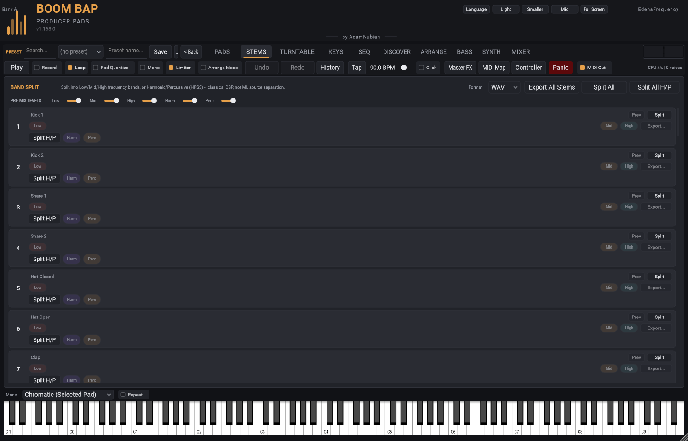
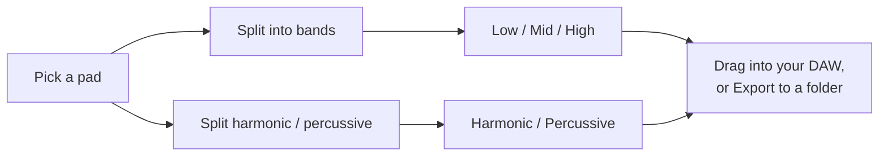

[&larr; Back to Usage overview](../../../USAGE.md) | [INSTALL](../../../INSTALL.md) | [LICENSE](../../../LICENSE.md) | [CHANGELOG](../../../CHANGELOG.md)

# STEMS tab

Splits a pad's sample into three frequency bands — **Low / Mid / High** —
using filters. This is **not** AI/ML source separation: it can't cleanly
pull an isolated vocal, drum, or bass part out of a full mix, since it only
splits by frequency, not by instrument. It's most useful for pulling apart
the tonal range of a single one-shot, not remixing a full song. For a
record's real **vocals, drums, bass and other**, use the deck's **Stems**
on the [TURNTABLE tab](../turntable/turntable-tab.md#stems).

The tab has three columns.

**Left -- the pads.** Every pad, with its number and sound. Click one to
work on it. Two small dots on the right show what it's been split into:
gold for the bands, purple for harmonic / percussive. A pad whose stems
are previewing has a teal number.

**Middle -- the pad you picked.** Its name, length, detected tempo and key,
and whether it's been split; an overview of its sound with **Play**
(the stems mixed together), the time and a position bar under it -- drag
or click the bar to jump; then a card per stem, in its own colour, with
its own waveform once it's been split:

- **Low** (below 250 Hz), **Mid** (250 Hz - 4 kHz), **High** (above 4 kHz)
  -- the band split.
- **Harmonic** (the sustained, tonal part) and **Percussive** (the hits and
  transients) -- the H/P split.
- Each card's round **icon** lights up once that stem exists. **Drag it**
  straight into your DAW, or **right-click** it for "Send to next empty
  pad". Stems you split earlier -- even in an earlier session --
  show up as soon as the pad has that sample again.
- **S** solos a stem (only the soloed ones play) and **M** mutes it, in
  the preview -- not in Export. They're for listening; they aren't saved.
- The slim **meter** beside each level shows that stem while it plays.
- **Waveform / Spectrum** (by STEMS) switches the overview and every stem
  between waveforms and spectrograms -- time left to right, low
  frequencies at the bottom, louder brighter. Handy for seeing what each
  split really kept.
- Each card's **level** (shown in dB; double-click for 0 dB) is the stem's level
  in the Preview mix and in Export. They're real, host-automatable
  parameters, shared by every pad (only one pad's stems are ever
  previewed or exported at a time).

**Right -- what to do.**

- **Split into bands** writes `..._Low`, `..._Mid` and `..._High` into a
  `Stems` folder next to the pad's sample file. **Split harmonic /
  percussive** writes `..._Harmonic` and `..._Percussive` there too -- a
  second, independent split; you can have both. It works best on
  material with real sustain (chords, vocal chops, pads); on pure drum
  breaks the two won't separate as cleanly.
- **Every pad: bands / H/P** run a split on every pad with a sample.
- Splits run in the background: the pad shows **SPLITTING...** (and
  "..." in the pad list) until it's done, and you can keep working --
  pick another pad, preview, export -- meanwhile. Several splits run one
  after another.
- **Format: WAV / AIFF** -- what Split and Export write from now on;
  anything already split stays as it was written.
- **Tick the stems** Export should write (all are ticked to start with).
- **Export this pad's stems...** copies the ticked ones to a folder you
  pick, with the levels baked in (a stem at 0 dB is copied untouched).
  **Export every pad's stems...** does it for every pad that has any, one
  subfolder per pad.

