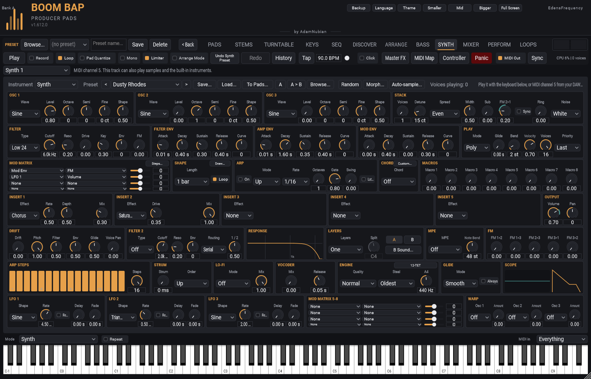
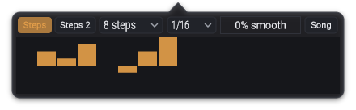

[&larr; Back to Usage overview](../../../USAGE.md) | [INSTALL](../../../INSTALL.md) | [LICENSE](../../../LICENSE.md) | [CHANGELOG](../../../CHANGELOG.md)

# SYNTH tab

A synthesiser, played like an instrument. The tab is an **instrument slot**:
the **Instrument** menu selects Synth, Samples, Electric Piano, Organ,
String Machine, FM Keys, Plucked Strings, Electric Bass, Upright Bass, Bell and
Mallet or [Granular](granular.md).

## Synth tracks (up to four)

The menu at the top of the tab picks which synth track you are editing:
**Synth 1** to **Synth 4**. Choose **Add a synth track** for another one
(up to four) and **Remove the last synth track** to take the last one away.
Each track has its own sound, presets and controls, and plays on its own
MIDI channel: Synth 1 on channel 5, Synth 2 on 6, Synth 3 on 7, Synth 4 on 8.
The keyboard below plays whichever track is showing. Synth 1 can also play
samples and the built-in instruments; tracks 2-4 are synths.

In the MIXER, each extra track has its own strip -- **SYNTH 2**, **SYNTH 3**
and **SYNTH 4**, after the Tape Loops strip, shown while the track is on --
with its own fader, pan, mute, solo, meter and channel strip (EQ, compressor,
input stage). Their reverb/delay sends and routing follow the SYNTH strip's.
Mixer snapshots don't store these three strips' faders yet.

In **KEYS**, the synth part's **Synth 1-4** menu (in the toolbar) picks which
track's notes you see and edit; each track's notes play its own sound, and
the keys you click audition that track. The SYNTH part's WAV export includes
every track's notes (tracks 2-4 go through the SYNTH strip's processing in
the export). Notes recorded or step-entered from a keyboard land on Synth 1. Undo and A/B for sounds work on Synth 1 only. A channel used by
the BASS lane's MIDI input is left to the bass.

## Sampled instruments

In **Instrument**, choose **Samples**, then **Load instrument...** to open a
supported `.sfz` or `.dspreset`. You can also drop either preset onto the tab.
Play with the keyboard below, MIDI channel 5, or notes in the SYNTH part.
The SYNTH mixer fader, pan, mute/solo, sends and channel strip apply; the part's
WAV export uses this sound too. Loading happens in the background. A failed
replacement keeps the previously loaded instrument and shows a diagnostic.

The project remembers the source choice and the absolute preset path. Keep the
preset and its sample files in place; they are not collected into the project.
A missing or unsupported reference on reload stays silent and reports an error.
Older projects select Synth. Choosing Synth while a file loads keeps that choice.

**Synth** returns to the synthesiser and its existing sound. Samples hides its
oscillator, arp/chord, effect, A/B and synth sound-export controls. Sample loading
and source changes are outside synth sound undo/A/B. Sample playback supports
notes, velocity, sustain, key zones, forward loops, round robin, random
choice, release samples (played when you let go of a key), velocity and key
tracking, and choke groups (a closed hi-hat cutting an open one). SFZ files
can use `#include` and `#define`, and `note_offset` / `octave_offset`.
SFZ static non-resonant two-pole low-pass filters and native stereo width are
supported; other filter/width modes, keyswitches, MPE, pitch bend/glide and
loop crossfades are not.

A preset's own knobs and screens, effects (reverb, delay), modulators, curves
and crossfades are left out: the samples still play, and the status under
the Instrument menu lists what was left out ("Played without: ..."). Anything
that would change which samples play is still reported as an error, so some
complex libraries will not load yet. No acoustic library is bundled; use samples you own or are
licensed to use.

Limits: preset text 1 MiB; 256 regions; 128 MiB decoded audio per bank; mono/stereo
8-192 kHz and up to 30 seconds per sample source. A replacement temporarily holds
both banks.

For a dedicated modelled voice, choose **Instrument > Electric Piano**.
Its [Tone, Decay and tremolo controls](electric-piano.md) are separate from
the Synth editor; selection/settings save with the project.

The selector also offers [Organ and String Machine](organ-and-strings.md),
with drawbar/rotary and envelope/ensemble controls respectively.

[FM Keys, Plucked Strings, Electric Bass and Bell and Mallet](fm-pluck-bass-mallet.md)
add four more built-in voices, each with three starting sounds and saved edits.
They share the SYNTH mixer and part-WAV export in plugin and Standalone.

## Playing it

- **The keyboard at the bottom** plays the synth while the SYNTH tab is
  open (its Mode switches to **Synth**, and back when you leave the tab).
  You can also pick **Synth** in that Mode menu on any tab.
- **MIDI channel 5** plays it from your DAW, a controller or a MIDI
  keyboard: notes, pitch bend, the mod wheel, the sustain pedal, aftertouch
  (pressure) and CC 74 (slide). Nothing else in the plugin listens to
  channel 5.
- **MPE controllers** (each note on its own channel, so every finger bends,
  presses and slides on its own): see **MPE** below.
- **Voices playing** (top) shows how many notes are sounding.

With local content installed, **Library...** offers [Room Upright](acoustic-piano-pilot.md)
and [Porch Bass](upright-bass.md). Porch Bass covers C1-A3 (MIDI 24-57).

### Your own instrument folders

Free instrument packs (DecentSampler `.dspreset` packs, SFZ libraries) can be
browsed from **Library...** too. Choose **Add a folder of instruments...** and
pick the folder you unpacked them into; if a usual folder already exists
(such as Documents/Decent Samples), it is offered as **Add ...** in the same
menu. Each added folder then shows its packs as sub-menus (the first folder
level below the one you added) with their presets inside; pick one to load
it into the Samples slot. Up to 500 presets and five folder levels per added
folder are listed; hidden folders are skipped. **Remove a folder** takes one
off the list (nothing is deleted). The folder list is kept for every project.

**Find free instruments online...** opens Decent Samples or Pianobook in your
browser; download a pack there, unpack it into one of your folders, and it
shows up the next time you open **Library...**. Packs that rely on unsupported
features still report why they did not load.

## Presets

Pick one from the **Preset** menu, or step through with **<** and **>**.
The menu is in folders by type, then character: **Bass** (Sub & 808,
Synth Bass, Reese & Wobble, Acid, Plucked), **Keys** (Electric Piano,
Lo-Fi Keys, Synth Keys, Organ, Clav), **Bells & Mallets**, **Pads** (Warm,
Dark, Airy, Evolving, Vinyl & Lo-Fi), **Strings**, **Brass & Winds**,
**Leads**, **Plucks & Stabs**, **Vocal & Choir**, **Arps & Sequences**,
**FX & Textures** and **World** (sitar-, koto- and steel-drum-like) -- with **Init** at the top and your own presets under
**My Presets**. **<** and **>** step through every sound in the menu's
order, on into the next folder when one ends.

**Browse...** opens the sound browser: a **folder tree** on the left (All
sounds, then Built-in, My Presets and Kits, each folder with how many
sounds are in it), the list on the right, and search, categories, tags
and favourites -- see [the toolbar](../toolbar/toolbar-and-presets.md).
Click a folder to see everything in it (that clears the search). Typing
in the search box looks in every folder. **A** / **B**
compares two versions of the sound: switch to B, change it, and flip back
to A to hear the difference; **A > B** copies the side you're on to the
other. Turning knobs, loading a preset or a wavetable are all **Undo**
steps.

**Save...** keeps your sound as a preset file (in Documents / Boom Bap
Producer Pads / Synth Presets). It asks where: **My Presets** itself, a
folder you already have, one of the type folders (Bass > Sub & 808...),
or **New folder...** (type `Leads/Mine` for a folder inside a folder);
**Choose a place...** saves anywhere. It asks before replacing a preset
of the same name. Folders you make in Explorer show up too; **Load...** opens one from anywhere. You can also drop a `.bbsynth`
file on the tab. Your project saves the synth's whole sound either way.

Double-click any knob to put it back to where Init has it.

## To Pads: resample the sound

**To Pads...** (beside Load...) plays the sound you've made into empty
pads, so you can chop it, sequence it on SEQ, put it through the pad
effects or export it in a kit like any sample:

| Choose | What you get |
|---|---|
| **One note** | One pad: the note held 1.5 seconds, with its release. |
| **Three velocities, as a velocity group** | Three pads, soft, medium and hard, joined as a velocity group: hit the first pad softly and it plays the soft take, harder and it plays the harder ones (see [Layers](../pads/pad-grid-and-browser.md)). |
| **One per octave, over four octaves** | Four pads, an octave apart, from an octave below the note to two above -- set up as **key zones**: select the first pad and play the keyboard, and every note plays the nearest take (see [Key zones](../pads/pad-grid-and-browser.md)). |
| **A chord stab of the key** | One pad: a chord of your key -- pick its degree (I to vii) and a triad or a seventh -- played on this sound with its release, named after the chord. |

- The note is your project's key (the KEYS / BASS **Key**), around middle
  C -- or C if no key is set. The BASS tab's **Edit sound...** has the
  same button, two octaves lower.
- The pads used are the first empty ones side by side in this bank. If
  there aren't enough, it says so: clear some or pick a bigger Grid Size.
- The sounds are saved as WAV files in **Music > Boom Bap Captures >
  Resampled**, by date, so your project keeps them. **Undo** takes the
  pads back.
- It's the sound itself: the synth's own effects are in it; its mixer
  strip (volume, pan, bus) isn't.

## The sections

- **OSC 1, OSC 2, OSC 3**: each has a **Wave** (Sine, Triangle, Saw, Pulse,
  Noise, Wavetable), a **Level** (0 = off), **Octave**, **Semi** and
  **Fine** (cents). **Shape** is the pulse width for Pulse and the position
  in the table for Wavetable.
- **Wavetables**: with Wave set to Wavetable, the built-in table sweeps
  sine to triangle to saw to square as you turn Shape. Click **Table...** >
  **Load a sound or a wavetable...** (or drop an audio file on the
  oscillator) to make one from any sound: its first few seconds are cut
  into single cycles, and Shape moves through them. Try a vocal, a drum
  loop or a chord -- each gives its own colour. Wavetable files from other
  synths load as they are (their own frame size, up to 256 frames).
- **Draw a wavetable**: **Table...** > **Draw a wavetable...** opens an
  editor with two waves, **A** and **B**. **Draw** one with the mouse, or
  switch to **Harmonics** and build it from 32 bars (bar 1 is the note,
  bar 2 an octave up, and so on); **Sine**, **Saw** and **Square** give a
  starting point. **Frames** sets how many steps the table takes from A to
  B -- Shape sweeps through them. **Apply** saves it in Documents/Boom Bap
  Producer Pads/Wavetables and plays it on that oscillator.
- **STACK**: **Voices** stacks up to 16 copies of each oscillator,
  **Detune** spreads their pitch (cents) and **Width** spreads them across
  left and right -- for thick leads and wide pads. **Sub** adds a sine an
  octave under OSC 1. **FM 2>1** lets OSC 2 bend OSC 1's wave for bells and
  metallic tones. **Sync** makes OSC 2 start its wave again every time OSC
  1 does -- tune OSC 2 up and sweep it for the classic tearing sync lead.
  **Ring** multiplies OSC 1 by OSC 2: metallic, bell-like tones (turn the
  two oscillators' own levels down to hear only the ring). **Spread**
  places the stacked voices: **Even**, or **Supersaw** -- close round the
  note and wide at the edges, the classic big saw (try 7 voices, Detune
  about 30). **Noise** colours the Noise wave: **White** (bright hiss),
  **Pink** (fuller, like rain) or **Brown** (a deep rumble).
- **FILTER**: **Type**, **Cutoff**, **Reso**, **Drive** (grit before the
  filter), **Key** (higher notes open the filter more), **Env** (how far
  the filter envelope moves the cutoff, up or down) and **FM** (OSC 1
  sweeps the cutoff at audio rate -- growls, buzz, metallic edges; put a
  sine on OSC 1 with its level at 0 and play a saw on OSC 2). The types:

  | Type | What it does |
  |---|---|
  | **Low 12, Low 24** | Low-pass, gentle or steep. |
  | **High 12, High 24** | High-pass. |
  | **Band, Notch** | Keeps or cuts a band around the cutoff. |
  | **Ladder 24** | A steep low-pass with a round, driven sound; its resonance thins the bass a little, the classic way. |
  | **Diode 18** | A gentler, squelchier low-pass that clips one way sooner -- the acid-line sound. |
  | **Comb +** | Rings at the pitch the **Cutoff** sets (and its harmonics); **Reso** makes it ring longer. Metallic, plucked, flanged. |
  | **Comb -** | The same, ringing between those harmonics -- hollow, an octave down. |
  | **Vowel** | Three formants that say A, E, I, O, U as **Cutoff** moves left to right; **Reso** sharpens them. Put the filter envelope or an LFO on it and the synth talks. |
- **FILTER ENV, AMP ENV, MOD ENV**: attack, decay, sustain, release. The
  amp envelope shapes the volume, the filter envelope the cutoff, and the
  mod envelope whatever the mod matrix sends it to. Each has a **Curve**:
  right of centre a punchy attack and a snappy fall, left of centre a slow
  swell and long tails; centre is a straight attack, as before.
- **LFO 1, LFO 2, LFO 3** (the bottom row): a **Shape** (sine, triangle,
  saw, square, random) at a **Rate**; **Restart** starts it from the top on
  every note. **Delay** keeps it still for that long after each note and
  **Fade** brings it in gradually -- LFO 1 to Pitch with a Delay of 0.5 s
  is vibrato that arrives on a held note, like a singer's.
- **MOD MATRIX**: four rows of *source*, *where it goes* and *how much*
  (drag left for the other way); **MOD MATRIX 5-8** (bottom row) has four
  more. Sources: the LFOs, the mod, amp and filter envelopes, velocity,
  the mod wheel, the bend wheel, a random value per note, the key,
  **Pressure** (aftertouch) and **Slide** (CC 74) -- per note with MPE --
  and the eight macros. Destinations: pitch, each oscillator's level and
  shape, cutoff, filter 2's cutoff, resonance, drive, FM, filter FM,
  detune, sub, ring, each LFO's rate, volume, pan. Example: LFO 1 to Pitch
  at a small amount is vibrato; Mod Env to Pitch with a short decay is an
  808's punch.
- **Drag to modulate**: drag the title of **LFO 1-3**, **MOD ENV**, **AMP
  ENV** or **FILTER ENV**, or a macro's name, onto a knob (cutoff, an
  oscillator's level or shape, drive, detune, an LFO's rate...). It fills
  the next empty matrix row at a small amount; a ring round the knob shows
  how far it moves (teal up, red down). Change the amount in the matrix.
- **WARP** (bottom row): each oscillator's wavetable read a different way
  -- **Bend** leans the wave, **Sync** runs through it several times a
  cycle (a sync sound from any table), **Mirror** plays it forward then
  back, **Squeeze** is a pulse width for any wave, **Quantize** steps it
  (lo-fi). **Amount** at 0 is off. Wavetable oscillators only.
- **MACROS**: eight knobs that do nothing on their own -- choose **Macro
  1-8** as a source in the matrix, send it to several places (cutoff up,
  drive up, detune up), and one knob turns a sound from soft to wild.
  Saved with the sound.
- **Steps...** (on the MOD MATRIX title): two step sources you draw,
  **Steps** and **Steps 2** -- 16 bars, how many steps go round, each
  step's length (1/32 to a bar, at the song's tempo) and **Smooth**, the
  same editor as a pad's Matrix. They start with every note; turn on
  **Song** and they follow the song's beats instead. Pick **Steps** or
  **Steps 2** as a source: Volume for a gate, Cutoff for a rhythmic
  filter, Pitch for an arpeggio-like line on one held note.

  

- **SHAPE**: a movement you draw (**Draw...**), its **Length** (1/16 to 4
  bars) and **Loop**. It starts with every note. Pick **Shape** as a
  source in the MOD MATRIX to send it anywhere -- a stepped pitch line,
  a rhythmic filter, an envelope with as many stages as you like.
- **PLAY**: **Mode** Poly (chords), Mono (one note, restarts the
  envelopes) or Legato (one note, glides without restarting); **Glide**
  time; **Bend** range in semitones; **Velocity** (how much playing harder
  makes it louder); **Voices** (the most notes at once); **Priority** --
  in Mono and Legato, which held key sounds: the **last** pressed, the
  **lowest** (a bass that stays down) or the **highest** (a lead on top).
- **ARP** (the arpeggiator): switch it **On** and held notes play one at a
  time, in time with the song -- **Mode** Up, Down, Up-Down, Random or As
  played; **Rate** 1/4 to 1/32 or triplets; **Octaves** 1-4 (the pattern
  climbs through them); **Gate** (short and plucky to smooth). When the
  song is stopped it keeps time at the tempo.
- **CHORD**: every note you play becomes a chord -- Major, Minor, 7th,
  Minor 7th, Major 7th, Sus2, Sus4, Power, Octave. With the ARP on too,
  the chord's notes are what it arpeggiates.
- **INSERT 1-5**: effects in order, the same ones the pads have (chorus,
  flanger, phaser, reverb, delay, saturation and more) with their own knobs
  and a **Mix**.
- **OUTPUT**: **Volume** and **Pan** (the same as the synth's mixer strip).

## The bottom row: character

- **DRIFT**: an old analogue polysynth never plays two notes quite alike --
  each voice is a little off in pitch, filter and envelope, and wanders.
  **Drift** is how much (0 is steady, as before); **Pitch**, **Filter**,
  **Env** and **Glide** share it out (Pitch moves up to 20 cents, Filter up
  to about half an octave). Each voice keeps its own character, so a chord
  sounds wider and alive rather than random. **Voice Pan** spreads the
  voices across left and right, each voice in its own place.
- **FILTER 2**: a second filter, any of the types above (**Off** is one
  filter, as before), with its own **Cutoff**, **Reso** and **Env**. Key and
  Drive are the first filter's. **Routing**: **Serial** runs filter 2 after
  filter 1 (a low-pass and a high-pass in series make a band); **Parallel**
  runs them side by side, and **1 / 2** mixes them (left: filter 1 only,
  right: filter 2 only, the middle both). Cutoff in the mod matrix moves both.
- **RESPONSE**: what the filters do to the sound, drawn from 20 Hz to
  20 kHz (the lines are 100 Hz, 1 kHz and 10 kHz; the flat line is 0 dB). It
  follows the knobs: the envelopes and the mod matrix move it further as
  you play.
- **LAYERS**: two sounds in one synth. **One** is a single sound.
  **Split** plays layer **B** below the **Split** key and layer A from it
  up -- a bass under your left hand, keys under the right. **Stack** plays
  both on every note -- a pad under a pluck. **A** and **B** choose which
  layer the knobs edit (the section titles say **- B** while you edit B);
  each layer has its own oscillators, filters, envelopes, LFOs, mod matrix,
  play mode, inserts and output. **B Sound...** gives layer B a built-in
  sound or a copy of layer A. The ARP and CHORD play both layers.
  Presets: a built-in preset is one sound and goes to layer A, leaving B
  and the layer settings as they are; a saved preset (**Save...**) and your
  project keep both layers.
- **MPE**: for controllers that put each note on its own channel (an MPE
  keyboard or pad surface, or a DAW's MPE clip). **Off**: the synth plays
  channel 5 only, as always. **Ch 5-16**: it takes channels 5 to 16 (set
  your controller to an MPE *upper zone*, channel 16 the master) and
  channels 1-4 still play the pads and bass. **All ch**: it takes every
  channel (a *lower zone*, channel 1 the master) and nothing else in the
  plugin hears MIDI. Each note's own bend moves it by **Note Bend**
  semitones (48 is the MPE standard); the master channel's bend moves all
  notes by the PLAY **Bend** range. Pressure and slide come into the mod
  matrix as **Pressure** and **Slide** -- for example Pressure to Volume or
  Cutoff, Slide to Cutoff.

- **FM**: any oscillator bending another's wave -- **FM 1>2**, **1>3**,
  **2>3**, **3>1** and **3>2** (STACK has **FM 2>1**). The first named is
  the source: turn its level down to hear only what it does to the other.
  A sine into a sine gives bells and electric pianos; more amount, more
  bite.

The BASS tab's **Edit sound...** has DRIFT, FILTER 2 and RESPONSE too, but
no layers or MPE: the bass is one sound, played as a line.

## The sixth row, and the header's tools

- **ARP STEPS**: the arp's 16 steps. Click a step to make it a rest (it
  plays nothing), click again to bring it back; right-click for an accent
  (louder). **Steps** sets how many it uses before going round. The step
  playing is outlined. In the ARP section, **Swing** makes every second
  step late, and **Latch** keeps the arp playing after you let go (the
  next chord replaces it). **Mode** adds **Chord** (all the notes at once)
  and **Converge** (outside notes first).
- **CHORD** has more types (9ths, 11th, 13th, 6/9, diminished, augmented)
  and **Custom...**: tick the notes above the one you play. **STRUM**
  plays them one after another, up, down or alternating.
- **LO-FI**: an old sampler's converter over the whole synth, the same
  modes as the pads' crush; **Mix** blends it.
- **VOCODER**: the synth shaped by the plugin's sidechain input. Route a
  vocal or a beat to the plugin's sidechain in your DAW (in FL Studio,
  from the mixer), hold a chord, turn up **Mix**. Live only -- exports
  have no input to shape it with.
- **ENGINE**: **Quality** -- Eco is lighter on the CPU (two unison voices,
  eight notes), High and Ultra run the voices at 2x and 4x for less
  harshness on bright, driven sounds. **Steal** picks which note gives
  way when every voice is busy: the oldest, the quietest, or one that
  isn't the lowest or highest. **A4** tunes the whole sound: 440 Hz is
  standard; 432 Hz, or 415 Hz for baroque pitch. The button on the ENGINE
  title (**12-TET**) picks the tuning: **Load a Scala scale (.scl)...**
  plays the synth in any of thousands of tunings -- just intonation, maqam,
  gamelan, historical temperaments (free .scl files are easy to find
  online). Middle C stays put; the other keys follow the scale. It's saved
  with the sound, and KEYS clips play in it too.
- **GLIDE**: how **Glide** (PLAY) moves between notes. **Mode**: Smooth
  (eases in, as before), **Time** (a straight slide that arrives in
  exactly the Glide time, however far) or **Rate** (an octave per Glide
  time, so bigger jumps take longer). **Always**: in Mono and Legato,
  every note glides from the last one, not only when a key is still held.
- **SCOPE**: the sound as a wave, and the amp envelope with a dot where
  the newest note is.
- **Random** (header): a new sound, or just its oscillators, filter,
  envelopes, modulation or effects, kept to useful ranges. Undo goes back.
- **Morph...**: pick a built-in sound and slide from yours toward it.
- **Auto-sample...**: play this sound across the keys into a folder -- an
  SFZ and a DecentSampler instrument with the WAVs -- for any sampler.
- There are now 553 built-in sounds, named by family ("Pad - Warm Saw",
  "Bass - Punchy Square"), so the sound browser files them by category.

## In the mixer

The MIXER tab has a **Synth** strip after the Bass: volume, pan, **Duck**
(dips it when a duck-source pad plays), mute, solo and its meter.
**Routing...** there can send it to Bus A or Bus B. See the
[MIXER tab](../mixer/mixer-tab.md).
