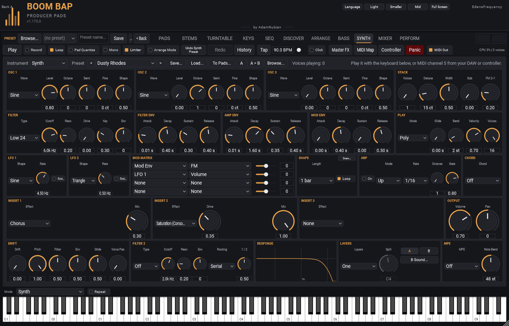

[&larr; Back to Usage overview](../../../USAGE.md) | [INSTALL](../../../INSTALL.md) | [LICENSE](../../../LICENSE.md) | [CHANGELOG](../../../CHANGELOG.md)

# SYNTH tab

A synthesiser, played like an instrument. The tab is an **instrument slot**:
the **Instrument** menu at the top holds the Synth now, and more instruments
will join it there.

## Playing it

- **The keyboard at the bottom** plays the synth while the SYNTH tab is
  open (its Mode switches to **Synth**, and back when you leave the tab).
  You can also pick **Synth** in that Mode menu on any tab.
- **MIDI channel 5** plays it from your DAW, a controller or a MIDI
  keyboard: notes, pitch bend, the mod wheel, the sustain pedal, aftertouch
  (pressure) and CC 74 (slide). Nothing else in the plugin listens to
  channel 5.
- **MPE controllers** (each note on its own channel, so every finger bends,
  presses and slides on its own): see **MPE** below.
- **Voices playing** (top) shows how many notes are sounding.

## Presets

Pick one from the **Preset** menu, or step through with **<** and **>**:
Init, then A to Z: 808, Acid, Arp Bells, Bell, Brass, Choir Pad, Chord Stab, Distorted 808, Dusty Rhodes, Fat Bass, G-Funk Whine, Lo-Fi Keys, Music Box, Organ, Pluck, Pluck Bass, Reese, Saw Lead, Soft Pad, Soul Stab, Square Lead, String Machine, Strings, Sub Bass, Sweep Pad, Warm Keys, Wavetable Sweep, Whistle Lead, Wobble Bass.
**Browse...** opens the sound browser (search, categories, tags,
favourites -- see [the toolbar](../toolbar/toolbar-and-presets.md)). **A** / **B**
compares two versions of the sound: switch to B, change it, and flip back
to A to hear the difference; **A > B** copies the side you're on to the
other. Turning knobs, loading a preset or a wavetable are all **Undo**
steps.

**Save...** keeps your sound as a preset file (in Documents / Boom Bap
Producer Pads / Synth Presets) and it joins the menu under the built-in
ones; **Load...** opens one from anywhere. You can also drop a `.bbsynth`
file on the tab. Your project saves the synth's whole sound either way.

Double-click any knob to put it back to where Init has it.

## To Pads: resample the sound

**To Pads...** (beside Load...) plays the sound you've made into empty
pads, so you can chop it, sequence it on SEQ, put it through the pad
effects or export it in a kit like any sample:

| Choose | What you get |
|---|---|
| **One note** | One pad: the note held 1.5 seconds, with its release. |
| **Three velocities, as a velocity group** | Three pads, soft, medium and hard, joined as a velocity group: hit the first pad softly and it plays the soft take, harder and it plays the harder ones (see [Layers](../pads/pad-grid-and-browser.md)). |
| **One per octave, over four octaves** | Four pads, an octave apart, from an octave below the note to two above -- set up as **key zones**: select the first pad and play the keyboard, and every note plays the nearest take (see [Key zones](../pads/pad-grid-and-browser.md)). |

- The note is your project's key (the KEYS / BASS **Key**), around middle
  C -- or C if no key is set. The BASS tab's **Edit sound...** has the
  same button, two octaves lower.
- The pads used are the first empty ones side by side in this bank. If
  there aren't enough, it says so: clear some or pick a bigger Grid Size.
- The sounds are saved as WAV files in **Music > Boom Bap Captures >
  Resampled**, by date, so your project keeps them. **Undo** takes the
  pads back.
- It's the sound itself: the synth's own effects are in it; its mixer
  strip (volume, pan, bus) isn't.

## The sections

- **OSC 1, OSC 2, OSC 3**: each has a **Wave** (Sine, Triangle, Saw, Pulse,
  Noise, Wavetable), a **Level** (0 = off), **Octave**, **Semi** and
  **Fine** (cents). **Shape** is the pulse width for Pulse and the position
  in the table for Wavetable.
- **Wavetables**: with Wave set to Wavetable, the built-in table sweeps
  sine to triangle to saw to square as you turn Shape. Click **Table...**
  (or drop an audio file on the oscillator) to make one from any sound: its
  first few seconds are cut into single cycles, and Shape moves through
  them. Try a vocal, a drum loop or a chord -- each gives its own colour.
- **STACK**: **Voices** stacks up to 7 copies of each oscillator,
  **Detune** spreads their pitch (cents) and **Width** spreads them across
  left and right -- for thick leads and wide pads. **Sub** adds a sine an
  octave under OSC 1. **FM 2>1** lets OSC 2 bend OSC 1's wave for bells and
  metallic tones.
- **FILTER**: **Type**, **Cutoff**, **Reso**, **Drive** (grit before the
  filter), **Key** (higher notes open the filter more) and **Env** (how far
  the filter envelope moves the cutoff, up or down). The types:

  | Type | What it does |
  |---|---|
  | **Low 12, Low 24** | Low-pass, gentle or steep. |
  | **High 12, High 24** | High-pass. |
  | **Band, Notch** | Keeps or cuts a band around the cutoff. |
  | **Ladder 24** | A steep low-pass with a round, driven sound; its resonance thins the bass a little, the classic way. |
  | **Diode 18** | A gentler, squelchier low-pass that clips one way sooner -- the acid-line sound. |
  | **Comb +** | Rings at the pitch the **Cutoff** sets (and its harmonics); **Reso** makes it ring longer. Metallic, plucked, flanged. |
  | **Comb -** | The same, ringing between those harmonics -- hollow, an octave down. |
  | **Vowel** | Three formants that say A, E, I, O, U as **Cutoff** moves left to right; **Reso** sharpens them. Put the filter envelope or an LFO on it and the synth talks. |
- **FILTER ENV, AMP ENV, MOD ENV**: attack, decay, sustain, release. The
  amp envelope shapes the volume, the filter envelope the cutoff, and the
  mod envelope whatever the mod matrix sends it to.
- **LFO 1, LFO 2**: a **Shape** (sine, triangle, saw, square, random) at a
  **Rate**; **Restart** starts it from the top on every note.
- **MOD MATRIX**: four rows of *source*, *where it goes* and *how much*
  (drag left for the other way). Sources: the LFOs, the mod envelope,
  velocity, the mod wheel, a random value per note, the key, **Pressure**
  (aftertouch) and **Slide** (CC 74) -- per note with MPE. Destinations:
  pitch, each oscillator's level and shape, cutoff, resonance, FM, volume,
  pan. Example: LFO 1 to Pitch at a small amount is vibrato; Mod Env to
  Pitch with a short decay is an 808's punch.
- **SHAPE**: a movement you draw (**Draw...**), its **Length** (1/16 to 4
  bars) and **Loop**. It starts with every note. Pick **Shape** as a
  source in the MOD MATRIX to send it anywhere -- a stepped pitch line,
  a rhythmic filter, an envelope with as many stages as you like.
- **PLAY**: **Mode** Poly (chords), Mono (one note, restarts the
  envelopes) or Legato (one note, glides without restarting); **Glide**
  time; **Bend** range in semitones; **Velocity** (how much playing harder
  makes it louder); **Voices** (the most notes at once).
- **ARP** (the arpeggiator): switch it **On** and held notes play one at a
  time, in time with the song -- **Mode** Up, Down, Up-Down, Random or As
  played; **Rate** 1/4 to 1/32 or triplets; **Octaves** 1-4 (the pattern
  climbs through them); **Gate** (short and plucky to smooth). When the
  song is stopped it keeps time at the tempo.
- **CHORD**: every note you play becomes a chord -- Major, Minor, 7th,
  Minor 7th, Major 7th, Sus2, Sus4, Power, Octave. With the ARP on too,
  the chord's notes are what it arpeggiates.
- **INSERT 1-3**: effects in order, the same ones the pads have (chorus,
  flanger, phaser, reverb, delay, saturation and more) with their own knobs
  and a **Mix**.
- **OUTPUT**: **Volume** and **Pan** (the same as the synth's mixer strip).

## The bottom row: character

- **DRIFT**: an old analogue polysynth never plays two notes quite alike --
  each voice is a little off in pitch, filter and envelope, and wanders.
  **Drift** is how much (0 is steady, as before); **Pitch**, **Filter**,
  **Env** and **Glide** share it out (Pitch moves up to 20 cents, Filter up
  to about half an octave). Each voice keeps its own character, so a chord
  sounds wider and alive rather than random. **Voice Pan** spreads the
  voices across left and right, each voice in its own place.
- **FILTER 2**: a second filter, any of the types above (**Off** is one
  filter, as before), with its own **Cutoff**, **Reso** and **Env**. Key and
  Drive are the first filter's. **Routing**: **Serial** runs filter 2 after
  filter 1 (a low-pass and a high-pass in series make a band); **Parallel**
  runs them side by side, and **1 / 2** mixes them (left: filter 1 only,
  right: filter 2 only, the middle both). Cutoff in the mod matrix moves both.
- **RESPONSE**: what the filters do to the sound, drawn from 20 Hz to
  20 kHz (the lines are 100 Hz, 1 kHz and 10 kHz; the flat line is 0 dB). It
  follows the knobs: the envelopes and the mod matrix move it further as
  you play.
- **LAYERS**: two sounds in one synth. **One** is a single sound.
  **Split** plays layer **B** below the **Split** key and layer A from it
  up -- a bass under your left hand, keys under the right. **Stack** plays
  both on every note -- a pad under a pluck. **A** and **B** choose which
  layer the knobs edit (the section titles say **- B** while you edit B);
  each layer has its own oscillators, filters, envelopes, LFOs, mod matrix,
  play mode, inserts and output. **B Sound...** gives layer B a built-in
  sound or a copy of layer A. The ARP and CHORD play both layers.
  Presets: a built-in preset is one sound and goes to layer A, leaving B
  and the layer settings as they are; a saved preset (**Save...**) and your
  project keep both layers.
- **MPE**: for controllers that put each note on its own channel (an MPE
  keyboard or pad surface, or a DAW's MPE clip). **Off**: the synth plays
  channel 5 only, as always. **Ch 5-16**: it takes channels 5 to 16 (set
  your controller to an MPE *upper zone*, channel 16 the master) and
  channels 1-4 still play the pads and bass. **All ch**: it takes every
  channel (a *lower zone*, channel 1 the master) and nothing else in the
  plugin hears MIDI. Each note's own bend moves it by **Note Bend**
  semitones (48 is the MPE standard); the master channel's bend moves all
  notes by the PLAY **Bend** range. Pressure and slide come into the mod
  matrix as **Pressure** and **Slide** -- for example Pressure to Volume or
  Cutoff, Slide to Cutoff.

The BASS tab's **Edit sound...** has DRIFT, FILTER 2 and RESPONSE too, but
no layers or MPE: the bass is one sound, played as a line.

## In the mixer

The MIXER tab has a **Synth** strip after the Bass: volume, pan, **Duck**
(dips it when a duck-source pad plays), mute, solo and its meter.
**Routing...** there can send it to Bus A or Bus B. See the
[MIXER tab](../mixer/mixer-tab.md).
